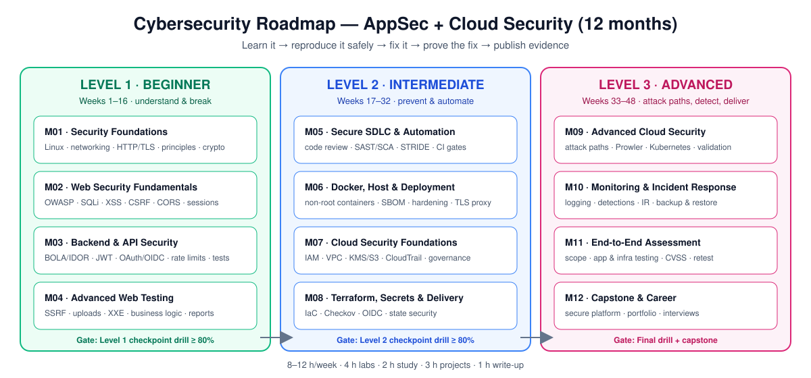
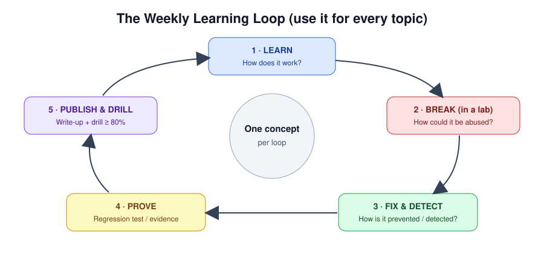

# Cybersecurity Roadmap — Beginner to Advanced (AppSec + Cloud Security)

A hands-on, 12-month, project-led course for **software developers who are new to security**.
Every topic is broken into weekly lessons with plain-language explanations, real-world scenarios,
step-by-step labs, diagrams, a follow-through project and drills that check you actually understand it.



> **Who it's for:** you can already build backends, APIs, use databases, Docker and deploy things.
> **Time:** 8–12 hours/week. **Budget:** mostly free. **Goal:** identify, test, fix and prevent
> application and cloud security weaknesses — and prove it with a portfolio.

---

## How this course works



Every week follows the same loop. For every concept you must be able to answer **the four questions**:

1. **How does it work?**
2. **How could it be abused** (in an authorized lab)?
3. **How can it be detected or prevented?**
4. **How can the fix be demonstrated** in code or infrastructure?

You advance when you can **demonstrate** the skill — not when the calendar says so.

| Start here | Why |
|---|---|
| 1. [How to study](docs/how-to-study.md) | Weekly routine, lesson anatomy, how to take notes |
| 2. [Safety & ethics](docs/safety-and-ethics.md) | **Read before any lab.** What you may and may not test |
| 3. [Lab setup](docs/lab-setup.md) | Step-by-step: Ubuntu VM, Docker, Node.js, security tools |
| 4. [First seven days](docs/first-seven-days.md) | A guided first week |
| 5. [Drills](docs/drills.md) | Take the diagnostic drill; learn how to get drilled |

---

## Course map

### 🟢 Level 1 — Beginner: understand & break (Weeks 1–16) · tracking: [#2](https://github.com/mascot200/cybersecurity-roadmap/issues/2)

| Month | Topic | Weeks | Project | Issue |
|---|---|---|---|---|
| 01 | [Security Foundations](curriculum/01-beginner/month-01-security-foundations/README.md) | Linux · Networking · Principles · Crypto | Linux hardening + login API threat model | [#5](https://github.com/mascot200/cybersecurity-roadmap/issues/5) |
| 02 | [Web Security Fundamentals](curriculum/01-beginner/month-02-web-security-fundamentals/README.md) | OWASP · SQLi · XSS/CSRF/CORS · Sessions | `web-security-labs` repo | [#6](https://github.com/mascot200/cybersecurity-roadmap/issues/6) |
| 03 | [Backend & API Security](curriculum/01-beginner/month-03-api-security/README.md) | BOLA · JWT/OAuth · API abuse · Test suite | **P1:** multi-tenant API security lab | [#7](https://github.com/mascot200/cybersecurity-roadmap/issues/7) |
| 04 | [Advanced Web Testing](curriculum/01-beginner/month-04-advanced-web-testing/README.md) | SSRF · Files/parsers · Business logic · Assessments | 5-finding assessment report | [#8](https://github.com/mascot200/cybersecurity-roadmap/issues/8) |

### 🔵 Level 2 — Intermediate: prevent & automate (Weeks 17–32) · tracking: [#3](https://github.com/mascot200/cybersecurity-roadmap/issues/3)

| Month | Topic | Weeks | Project | Issue |
|---|---|---|---|---|
| 05 | [Secure SDLC & AppSec Automation](curriculum/02-intermediate/month-05-secure-sdlc-appsec-automation/README.md) | Code review · SAST/SCA · Threat modeling · Secure CI | **P2:** secure Node.js API template | [#9](https://github.com/mascot200/cybersecurity-roadmap/issues/9) |
| 06 | [Docker, Host & Deployment Security](curriculum/02-intermediate/month-06-docker-host-deployment-security/README.md) | Docker · Supply chain · Host hardening · Reverse proxy | **P3:** hardened Compose deployment | [#10](https://github.com/mascot200/cybersecurity-roadmap/issues/10) |
| 07 | [Cloud Security Foundations](curriculum/02-intermediate/month-07-cloud-security-foundations/README.md) | IAM · VPC · Data protection · Logging | Cloud architecture + checklist | [#11](https://github.com/mascot200/cybersecurity-roadmap/issues/11) |
| 08 | [Terraform, Secrets & Secure Delivery](curriculum/02-intermediate/month-08-terraform-secrets-secure-delivery/README.md) | Terraform · IaC scanning · OIDC/secrets · State | **P4:** Terraform deployment with least-privilege CI | [#12](https://github.com/mascot200/cybersecurity-roadmap/issues/12) |

### 🔴 Level 3 — Advanced: attack paths, detection & delivery (Weeks 33–48) · tracking: [#4](https://github.com/mascot200/cybersecurity-roadmap/issues/4)

| Month | Topic | Weeks | Project | Issue |
|---|---|---|---|---|
| 09 | [Advanced Cloud Security](curriculum/03-advanced/month-09-advanced-cloud-security/README.md) | Attack paths · Misconfig audits · Kubernetes · Validation | Cloud threat model (10+ threats) | [#13](https://github.com/mascot200/cybersecurity-roadmap/issues/13) |
| 10 | [Monitoring & Incident Response](curriculum/03-advanced/month-10-monitoring-incident-response/README.md) | Logging · Detection · IR · Recovery | **P5:** monitoring lab + IR report | [#14](https://github.com/mascot200/cybersecurity-roadmap/issues/14) |
| 11 | [End-to-End Assessment](curriculum/03-advanced/month-11-end-to-end-assessment/README.md) | Scope · App testing · Infra testing · Reporting | Full assessment report | [#15](https://github.com/mascot200/cybersecurity-roadmap/issues/15) |
| 12 | [Capstone & Career](curriculum/03-advanced/month-12-capstone-career/README.md) | Architecture · Pipeline · Operations · Publication | **Capstone** secure cloud-native platform | [#16](https://github.com/mascot200/cybersecurity-roadmap/issues/16) |

---

## Tracking your progress

Progress is tracked with **GitHub Issues** — one per month, grouped under one epic per level:

```
#1  Setup & first seven days
#2  Level 1 · Beginner      ── #5 M01 · #6 M02 · #7 M03 · #8 M04
#3  Level 2 · Intermediate  ── #9 M05 · #10 M06 · #11 M07 · #12 M08
#4  Level 3 · Advanced      ── #13 M09 · #14 M10 · #15 M11 · #16 M12
```

1. Open the issue for your current month and **tick the weekly checkboxes** as you go.
2. At the end of each week, **comment a weekly log** on the issue (template: *Weekly log* in *New issue*).
3. Take the week's drill. Record the score in your log. Under 80%? Re-study the flagged sections and retake.
4. Close the month issue when the milestone and monthly drill are done. Close the level epic when the level gate passes.

## Every lesson has the same anatomy

| Section | What you get |
|---|---|
| 🎯 Objectives | What you'll be able to *do* by the end |
| 🌍 Why it matters | A real incident or job scenario |
| 📖 Concepts | Plain-language explanations, diagrams, vulnerable vs. secure code |
| 🧪 Lab | Numbered steps with exact commands and expected output |
| 📝 Assignment | The roadmap assignment, broken into steps with acceptance criteria |
| 💼 On the job | How this shows up in real AppSec/Cloud roles |
| ⚠️ Common mistakes | What learners and real teams get wrong |
| 🥊 Drill | Questions + scenarios with hidden answers |
| ✅ Checklist | Tick before moving on |

## Portfolio, certifications and resources

- [Portfolio requirements](docs/portfolio.md) — the 8 projects and what evidence to publish
- [Certifications](docs/certifications.md) — when (and whether) to pursue them
- [Resource directory](docs/resources.md) — every free resource used in the course
- [Glossary](docs/glossary.md) — security terms in plain English

> **Final principle:** learn a security concept, reproduce it safely, fix it in code or infrastructure,
> and publish evidence of the result. Consistent hands-on practice beats collecting tools or watching courses.
