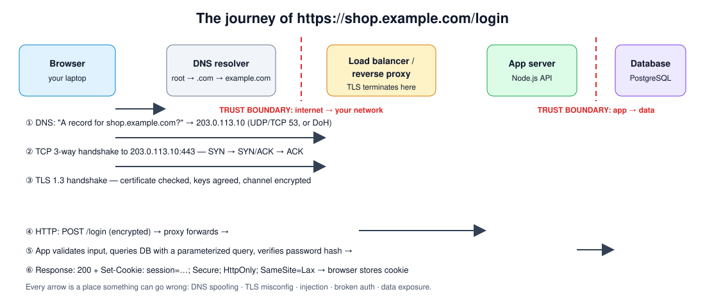
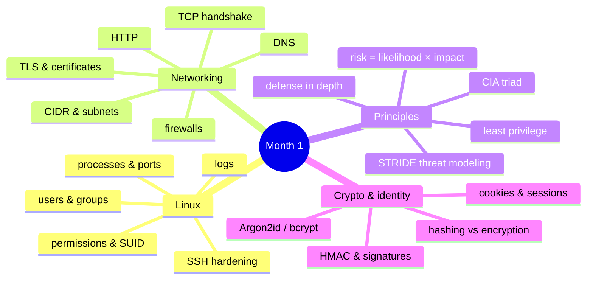

# Month 1 — Security Foundations

> 🟢 **Level 1 · Beginner** · Weeks 1–4 · ~40 h · Tracking issue: [#5](https://github.com/mascot200/cybersecurity-roadmap/issues/5)

**Goal:** understand the systems being protected before studying how to attack them.

You already build software. This month fills in the layers *under* your code — the operating system,
the network and the cryptography — and gives you the mental models (CIA, least privilege, threat
modeling) used for the rest of the course.

## Weekly plan

| Week | Lesson | You will build / prove | Est. time |
|---|---|---|---|
| 1 | [Linux, processes and permissions](week-01-linux-processes-permissions.md) | Key-only SSH, non-root admin, least-privilege file permissions | 10 h |
| 2 | [Networking fundamentals](week-02-networking-fundamentals.md) | Annotated trace of an HTTPS request (DNS → TCP → TLS → HTTP) | 10 h |
| 3 | [Security principles](week-03-security-principles.md) | STRIDE threat model of a login API | 10 h |
| 4 | [Cryptography and web identity](week-04-cryptography-web-identity.md) | Tested Argon2id + secure-cookie auth demo | 10–12 h |
| — | [Month project](project.md) | **Linux hardening + login API threat model** | woven into weeks |
| — | [Monthly drill](drill.md) | ≥ 80% to complete the month | 45 min |

## Skills map

## Milestone (must demonstrate before Month 2)

- [ ] **Explain a web request** end to end without notes (whiteboard or recording)
- [ ] **Secure a basic Linux environment**: non-root admin, key-only SSH, firewall default-deny, no world-readable secrets
- [ ] **Identify application trust boundaries** on a diagram of a login API

## Deliverables (put in your `cybersecurity-journey` repo)

1. Linux setup + hardening notes with verification evidence
2. A network request diagram
3. A basic login API threat model
4. The `auth-demo` lab with passing tests

## Recommended resources

- **OverTheWire Bandit** — Linux practice: <https://overthewire.org/wargames/bandit/>
- **MDN HTTP** — <https://developer.mozilla.org/en-US/docs/Web/HTTP>
- **Microsoft Threat Modeling** — <https://learn.microsoft.com/en-us/training/paths/tm-threat-modeling-fundamentals/>

---
[← Course home](../../../README.md) · [Start Week 1 →](week-01-linux-processes-permissions.md)
