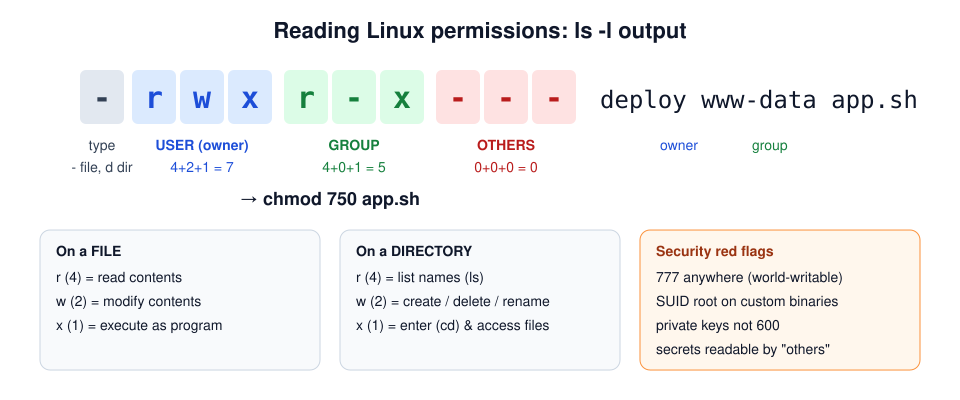
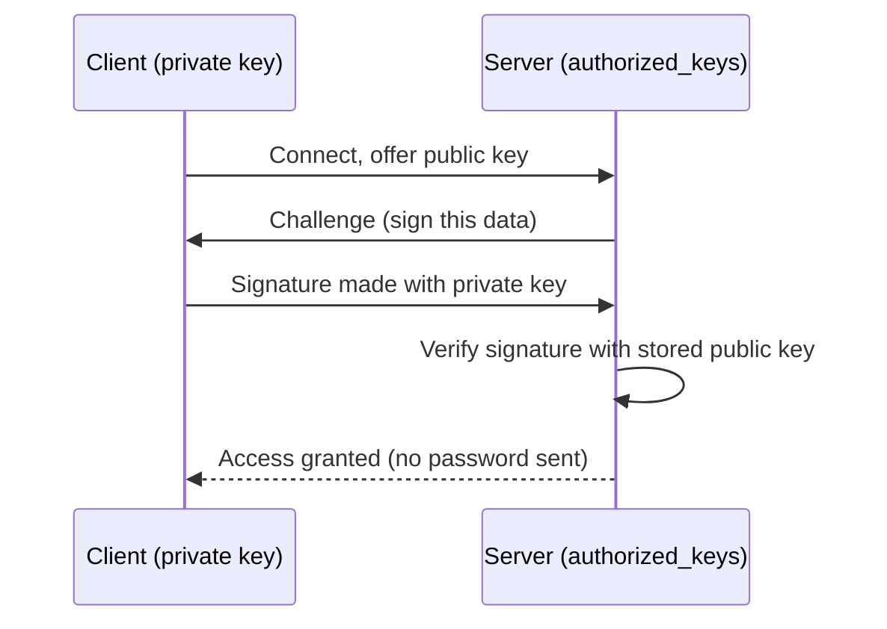

# Week 1 — Linux, Processes and Permissions

> **Level:** Beginner · **Time:** ~10 h · **Tracking:** [Month 1 issue #5](https://github.com/mascot200/cybersecurity-roadmap/issues/5)
> **Prerequisites:** [Lab setup](../../../docs/lab-setup.md) done; VM snapshot `clean-install` taken.

## 🎯 Objectives

By the end of this week you can:

1. Explain how Linux decides whether a user may read, write or execute a file.
2. Create users and groups and apply least-privilege permissions.
3. Inspect running processes, services and listening ports, and say which user each runs as.
4. Configure SSH for key-only login and disable remote root login.
5. Find security-relevant events in system logs.

## 🌍 Why it matters

Most servers on the internet — and nearly every container you'll deploy — run Linux. Attackers who
get a foothold (a vulnerable web app, a leaked SSH key) immediately ask: *"Who am I running as? What
can I read? Can I become root?"* Defenders need to ask the same questions first.

**Real-world scenario:** A startup's Node.js API ran as `root` on a VM. A remote code execution bug in
a dependency let an attacker run commands. Because the process was root, the attacker could read
`/etc/shadow`, add an SSH key to `/root/.ssh/authorized_keys`, and install a cryptominer as a systemd
service. If the API had run as an unprivileged `app` user, the same bug would have given access
only to that user's files — still bad, but containable.

---

## 📖 Concepts

### 1. Users, groups and the root account

Every process runs **as a user**. Linux identifies users by **UID** (number) and groups by **GID**.

| Account type | UID range (Ubuntu) | Purpose |
|---|---|---|
| `root` | 0 | Can do anything. Bypasses permission checks. |
| System/service accounts | 1–999 | Run daemons (`www-data`, `postgres`, `sshd`). Usually no login shell. |
| Human users | 1000+ | People. |

```bash
whoami            # your username
id                # uid, gid and all groups you belong to
cat /etc/passwd   # user database (no passwords here)
sudo cat /etc/shadow   # password hashes — root only. Look at the $y$ / $6$ prefixes
getent group sudo # who can use sudo?
```

> **Security idea:** anyone in the `sudo` (or `wheel`) group is effectively root. Anyone in the
> `docker` group is effectively root too. Audit these groups.

### 2. File permissions



Each file has an **owner**, a **group**, and three permission sets: **user / group / others**.
Linux checks them **in order** and uses the **first match**: if you're the owner, only the owner bits apply.

```bash
ls -l /etc/passwd /etc/shadow
# -rw-r--r-- 1 root root   ... /etc/passwd   (everyone may read)
# -rw-r----- 1 root shadow ... /etc/shadow   (only root + shadow group)

chmod 640 file      # rw- r-- ---
chmod u+x script.sh # add execute for owner
chown alice:devs file
```

**Special bits** (security-relevant):

| Bit | Example | Meaning | Risk |
|---|---|---|---|
| SUID | `-rwsr-xr-x /usr/bin/passwd` | Runs as the file's **owner** (often root) | A buggy SUID-root program = privilege escalation |
| SGID | `drwxrwsr-x` | New files inherit the directory's group | Usually fine for shared dirs |
| Sticky | `drwxrwxrwt /tmp` | Only owners can delete their files | Without it, users could delete each other's files in `/tmp` |

Find SUID files (attackers run this in the first minute after a foothold):

```bash
find / -perm -4000 -type f 2>/dev/null
```

**umask** sets default permissions for new files. `umask 027` → new files `640`, dirs `750`.

### 3. Processes and services

```bash
ps aux --sort=-%mem | head     # processes, the USER column shows who they run as
pstree -p | head -30           # parent/child tree
top                            # live view (q to quit)
sudo ss -tulpn                 # listening TCP/UDP ports + owning process
systemctl list-units --type=service --state=running
systemctl status ssh
```

**Why defenders care:**
- A process listening on `0.0.0.0` is reachable from every network interface; `127.0.0.1` is local only.
- A web server running as root, or an unknown process listening on a high port, is a red flag.
- The parent/child tree reveals attacks: a `bash` shell whose parent is `node` is suspicious.

A systemd unit can sandbox a service. Preview (you'll use this in Month 6):

```ini
[Service]
User=app
Group=app
NoNewPrivileges=true
ProtectSystem=strict
ProtectHome=true
PrivateTmp=true
ReadWritePaths=/var/lib/myapp
```

### 4. SSH

SSH gives you an encrypted remote shell. Its config is `/etc/ssh/sshd_config` (plus files in
`/etc/ssh/sshd_config.d/`).

Key-based authentication: you keep the **private key**; the server stores your **public key** in
`~/.ssh/authorized_keys`. Nobody can guess a strong key the way they can guess a password.



### 5. Logs

| Where | What |
|---|---|
| `journalctl -u ssh` | SSH logins/failures (systemd journal) |
| `/var/log/auth.log` | Authentication events, sudo usage |
| `journalctl -p warning --since "1 hour ago"` | Warnings and above |
| `last`, `lastb` | Successful / failed logins |
| `/var/log/apt/history.log` | Package installs and upgrades |

```bash
sudo journalctl -u ssh --since today | grep -E "Failed|Accepted|Invalid"
sudo grep sudo /var/log/auth.log | tail
```

### 6. Package updates

Most real-world compromises exploit **known** vulnerabilities that already had a patch.

```bash
sudo apt update && apt list --upgradable
sudo apt -y upgrade
sudo apt -y install unattended-upgrades && sudo dpkg-reconfigure -plow unattended-upgrades
```

---

## 🧪 Lab — Least privilege in practice (90 min)

**1. Create users and a group**

```bash
sudo adduser alice          # follow prompts, use a throwaway password
sudo adduser bob
sudo groupadd devs
sudo usermod -aG devs alice
id alice                    # expect: groups=...,devs
```

**2. Shared folder only `devs` can use**

```bash
sudo mkdir -p /srv/project
sudo chown root:devs /srv/project
sudo chmod 2770 /srv/project      # SGID so new files keep group "devs"
ls -ld /srv/project               # drwxrws---
```

**3. Prove it works (positive AND negative test)**

```bash
sudo -u alice touch /srv/project/alice.txt && echo "alice OK"
sudo -u bob ls /srv/project       # expect: Permission denied
```

> ✅ Always test **both** that the allowed user *can* and the disallowed user *cannot*. Security
> controls are only proven by the negative test.

**4. Find a misconfiguration**

```bash
echo "DB_PASSWORD=supersecret" | sudo tee /srv/app.env
ls -l /srv/app.env                # -rw-r--r-- → world-readable secret!
sudo -u bob cat /srv/app.env      # bob can read it
sudo chmod 600 /srv/app.env && sudo -u bob cat /srv/app.env   # now denied
```

**5. Investigate processes**

```bash
sudo ss -tulpn
ps -o user,pid,ppid,cmd -C sshd
```

Write down: which services listen on all interfaces? which user runs each?

**6. SSH log hunt**

From your host, try logging in as a nonexistent user a few times (`ssh nobody@<vm-ip>`), then on the VM:

```bash
sudo journalctl -u ssh --since "10 min ago" | grep -i invalid
```

**7. OverTheWire Bandit** — complete levels 0–10. For each level, note the command and the concept it taught (no passwords in public notes).

---

## 📝 Assignment — Secure SSH access with a non-root user

**Task:** create a non-root admin user, configure SSH key access, apply least privilege, and document every change.

### Steps

1. **Create the admin user**
   ```bash
   sudo adduser opsadmin
   sudo usermod -aG sudo opsadmin
   ```
2. **Generate a key on your host** (not the VM):
   ```bash
   ssh-keygen -t ed25519 -C "opsadmin-lab" -f ~/.ssh/lab_ed25519
   ssh-copy-id -i ~/.ssh/lab_ed25519.pub opsadmin@<vm-ip>
   ssh -i ~/.ssh/lab_ed25519 opsadmin@<vm-ip>    # confirm key login works BEFORE the next step
   ```
3. **Harden sshd** — create `/etc/ssh/sshd_config.d/10-hardening.conf`:
   ```
   PermitRootLogin no
   PasswordAuthentication no
   KbdInteractiveAuthentication no
   PubkeyAuthentication yes
   AllowUsers opsadmin
   MaxAuthTries 3
   LoginGraceTime 30
   X11Forwarding no
   ```
4. **Validate then reload** (keep your current session open in case you lock yourself out):
   ```bash
   sudo sshd -t && sudo systemctl reload ssh
   ```
5. **Verify — positive and negative**
   ```bash
   ssh -i ~/.ssh/lab_ed25519 opsadmin@<vm-ip>                     # works
   ssh -o PubkeyAuthentication=no opsadmin@<vm-ip>                # expect: Permission denied (publickey)
   ssh root@<vm-ip>                                               # expect: denied
   sudo sshd -T | grep -Ei "permitrootlogin|passwordauthentication"
   ```
6. **Check file permissions**
   ```bash
   ls -la ~opsadmin/.ssh   # .ssh = 700, authorized_keys = 600
   ```
7. **Document** in `notes/week-01.md`: each change, *why* you made it, and the verification output.

### Acceptance criteria

- [ ] Root cannot log in over SSH (evidence: command output)
- [ ] Password authentication is refused (evidence)
- [ ] `opsadmin` logs in with an ed25519 key
- [ ] `.ssh` is `700` and `authorized_keys` is `600`
- [ ] A short "change log" table: *change → reason → how verified*
- [ ] Bandit levels 0–10 completed

---

## 💼 On the job

- **Cloud/DevOps security engineer:** writes the baseline image (golden AMI) with these settings, and checks them continuously with tools like CIS benchmarks or Lynis.
- **Incident responder:** first commands on a suspect host are `who`, `last`, `ps auxf`, `ss -tulpn`, `crontab -l`, `systemctl list-units`, and reviewing `authorized_keys` — looking for persistence.
- **AppSec engineer:** reviews Dockerfiles and systemd units to ensure apps don't run as root.

## ⚠️ Common mistakes

- Disabling password login **before** confirming key login works → locked out. (That's what snapshots are for.)
- `chmod -R 777` to "fix" a permission error. Find *which* user needs *which* access instead.
- Forgetting the negative test — you only proved the right person *can*, not that others *can't*.
- Leaving secrets in world-readable `.env` files.

## 🥊 Drill (pass mark 8/10)

**1.** A file is `-rw-r-----  root  shadow`. Can a normal user in no special group read it?
<details><summary>Answer</summary>No. Owner is root (rw), group shadow (r), others have no permissions.</details>

**2.** What octal value is `rwxr-x---`?
<details><summary>Answer</summary>750.</details>

**3.** Why is the SUID bit on a custom root-owned binary dangerous?
<details><summary>Answer</summary>It runs with root privileges for any user who executes it; any bug (command injection, path hijack) becomes privilege escalation to root.</details>

**4.** You see `node` listening on `0.0.0.0:9229`. Why should you care?
<details><summary>Answer</summary>9229 is the Node.js inspector/debug port. Listening on all interfaces means remote users could attach a debugger and execute arbitrary code. It should be disabled in production or bound to 127.0.0.1.</details>

**5.** Which two sshd settings stop password guessing and direct root login?
<details><summary>Answer</summary><code>PasswordAuthentication no</code> and <code>PermitRootLogin no</code>.</details>

**6.** Which command shows listening ports and the owning process?
<details><summary>Answer</summary><code>sudo ss -tulpn</code> (or <code>netstat -tulpn</code> on older systems).</details>

**7.** Explain: why does being in the `docker` group equal root?
<details><summary>Answer</summary>Members can start containers that mount the host's root filesystem (<code>docker run -v /:/host</code>) as root inside the container, then modify any host file.</details>

**8.** Scenario: during an investigation you find a `bash` process whose parent is `node`. What might it mean?
<details><summary>Answer</summary>The web app may have been exploited (command injection / RCE) to spawn a shell. Investigate the request logs around the start time, the command line, network connections, and isolate the host if confirmed.</details>

**9.** Where would you look to see who used `sudo` today?
<details><summary>Answer</summary><code>/var/log/auth.log</code> or <code>journalctl _COMM=sudo --since today</code>.</details>

**10.** What is the purpose of the sticky bit on `/tmp`?
<details><summary>Answer</summary>Users can only delete or rename files they own in a world-writable directory, preventing them from deleting or replacing other users' files.</details>

## ✅ Checklist

- [ ] Lab steps 1–7 done
- [ ] Assignment acceptance criteria met
- [ ] Drill ≥ 8/10
- [ ] Four questions answered in `notes/week-01.md`
- [ ] Weekly log commented on issue #5

## 📚 Resources

- OverTheWire Bandit — <https://overthewire.org/wargames/bandit/>
- OpenSSH manual pages — <https://www.openssh.com/manual.html>
- `man 5 sshd_config`, `man chmod`, `man systemd.exec`

---
[← Month overview](README.md) · [Next: Week 2 — Networking →](week-02-networking-fundamentals.md)
