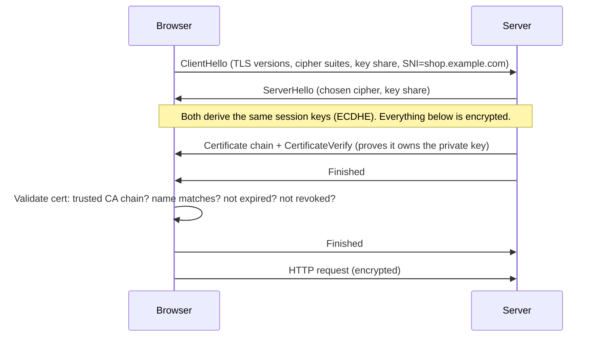

# Week 2 — Networking Fundamentals

> **Level:** Beginner · **Time:** ~10 h · **Tracking:** [issue #5](https://github.com/mascot200/cybersecurity-roadmap/issues/5)

## 🎯 Objectives

1. Explain TCP/IP layers, ports, DNS, routing and subnets in plain language.
2. Trace a real HTTPS request from DNS lookup to rendered response using command-line tools.
3. Explain the TLS 1.3 handshake and what certificate validation actually checks.
4. Read a CIDR block and say whether an IP is inside it.
5. Explain what a firewall can and cannot protect.

## 🌍 Why it matters

Every web vulnerability you'll study rides on top of networking. You can't reason about SSRF,
exposed databases, TLS misconfigurations or cloud security groups if "port", "subnet" and
"DNS" are fuzzy.

**Real-world scenario:** Thousands of MongoDB, Elasticsearch and Redis instances have been wiped or
ransomed over the years because they listened on `0.0.0.0` with no authentication and no firewall —
a networking misconfiguration, not a sophisticated hack. Search engines like Shodan index such
exposed services continuously.

---

## 📖 Concepts

### 1. The layers (simplified TCP/IP model)

| Layer | What it does | Examples | Security angle |
|---|---|---|---|
| Application | Meaning of the data | HTTP, DNS, SSH, SMTP | Injection, auth flaws |
| Transport | Delivery between *ports* | TCP (reliable), UDP (fast) | Port exposure, SYN floods |
| Internet | Delivery between *hosts* | IP, ICMP | IP spoofing, routing |
| Link | Delivery on the local network | Ethernet, Wi-Fi, ARP | ARP spoofing, sniffing on open Wi-Fi |

### 2. IP addresses, subnets and CIDR

An IPv4 address is 32 bits. **CIDR** notation `10.0.1.0/24` means "the first 24 bits are the network",
leaving 8 bits (256 addresses) for hosts.

| CIDR | Addresses | Typical use |
|---|---|---|
| `/32` | 1 | a single host ("only my IP") |
| `/24` | 256 | a subnet |
| `/16` | 65,536 | a cloud VPC |
| `/0` | everything | `0.0.0.0/0` = **the whole internet** ⚠️ |

**Private ranges** (RFC 1918 — not routable on the internet): `10.0.0.0/8`, `172.16.0.0/12`, `192.168.0.0/16`.
Also special: `127.0.0.0/8` (loopback), `169.254.0.0/16` (link-local — includes the **cloud metadata
service `169.254.169.254`**, which you'll attack via SSRF in Month 4).

```bash
ip a           # your interfaces and addresses
ip route       # routing table; "default via ..." is your gateway
```

### 3. Ports and TCP

A port identifies a service on a host. Well-known: 22 SSH, 53 DNS, 80 HTTP, 443 HTTPS, 5432 PostgreSQL,
6379 Redis, 3306 MySQL.

TCP connections start with a **3-way handshake**: `SYN → SYN/ACK → ACK`. A port is:
- **open** — something replies SYN/ACK,
- **closed** — host replies RST,
- **filtered** — nothing replies (a firewall dropped it).

```bash
nc -zv 127.0.0.1 22        # is port 22 open?
nmap -sT -p 1-1000 127.0.0.1   # scan YOUR OWN machine only
```

### 4. DNS

DNS turns names into addresses. Key record types:

| Record | Meaning |
|---|---|
| A / AAAA | name → IPv4 / IPv6 |
| CNAME | alias → another name |
| MX | mail servers |
| TXT | arbitrary text (SPF, DKIM, domain verification) |
| NS | which servers are authoritative |

```bash
dig example.com A +short
dig +trace example.com        # watch root → .com → example.com
dig example.com TXT
```

**Security angle:** DNS spoofing/cache poisoning, **subdomain takeover** (a CNAME pointing to a
deleted cloud resource someone else can claim), and DNS as a data-exfiltration channel.

### 5. HTTP

HTTP is a text protocol: a request line, headers, blank line, optional body.

```http
POST /login HTTP/1.1
Host: shop.example.com
Content-Type: application/json
Cookie: session=abc123

{"email":"a@example.com","password":"..."}
```

Status classes: `2xx` success, `3xx` redirect, `4xx` client error (401 unauthenticated, 403 forbidden,
404 not found, 429 rate limited), `5xx` server error.

**Everything in a request is attacker-controlled** — method, path, query, headers (including `Host`,
`Cookie`, `X-Forwarded-For`), and body. Remember that sentence; it's the root of most web bugs.

### 6. TLS


TLS gives you **confidentiality** (encryption), **integrity** (tamper detection) and **server
authentication** (certificates).



What the browser checks on the certificate:
1. Chain leads to a **trusted root CA**.
2. The **hostname** matches the certificate's Subject Alternative Name.
3. It's within its **validity dates**.
4. The server proved it holds the **private key**.

What TLS does **not** do: protect against a vulnerable app, protect data once it's on the server, or
prove the site is honest — phishing sites get valid certificates too.

### 7. Firewalls

A firewall allows/denies traffic by rules (source, destination, port, protocol). **Default deny** inbound:

```bash
sudo ufw default deny incoming
sudo ufw default allow outgoing
sudo ufw allow from 192.168.56.0/24 to any port 22 proto tcp   # SSH only from lab network
sudo ufw enable && sudo ufw status verbose
```

Firewalls reduce **attack surface**; they don't fix vulnerable services that must be exposed (your web app on 443).

---

## 🧪 Lab — Trace a request (2 h)

**1. DNS**

```bash
dig +trace developer.mozilla.org | tail -20
dig developer.mozilla.org +short
```
Note: which servers answered at each step? What's the final IP? What's the TTL?

**2. TCP + TLS + HTTP in one view**

```bash
curl -v https://developer.mozilla.org/ -o /dev/null 2>&1 | less
```
Identify in the output: the resolved IP (`Trying ...`), `Connected to`, TLS version and cipher,
the certificate subject/issuer/expiry, request headers (`>`), response headers (`<`).

**3. Inspect the certificate directly**

```bash
openssl s_client -connect developer.mozilla.org:443 -servername developer.mozilla.org </dev/null 2>/dev/null \
  | openssl x509 -noout -subject -issuer -dates -ext subjectAltName
```

**4. Watch the packets** (two terminals)

```bash
# terminal 1
sudo tcpdump -i any -n 'port 53 or port 443' -c 30
# terminal 2
curl -s https://example.com -o /dev/null
```
Find the DNS query, the TCP SYN/SYN-ACK/ACK, then TLS traffic. Notice you **can't read** the HTTP
inside TLS — that's the point.

**5. Plain HTTP is readable** — run a tiny local server and capture:

```bash
python3 -m http.server 8000 --bind 127.0.0.1 &
sudo tcpdump -i lo -A -n port 8000 -c 20 &
curl -s "http://127.0.0.1:8000/?password=hunter2" > /dev/null
kill %1 %2
```
You'll see `password=hunter2` in clear text. That's why HTTPS everywhere matters.

**6. Browser DevTools** — open DevTools → Network, load a site, click the first request: check
*Timing* (DNS, connect, SSL, waiting) and *Headers*. Then the padlock → certificate viewer.

**7. Firewall** — enable `ufw` with default-deny and allow SSH only from your host network; verify with `nmap` from the host that only 22 is reachable.

---

## 📝 Assignment — Explain a browser request

**Task:** trace a browser request using curl and developer tools; explain DNS resolution and the TLS handshake.

### Steps
1. Pick a site (e.g. `https://developer.mozilla.org`).
2. Capture evidence: `dig +trace`, `curl -v`, `openssl s_client` output, a DevTools timing screenshot.
3. Draw a diagram (Mermaid, draw.io or Excalidraw) of the full journey: browser → DNS → TCP → TLS → HTTP → server → response. Mark the **trust boundaries**.
4. Write `notes/week-02.md` explaining, in your own words:
   - each DNS step from `dig +trace`,
   - each TLS handshake message and what the browser validates,
   - what an attacker on the same café Wi-Fi could see with HTTP vs HTTPS,
   - three things that could go wrong at each stage (e.g. DNS hijack, expired cert, weak TLS config).

### Acceptance criteria
- [ ] Diagram with at least 6 labelled steps and trust boundaries
- [ ] DNS explanation references actual servers from your `dig +trace`
- [ ] TLS explanation names ClientHello, ServerHello, Certificate, Finished, and the 4 cert checks
- [ ] HTTP vs HTTPS comparison backed by your tcpdump captures
- [ ] Firewall configured default-deny with evidence (`ufw status verbose`)

---

## 💼 On the job

- **Cloud security:** every security group, NACL and firewall rule review is this week's CIDR + ports knowledge.
- **AppSec:** debugging why a cookie isn't sent, why CORS fails, or why an SSRF filter was bypassed requires reading raw HTTP.
- **Incident response:** "Which IP connected to our DB on 5432 at 03:12?" → flow logs, `ss`, packet captures.

## ⚠️ Common mistakes

- Thinking `0.0.0.0/0` in a security group is "fine for now".
- Assuming HTTPS = secure site.
- Scanning hosts you don't own. Only scan your lab.
- Confusing "port closed" with "port filtered".

## 🥊 Drill (pass mark 8/10)

**1.** Is `172.20.5.4` a private address? Is `172.32.0.1`?
<details><summary>Answer</summary><code>172.16.0.0/12</code> covers 172.16.0.0–172.31.255.255. So 172.20.5.4 is private; 172.32.0.1 is not.</details>

**2.** How many addresses are in a `/28`?
<details><summary>Answer</summary>2^(32−28) = 16.</details>

**3.** What does a security group rule allowing `0.0.0.0/0` on port 5432 mean?
<details><summary>Answer</summary>Anyone on the internet can attempt to connect to PostgreSQL. Databases should only accept connections from app subnets/security groups.</details>

**4.** Name the four certificate checks a browser performs.
<details><summary>Answer</summary>Trusted chain to a root CA; hostname matches SAN; within validity period; server proves possession of the private key (and revocation status where checked).</details>

**5.** What is SNI and why is it sent?
<details><summary>Answer</summary>Server Name Indication — the hostname the client wants, sent in ClientHello so one IP can serve certificates for many domains. (It's visible to observers unless Encrypted Client Hello is used.)</details>

**6.** `nmap` reports a port as *filtered*. What does that mean?
<details><summary>Answer</summary>No response was received — most likely a firewall silently dropped the probe.</details>

**7.** Which headers in an HTTP request can the client control?
<details><summary>Answer</summary>All of them — including Host, Cookie, Referer, User-Agent, X-Forwarded-For. Never trust them blindly.</details>

**8.** What is a subdomain takeover?
<details><summary>Answer</summary>A DNS record (often CNAME) points to an external resource (e.g. a deleted cloud bucket or app) that an attacker can claim, letting them serve content on your subdomain.</details>

**9.** Scenario: a user on public Wi-Fi visits `http://bank.example` before being redirected to HTTPS. What's the risk and the fix?
<details><summary>Answer</summary>The first plain-HTTP request can be intercepted/modified (SSL stripping). Fix: HSTS header (and HSTS preload) so browsers go straight to HTTPS.</details>

**10.** Why is `169.254.169.254` interesting to an attacker?
<details><summary>Answer</summary>It's the cloud instance metadata service; it can expose instance credentials. SSRF attacks often target it (Capital One 2019).</details>

## ✅ Checklist
- [ ] Lab steps 1–7
- [ ] Assignment acceptance criteria met
- [ ] Drill ≥ 8/10
- [ ] Weekly log on issue #5

## 📚 Resources
- MDN HTTP overview — <https://developer.mozilla.org/en-US/docs/Web/HTTP/Overview>
- MDN TLS — <https://developer.mozilla.org/en-US/docs/Web/Security/Transport_Layer_Security>
- Cloudflare Learning Center (DNS, TLS) — <https://www.cloudflare.com/learning/>
- `man dig`, `man curl`, `man tcpdump`

---
[← Week 1](week-01-linux-processes-permissions.md) · [Next: Week 3 — Security principles →](week-03-security-principles.md)
