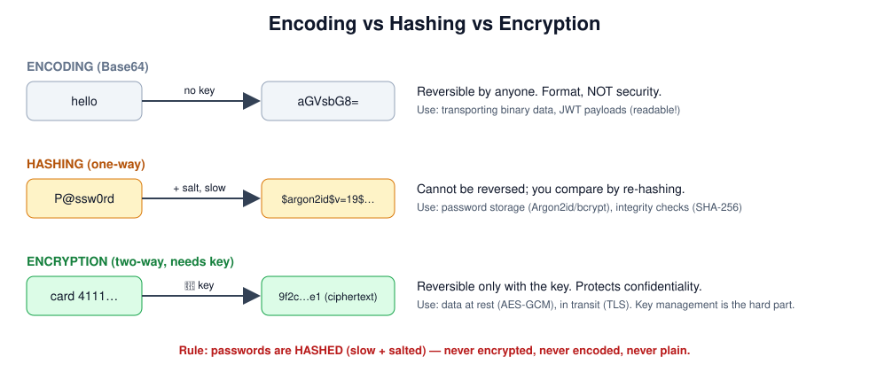
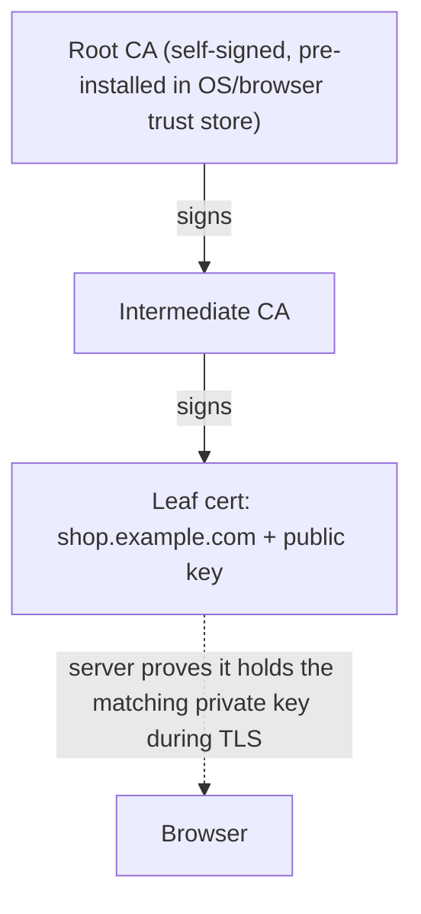
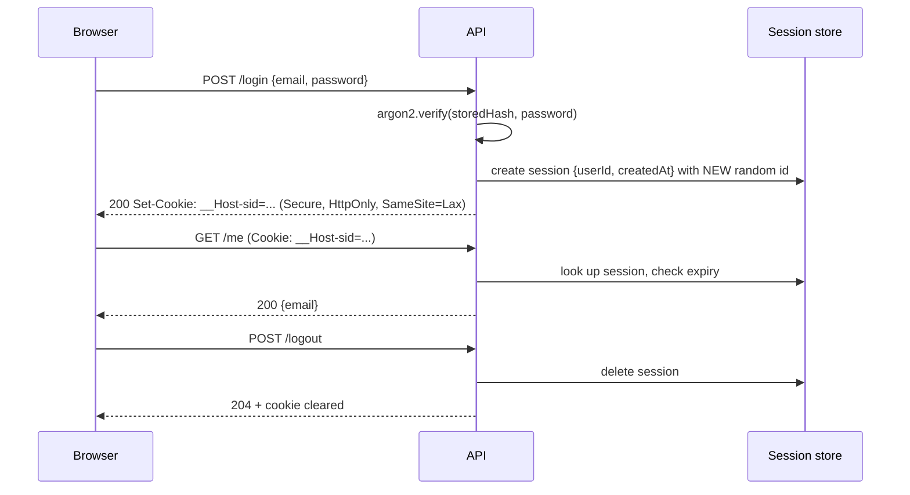

# Week 4 — Cryptography and Web Identity

> **Level:** Beginner · **Time:** ~10–12 h · **Tracking:** [issue #5](https://github.com/mascot200/cybersecurity-roadmap/issues/5)

## 🎯 Objectives

1. Distinguish encoding, hashing, MACs, symmetric and asymmetric encryption, and signatures — and pick the right one.
2. Store passwords correctly with Argon2id or bcrypt and explain why.
3. Explain certificates and the chain of trust.
4. Configure session cookies with `Secure`, `HttpOnly`, `SameSite`, expiry and rotation.
5. Build and test a small authentication demo.

## 🌍 Why it matters

**Real-world scenarios:**
- **LinkedIn (2012):** ~117 million passwords hashed with unsalted SHA-1 were leaked and the vast majority cracked — fast hashes and no salt.
- **Adobe (2013):** passwords were *encrypted* (3DES, ECB mode) rather than hashed, with password hints stored in plaintext; identical passwords produced identical ciphertext, so the "crossword puzzle" of hints revealed many.
- Session hijacking: when cookies lack `HttpOnly`, a single XSS bug lets attackers steal sessions with `document.cookie`.

Using the wrong primitive is one of the most common, and most avoidable, security failures.

---

## 📖 Concepts



### 1. The toolbox

| Primitive | Key? | Reversible? | Gives you | Use it for | Examples |
|---|---|---|---|---|---|
| Encoding | No | Yes, by anyone | Format | Transport | Base64, URL encoding, hex |
| Hash | No | No | Fingerprint / integrity | File checksums, dedupe | SHA-256, SHA-3 |
| Password hash | No (salt) | No, **deliberately slow** | Safe password storage | Passwords | Argon2id, scrypt, bcrypt |
| MAC | Shared secret | No | Integrity + authenticity | Signed cookies, webhooks | HMAC-SHA256 |
| Symmetric encryption | Shared secret | Yes, with key | Confidentiality (+ integrity if AEAD) | Data at rest, TLS records | AES-256-GCM, ChaCha20-Poly1305 |
| Asymmetric encryption / key exchange | Public/private pair | Yes, with private key | Key agreement | TLS handshake | ECDHE, RSA-OAEP |
| Digital signature | Private signs, public verifies | — | Authenticity + integrity + non-repudiation | Certificates, JWT (RS256/ES256), code signing | Ed25519, ECDSA, RSA-PSS |

**Rules of thumb**
- **Never invent crypto.** Use your platform's well-reviewed libraries.
- Prefer **AEAD** modes (AES-GCM, ChaCha20-Poly1305) — they encrypt *and* detect tampering. Never ECB.
- Never reuse a nonce/IV with the same key in GCM.
- Use a **CSPRNG** for tokens: `crypto.randomBytes(32)` in Node, never `Math.random()`.
- Compare secrets in **constant time** (`crypto.timingSafeEqual`).

### 2. Password storage

Why not SHA-256? GPUs compute **billions** of SHA-256 hashes per second. A password hash function is
designed to be **slow** and (for Argon2/scrypt) **memory-hard**, making each guess expensive.

The **salt** is a random per-user value stored with the hash. It makes identical passwords produce
different hashes and defeats precomputed (rainbow) tables. It is **not** secret.

An Argon2id hash string contains everything needed to verify it:

```
$argon2id$v=19$m=65536,t=3,p=4$<salt-base64>$<hash-base64>
           |      |      |   |
        version  memory iters parallelism
```

OWASP's Password Storage Cheat Sheet gives current recommended parameters — check it rather than
memorizing numbers. Also: allow long passwords (64+ chars), check new passwords against breached-password
lists, and don't impose arbitrary composition rules.

### 3. Certificates and chain of trust

A certificate binds a **public key** to a **name**, signed by a Certificate Authority.



Free, automated certificates: Let's Encrypt (ACME). Certificate leaks to watch for: private keys
committed to git, wildcard certs copied to many servers.

### 4. Cookies and sessions

HTTP is stateless. After login, the server issues a **session identifier** (random, unguessable) in a
cookie; the browser sends it on each request.

```http
Set-Cookie: sid=Yb3v...Q; Path=/; Secure; HttpOnly; SameSite=Lax; Max-Age=3600
```

| Attribute | Protects against |
|---|---|
| `Secure` | Sent only over HTTPS → no leak on plain HTTP |
| `HttpOnly` | JavaScript can't read it → XSS can't steal it via `document.cookie` |
| `SameSite=Lax` / `Strict` | Not sent on most cross-site requests → mitigates CSRF |
| `Max-Age` / `Expires` | Limits lifetime of stolen sessions |
| `__Host-` prefix | Requires `Secure`, `Path=/`, no `Domain` → can't be set by subdomains |

**Session lifecycle rules:**
1. Generate a **new** session ID at login (prevents **session fixation**).
2. Enforce **idle** timeout and **absolute** timeout server-side.
3. **Invalidate** server-side on logout and on password change.
4. Never put session IDs in URLs.



---

## 🧪 Lab — Crypto hands-on (60 min)

```bash
# Encoding is not encryption
echo -n 'admin:password' | base64            # YWRtaW46cGFzc3dvcmQ=
echo 'YWRtaW46cGFzc3dvcmQ=' | base64 -d

# Hashes: tiny input change → completely different output (avalanche effect)
echo -n 'hello' | sha256sum
echo -n 'hellp' | sha256sum

# HMAC: integrity + authenticity with a shared key
echo -n '{"amount":100}' | openssl dgst -sha256 -hmac 'webhook-secret'

# Symmetric encryption with AES-256 (CLI demo only; use library AEAD in code)
echo 'card 4111111111111111' > secret.txt
openssl enc -aes-256-cbc -pbkdf2 -salt -in secret.txt -out secret.enc
openssl enc -d -aes-256-cbc -pbkdf2 -in secret.enc

# Asymmetric signature
openssl genpkey -algorithm ed25519 -out priv.pem
openssl pkey -in priv.pem -pubout -out pub.pem
echo 'release v1.0' > msg.txt
openssl pkeyutl -sign -inkey priv.pem -rawin -in msg.txt -out msg.sig
openssl pkeyutl -verify -pubin -inkey pub.pem -rawin -in msg.txt -sigfile msg.sig   # Signature Verified Successfully
echo 'release v1.1' > msg.txt
openssl pkeyutl -verify -pubin -inkey pub.pem -rawin -in msg.txt -sigfile msg.sig   # fails
rm -f secret.* priv.pem pub.pem msg.*
```

Feel the cost difference:

```bash
mkdir -p ~/labs/hash-speed && cd ~/labs/hash-speed && npm init -y >/dev/null && npm i argon2 >/dev/null
cat > speed.mjs <<'EOF'
import crypto from 'node:crypto';
import argon2 from 'argon2';
let t = performance.now();
for (let i = 0; i < 100000; i++) crypto.createHash('sha256').update('pw' + i).digest();
console.log('100,000 SHA-256:', (performance.now() - t).toFixed(0), 'ms');
t = performance.now();
for (let i = 0; i < 10; i++) await argon2.hash('pw' + i, { type: argon2.argon2id });
console.log('10 Argon2id:', (performance.now() - t).toFixed(0), 'ms');
EOF
node speed.mjs
```

That ratio is exactly what makes offline cracking expensive.

---

## 📝 Assignment — Authentication demo

**Task:** build a small authentication demo using a reputable password-hashing library and secure cookie settings.

### Starter code

```bash
mkdir -p ~/cybersecurity-journey/labs/auth-demo && cd $_
npm init -y && npm pkg set type=module
npm i express argon2 cookie-parser
npm i -D vitest supertest
```

`app.js`:

```js
import express from 'express';
import crypto from 'node:crypto';
import argon2 from 'argon2';
import cookieParser from 'cookie-parser';

export function createApp() {
  const app = express();
  app.use(express.json({ limit: '10kb' }));
  app.use(cookieParser());

  const users = new Map();     // email -> { id, email, pwHash }   (use a DB in real apps)
  const sessions = new Map();  // sid -> { userId, created, lastSeen }
  const IDLE_MS = 15 * 60 * 1000;
  const ABSOLUTE_MS = 8 * 60 * 60 * 1000;
  // Used to keep timing similar when the user does not exist
  const dummyHashPromise = argon2.hash('dummy-password-for-timing', { type: argon2.argon2id });

  const cookieOpts = {
    httpOnly: true,
    secure: true,        // browsers still accept Secure cookies on http://localhost
    sameSite: 'lax',
    path: '/',
    maxAge: ABSOLUTE_MS,
  };

  app.post('/signup', async (req, res) => {
    const { email, password } = req.body ?? {};
    if (typeof email !== 'string' || typeof password !== 'string') return res.status(400).end();
    if (password.length < 12 || password.length > 128) {
      return res.status(400).json({ error: 'Password must be 12–128 characters' });
    }
    const key = email.trim().toLowerCase();
    if (users.has(key)) return res.status(202).json({ message: 'If this email can register, check your inbox' });
    const pwHash = await argon2.hash(password, { type: argon2.argon2id });
    users.set(key, { id: crypto.randomUUID(), email: key, pwHash });
    res.status(202).json({ message: 'If this email can register, check your inbox' });
  });

  app.post('/login', async (req, res) => {
    const { email, password } = req.body ?? {};
    if (typeof email !== 'string' || typeof password !== 'string') return res.status(400).end();
    const user = users.get(email.trim().toLowerCase());
    const hash = user ? user.pwHash : await dummyHashPromise;
    const ok = await argon2.verify(hash, password);
    if (!user || !ok) return res.status(401).json({ error: 'Invalid email or password' });

    const sid = crypto.randomBytes(32).toString('base64url');   // new id on every login
    const now = Date.now();
    sessions.set(sid, { userId: user.id, email: user.email, created: now, lastSeen: now });
    res.cookie('__Host-sid', sid, cookieOpts).json({ ok: true });
  });

  function requireSession(req, res, next) {
    const sid = req.cookies['__Host-sid'];
    const s = sid && sessions.get(sid);
    const now = Date.now();
    if (!s || now - s.lastSeen > IDLE_MS || now - s.created > ABSOLUTE_MS) {
      if (sid) sessions.delete(sid);
      return res.status(401).json({ error: 'Not authenticated' });
    }
    s.lastSeen = now;
    req.session = s;
    req.sid = sid;
    next();
  }

  app.get('/me', requireSession, (req, res) => res.json({ email: req.session.email }));

  app.post('/logout', requireSession, (req, res) => {
    sessions.delete(req.sid);
    res.clearCookie('__Host-sid', { ...cookieOpts, maxAge: undefined }).status(204).end();
  });

  app._test = { sessions, users, IDLE_MS };   // test hook — do not do this in production code
  return app;
}
```

`server.js`:

```js
import { createApp } from './app.js';
createApp().listen(3000, '127.0.0.1', () => console.log('http://127.0.0.1:3000'));
```

`auth.test.js`:

```js
import { describe, it, expect } from 'vitest';
import request from 'supertest';
import { createApp } from './app.js';

const creds = { email: 'alice@example.com', password: 'correct horse battery staple' };

// Sign up + log in, return the "name=value" part of the session cookie.
// We send it back manually: supertest's cookie jar (correctly!) refuses to
// return a Secure cookie over plain http, which would make tests pass for the wrong reason.
async function login(app) {
  await request(app).post('/signup').send(creds);
  const res = await request(app).post('/login').send(creds);
  return { res, cookie: res.headers['set-cookie'][0].split(';')[0] };
}

describe('auth demo', () => {
  it('sets a hardened session cookie on login', async () => {
    const { res } = await login(createApp());
    const cookie = res.headers['set-cookie'][0];
    expect(cookie).toMatch(/^__Host-sid=/);
    expect(cookie).toMatch(/HttpOnly/);
    expect(cookie).toMatch(/Secure/);
    expect(cookie).toMatch(/SameSite=Lax/);
  });

  it('accepts a valid session (positive control)', async () => {
    const app = createApp();
    const { cookie } = await login(app);
    const me = await request(app).get('/me').set('Cookie', cookie);
    expect(me.status).toBe(200);
    expect(me.body.email).toBe(creds.email);
  });

  it('rejects a wrong password with a generic message', async () => {
    const app = createApp();
    await request(app).post('/signup').send(creds);
    const res = await request(app).post('/login').send({ ...creds, password: 'wrong password!!' });
    expect(res.status).toBe(401);
    expect(res.body.error).toBe('Invalid email or password');
  });

  it('gives the same error for unknown users (no enumeration)', async () => {
    const res = await request(createApp()).post('/login').send({ email: 'nobody@example.com', password: 'whatever12345' });
    expect(res.status).toBe(401);
    expect(res.body.error).toBe('Invalid email or password');
  });

  it('stores an Argon2id hash, never the plaintext password', async () => {
    const app = createApp();
    await request(app).post('/signup').send(creds);
    const stored = app._test.users.get(creds.email);
    expect(stored.pwHash.startsWith('$argon2id$')).toBe(true);
    expect(JSON.stringify(stored)).not.toContain(creds.password);
  });

  it('expires idle sessions', async () => {
    const app = createApp();
    const { cookie } = await login(app);
    for (const s of app._test.sessions.values()) s.lastSeen -= app._test.IDLE_MS + 1;
    expect((await request(app).get('/me').set('Cookie', cookie)).status).toBe(401);
  });

  it('invalidates the session server-side on logout', async () => {
    const app = createApp();
    const { cookie } = await login(app);
    expect((await request(app).post('/logout').set('Cookie', cookie)).status).toBe(204);
    const replay = await request(app).get('/me').set('Cookie', cookie);
    expect(replay.status).toBe(401);
  });
});
```

Run: `npx vitest run`.

> 💡 **Why the tests set the `Cookie` header by hand:** a cookie jar (browser or supertest's agent)
> will not send a `Secure` cookie over plain `http://`. If you used `request.agent(app)`, `/me` would
> return 401 because *no cookie was sent* — and a "session expired" test would pass for the wrong reason.
> That's why there is a **positive control** test: always prove the happy path works before trusting a
> negative test.

### Your tasks
1. Get all tests passing. Complete the "never stores the plaintext password" test (e.g. expose a test-only getter, or switch to PostgreSQL and query `pw_hash`).
2. Add a test: **logging in again issues a different session ID** (session fixation defense).
3. Add a test: **absolute timeout** expires a session even if it's active.
4. Add **login throttling**: after 5 failed attempts for an email within 15 minutes, return `429`. Test it.
5. Write `README.md`: design, why Argon2id, cookie attributes table, and limitations (in-memory store, no MFA, no CSRF token yet — that's Week 7).

### Acceptance criteria
- [ ] Passwords hashed with Argon2id (or bcrypt cost ≥ 10) — never logged or stored in plaintext
- [ ] Session ID from a CSPRNG, ≥ 128 bits, regenerated on login
- [ ] Cookie has `HttpOnly`, `Secure`, `SameSite`, bounded lifetime
- [ ] Idle + absolute timeout and server-side logout, each with a passing test
- [ ] Generic login error; same code path for unknown users
- [ ] Throttling test passes
- [ ] README with limitations

---

## 💼 On the job

AppSec engineers review auth code more than almost anything else. Typical review comments:
"use `timingSafeEqual` for the webhook signature", "regenerate session on login", "this reset token
uses `Math.random()`", "bcrypt truncates at 72 bytes — enforce a max length or pre-hash correctly".

## ⚠️ Common mistakes

- Encrypting passwords "so we can email them back". Never.
- Using JWTs in `localStorage` for browser sessions without understanding the XSS trade-off (Month 3).
- Rolling your own token format or crypto.
- Logging request bodies that contain passwords.

## 🥊 Drill (pass mark 8/10)

**1.** Why is a salt needed, and must it be secret?
<details><summary>Answer</summary>It makes each user's hash unique (identical passwords → different hashes) and defeats precomputed tables. It doesn't need to be secret; it's stored alongside the hash.</details>

**2.** Which primitive verifies a webhook really came from Stripe/GitHub?
<details><summary>Answer</summary>An HMAC (e.g. HMAC-SHA256) over the payload with a shared secret, compared in constant time.</details>

**3.** What do `HttpOnly` and `SameSite=Lax` each protect against?
<details><summary>Answer</summary><code>HttpOnly</code>: JavaScript (XSS) can't read the cookie. <code>SameSite=Lax</code>: cookie not sent on most cross-site subrequests/POSTs → CSRF mitigation.</details>

**4.** What is session fixation and how do you prevent it?
<details><summary>Answer</summary>Attacker makes the victim use a session ID the attacker knows; after the victim logs in, the attacker shares the authenticated session. Prevent by issuing a new session ID at login (and privilege change).</details>

**5.** Spot the bug: `const token = Math.random().toString(36).slice(2)` for password reset.
<details><summary>Answer</summary><code>Math.random()</code> is not cryptographically secure and the output is short/predictable. Use <code>crypto.randomBytes(32).toString('base64url')</code>, store only a hash of it, and expire it quickly.</details>

**6.** Why should a password-reset token be stored hashed in the DB?
<details><summary>Answer</summary>If the DB leaks, attackers can't use live reset tokens to take over accounts — same reasoning as for passwords.</details>

**7.** Is a JWT payload confidential?
<details><summary>Answer</summary>No — it's Base64URL-encoded JSON; anyone can read it. Signing gives integrity, not confidentiality.</details>

**8.** What does a digital signature give that a hash alone does not?
<details><summary>Answer</summary>Authenticity — proof it was produced by the private-key holder — plus integrity. Anyone can compute a hash of altered data.</details>

**9.** What's wrong with AES in ECB mode?
<details><summary>Answer</summary>Identical plaintext blocks produce identical ciphertext blocks, leaking patterns (the "ECB penguin", and Adobe's password leak). Use an AEAD mode like AES-GCM.</details>

**10.** Scenario: a database dump with bcrypt hashes leaks. What do you do?
<details><summary>Answer</summary>Treat it as an incident: contain the leak, force password resets (prioritize privileged accounts), invalidate sessions, notify users/regulators as required, monitor for credential stuffing, and review how it leaked. Strong hashes buy time; they don't make it a non-event.</details>

## ✅ Checklist
- [ ] Lab done
- [ ] Assignment acceptance criteria met
- [ ] Drill ≥ 8/10
- [ ] Weekly log on issue #5

## 📚 Resources
- OWASP Password Storage Cheat Sheet — <https://cheatsheetseries.owasp.org/cheatsheets/Password_Storage_Cheat_Sheet.html>
- OWASP Session Management Cheat Sheet — <https://cheatsheetseries.owasp.org/cheatsheets/Session_Management_Cheat_Sheet.html>
- MDN Set-Cookie — <https://developer.mozilla.org/en-US/docs/Web/HTTP/Headers/Set-Cookie>
- Node.js `crypto` docs — <https://nodejs.org/api/crypto.html>

---
[← Week 3](week-03-security-principles.md) · [Month project →](project.md)
