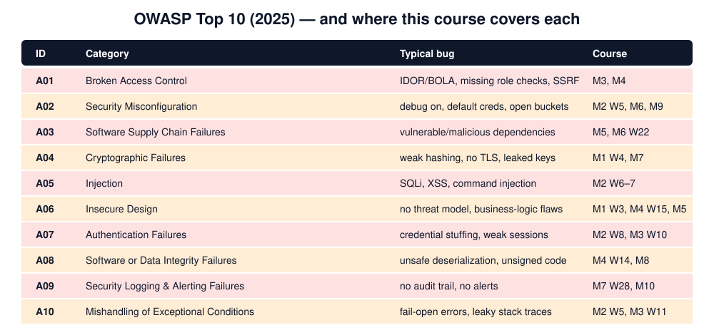
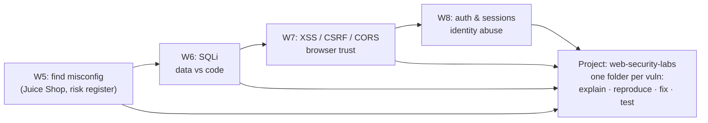

# Month 2 — Web Application Security Fundamentals

> 🟢 **Level 1 · Beginner** · Weeks 5–8 · ~44 h · Tracking issue: [#6](https://github.com/mascot200/cybersecurity-roadmap/issues/6)

**Goal:** understand common web vulnerabilities, and reproduce and fix them in controlled labs.

This is the month you start *breaking things*, always in a local lab and always followed by a fix
and a test that proves it. Each vulnerable/fixed lab app in these lessons was run, and its test suite
fails on the vulnerable version and passes on the fixed one.

## Weekly plan

| Week | Lesson | You will build / prove | Est. time |
|---|---|---|---|
| 5 | [OWASP and security misconfiguration](week-05-owasp-misconfiguration.md) | Juice Shop misconfig challenges, risk register, misconfig fix | 10 h |
| 6 | [SQL injection and input handling](week-06-sql-injection-input-handling.md) | Exploit 8 SQLi techniques, fix with parameters, regression tests | 10–12 h |
| 7 | [Browser security: XSS, CSRF, CORS](week-07-browser-security.md) | XSS/CSRF/CORS lab, CSP, sanitizer, tests | 12 h |
| 8 | [Authentication and sessions](week-08-authentication-sessions.md) | Throttling, safe password reset, session invalidation, mutation-tested | 10–12 h |
| — | [Month project](project.md) | **`web-security-labs` repository** | woven into weeks |
| — | [Monthly drill](drill.md) | ≥ 80% (includes Month 1 review) | 60 min |

## How the labs fit together

## The pattern you'll repeat all month

1. **Explain** the vulnerability's root cause in one sentence.
2. **Reproduce** it locally, with the exact request and response.
3. **Write a failing test** that captures the attack.
4. **Fix** the root cause, not the symptom.
5. **Prove** the test passes, and try a variant payload to check the fix is general.

## Milestone (must demonstrate before Month 3)

- [ ] Given a code snippet, **distinguish vulnerable from secure code** for SQLi, XSS, CSRF, CORS and auth flows
- [ ] **Explain why each fix works**, not only what it is
- [ ] `web-security-labs` repo with at least 6 documented vulnerabilities, each with a regression test

## Recommended resources

- **PortSwigger Web Security Academy** — <https://portswigger.net/web-security>
- **OWASP Juice Shop** — <https://owasp.org/www-project-juice-shop/>
- **OWASP Cheat Sheet Series** — <https://cheatsheetseries.owasp.org/>

---
[← Month 1](../month-01-security-foundations/README.md) · [Course home](../../../README.md) · [Start Week 5 →](week-05-owasp-misconfiguration.md)
