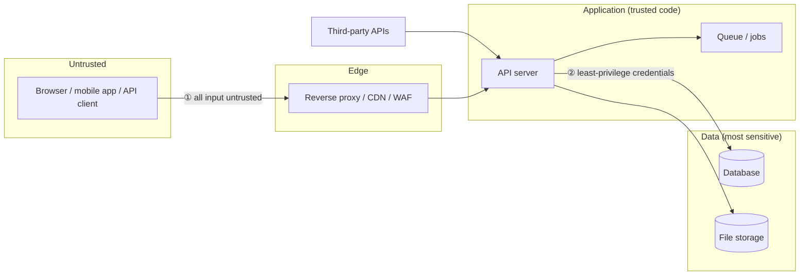

# Week 5 — OWASP and Security Misconfiguration

> **Level:** Beginner · **Time:** ~10 h · **Tracking:** [issue #6](https://github.com/mascot200/cybersecurity-roadmap/issues/6)

## 🎯 Objectives

1. Name the OWASP Top 10 categories and give a concrete bug for each.
2. Identify trust boundaries and unsafe defaults in a web application.
3. Find and fix common misconfigurations: verbose errors, default credentials, missing security headers, exposed files, debug modes.
4. Build a risk register ranked by likelihood × impact.
5. Run OWASP Juice Shop safely and use it as a practice target.

## 🌍 Why it matters

**Real-world scenarios:**
- **Capital One (2019)** — a misconfigured web application firewall plus SSRF exposed cloud credentials; ~100 million customer records were taken. Misconfiguration was the root cause, not a novel exploit.
- **Exposed `.git` directories and `.env` files** are found constantly by automated scanners; they leak source code, database passwords and API keys.
- **Default credentials** (admin/admin) on admin panels, databases and IoT devices remain one of the most common initial access methods.

Misconfiguration is attractive to attackers because it's **cheap to find at scale**: one scanner, millions of targets.

---

## 📖 Concepts

### 1. The OWASP Top 10


The OWASP Top 10 is an **awareness document** ranking the most important web application risk
categories, based on data from many organizations. It's not a complete checklist — for that, use
**OWASP ASVS** (Application Security Verification Standard), which you'll use in Month 12.

> The list is updated every few years (2017, 2021, 2025). Check <https://owasp.org/Top10/> for the
> current version; categories are renamed/merged between editions.

### 2. Trust boundaries in a web app

A **trust boundary** is any point where data moves from a less-trusted to a more-trusted context.
Every one is a place to validate, authorize and log.



Common mistake: trusting data because it came from "our" frontend, "our" mobile app, or an
internal service. **The client is never trusted** — an attacker can send any request with curl or Burp.

### 3. Security misconfiguration — catalogue

| Misconfiguration | How it's found | Impact | Fix |
|---|---|---|---|
| Stack traces / verbose errors in responses | Send malformed input | Leaks framework versions, file paths, SQL | Generic error to client, details to logs |
| Debug mode / dev tools in prod | `/debug`, `/__webpack_hmr`, `NODE_ENV!=production` | Code execution, info leak | Separate configs, CI checks |
| Default credentials | Try vendor defaults | Full takeover | Force change on first use, no defaults |
| Exposed files: `.git/`, `.env`, backups (`db.sql.bak`) | Request common paths | Source code, secrets | Don't deploy them; deny dotfiles at proxy |
| Directory listing enabled | Browse `/uploads/` | Data exposure | Disable autoindex |
| Missing security headers | Inspect response headers | Easier XSS/clickjacking | CSP, HSTS, X-Content-Type-Options, frame-ancestors |
| Permissive CORS (`*` with credentials, reflected origin) | Send `Origin: https://evil.example` | Cross-site data theft | Explicit allowlist |
| Unnecessary features/ports/services | Port scan, endpoint discovery | Larger attack surface | Remove what you don't use |
| Cloud storage public | Cloud scanners | Mass data leaks | Block public access (Month 7) |
| Out-of-date software | Version banners, SCA | Known exploits | Patch process (Month 5–6) |

### 4. Security headers you should know

| Header | Example value | Purpose |
|---|---|---|
| `Content-Security-Policy` | `default-src 'self'; script-src 'self'; object-src 'none'; frame-ancestors 'none'; base-uri 'none'` | Restricts where scripts and other resources load from → limits XSS |
| `Strict-Transport-Security` | `max-age=31536000; includeSubDomains` | Forces HTTPS for the domain |
| `X-Content-Type-Options` | `nosniff` | Stops MIME sniffing (e.g. treating an upload as script) |
| `Referrer-Policy` | `strict-origin-when-cross-origin` | Limits URL leakage to other sites |
| `X-Frame-Options` / CSP `frame-ancestors` | `DENY` / `'none'` | Prevents clickjacking |
| `Permissions-Policy` | `camera=(), geolocation=()` | Disables powerful browser features |
| (remove) `X-Powered-By`, `Server` versions | — | Reduce fingerprinting |

In Express, `helmet` sets sensible defaults: `app.use(helmet())`.

### 5. Errors done right

```js
// ❌ Leaks internals to the attacker
app.use((err, req, res, next) => res.status(500).send(err.stack));

// ✅ Correlation ID for support; details only in server logs
import crypto from 'node:crypto';
app.use((err, req, res, next) => {
  const id = crypto.randomUUID();
  req.log?.error({ err, id }, 'unhandled error');   // or console.error in a lab
  res.status(500).json({ error: 'Internal error', id });
});
```

Also **fail closed**: if an exception happens during an authorization check, the request must be denied, not allowed.

### 6. Risk register

A risk register is a living table of risks, owners and decisions. Format used in this course:

| ID | Risk (attacker story) | Asset | Likelihood (1–3) | Impact (1–3) | Score | Owner | Treatment | Status |
|---|---|---|---|---|---|---|---|---|
| R1 | Anyone can download `/.env` and get DB password | DB, all data | 3 | 3 | 9 | Dev lead | Mitigate: deny dotfiles at proxy; rotate creds | Open |

---

## 🧪 Lab — Juice Shop + misconfiguration hunt (3 h)

**1. Run OWASP Juice Shop (bound to localhost only)**

```bash
docker run --rm -d --name juice -p 127.0.0.1:3000:3000 bkimminich/juice-shop
```
Open `http://127.0.0.1:3000` through Burp's browser.

**2. Find the Score Board** — Juice Shop tracks your progress on a hidden page. Hint: look at the
JavaScript bundle in DevTools → Sources and search for "score".

**3. Misconfiguration challenges** (search the Score Board for these categories):
- *Error Handling* — provoke an error that reveals too much.
- *Confidential Document* — find a file that shouldn't be public (hint: an FTP-like directory).
- *Exposed Metrics* — find a monitoring endpoint.

For each: write **what you did, why it worked, and the fix** in your notes.

**4. Header review** — compare response headers:

```bash
curl -sI http://127.0.0.1:3000 | sort
curl -sI https://github.com | sort
```
Which security headers does each set? What's missing from Juice Shop?

**5. Build a misconfigured Express app and fix it** — `~/cybersecurity-journey/labs/misconfig/`:

```bash
npm init -y && npm pkg set type=module && npm i express helmet
```

`bad.js`:
```js
import express from 'express';
const app = express();
app.use(express.static('.', { dotfiles: 'allow' }));       // serves .env, .git!
app.get('/user/:id', (req, res) => {
  if (!/^\d+$/.test(req.params.id)) throw new Error(`Bad id ${req.params.id} in db.users lookup at ${process.cwd()}`);
  res.json({ id: req.params.id });
});
app.use((err, req, res, next) => res.status(500).send(err.stack));
app.listen(3001, '127.0.0.1');
```

```bash
echo "DB_PASSWORD=lab-only-secret" > .env
node bad.js &
curl -s http://127.0.0.1:3001/.env            # secret leaked
curl -s http://127.0.0.1:3001/user/abc        # stack trace with paths
curl -sI http://127.0.0.1:3001/user/1         # X-Powered-By: Express, no security headers
kill %1
```

Now write `good.js` that: serves only a `public/` directory with `dotfiles: 'deny'`, uses `helmet()`,
validates `id` and returns `400` with a generic message, and has a safe error handler. Re-run the
three curl commands and record before/after.

---

## 📝 Assignment — Risk map of an application you own

**Task:** map risks in an application you own and rank them by likelihood and impact.

### Steps
1. Pick an app you built (side project, work app with permission, or the `auth-demo` from Week 4).
2. Draw its architecture with trust boundaries (Mermaid is fine).
3. Walk through each OWASP Top 10 category and ask "could this happen here?" Record evidence (code line, config, header output).
4. Run quick checks: `curl -sI` for headers; request `/.env`, `/.git/HEAD`, `/server-status`, `/debug`; provoke an error; check `npm audit`.
5. Build a **risk register** with at least 8 risks, scored and sorted.
6. Fix the top 2 risks and show before/after evidence.

### Acceptance criteria
- [ ] Architecture diagram with trust boundaries
- [ ] OWASP Top 10 walkthrough table (category → applicable? → evidence)
- [ ] Risk register ≥ 8 rows with likelihood, impact, score, owner, treatment
- [ ] Top 2 risks fixed with before/after evidence
- [ ] Juice Shop: Score Board + 3 misconfiguration challenges solved and written up

---

## 💼 On the job

Security engineers run **configuration reviews** before launch and continuous checks after (header
scanners, cloud posture tools, CI policy checks). Risk registers are what you present to leadership
to get time allocated for fixes.

## ⚠️ Common mistakes

- Treating the Top 10 as a complete security standard (it's awareness; use ASVS for verification).
- Adding headers but with weak values (e.g. CSP with `'unsafe-inline'` and `*`).
- Relying on obscurity ("nobody knows that URL").
- Ranking risks by gut feel without writing down likelihood and impact separately.

## 🥊 Drill (pass mark 8/10)

**1.** What's the difference between the OWASP Top 10 and OWASP ASVS?
<details><summary>Answer</summary>Top 10 is an awareness list of the most critical risk categories; ASVS is a detailed, testable requirements standard used to verify an application.</details>

**2.** Name three things an exposed `.git` directory can leak.
<details><summary>Answer</summary>Full source code (and history), hard-coded secrets in old commits, internal hostnames/paths, author emails.</details>

**3.** Why is returning `err.stack` to the client dangerous?
<details><summary>Answer</summary>It reveals framework/library versions, file paths, code structure and sometimes queries or data — reconnaissance for further attacks.</details>

**4.** What does `X-Content-Type-Options: nosniff` prevent?
<details><summary>Answer</summary>The browser guessing (sniffing) a different content type, e.g. executing an uploaded "text" file as JavaScript.</details>

**5.** Which CSP directive prevents your page from being framed?
<details><summary>Answer</summary><code>frame-ancestors 'none'</code> (or a list of allowed origins).</details>

**6.** Spot the issue: `app.use(cors({ origin: true, credentials: true }))`
<details><summary>Answer</summary><code>origin: true</code> reflects any request Origin, and with credentials allowed, any website can make authenticated requests and read the responses. Use an explicit allowlist.</details>

**7.** Likelihood 2, impact 3 — what score and level in our matrix?
<details><summary>Answer</summary>6 → High.</details>

**8.** Give two reasons misconfigurations are so common.
<details><summary>Answer</summary>Insecure defaults in frameworks/products; config drift across environments; manual changes; lack of automated checks; many settings and services.</details>

**9.** Scenario: a scanner reports `Server: nginx/1.18.0`. Is it a vulnerability?
<details><summary>Answer</summary>By itself it's information disclosure (low). The real question is whether that version has known vulnerabilities that apply — check and patch. Hiding the banner reduces fingerprinting but doesn't fix outdated software.</details>

**10.** What does "fail closed" mean for error handling in authorization?
<details><summary>Answer</summary>If an error occurs while deciding whether to allow access, the request is denied by default.</details>

## ✅ Checklist
- [ ] Juice Shop running on localhost only; Score Board found
- [ ] Misconfig lab before/after evidence
- [ ] Assignment acceptance criteria met
- [ ] Drill ≥ 8/10, weekly log on issue #6

## 📚 Resources
- OWASP Top 10 — <https://owasp.org/Top10/>
- OWASP Juice Shop — <https://owasp.org/www-project-juice-shop/> · companion guide <https://pwning.owasp-juice.shop/>
- OWASP Secure Headers Project — <https://owasp.org/www-project-secure-headers/>
- OWASP Error Handling Cheat Sheet — <https://cheatsheetseries.owasp.org/cheatsheets/Error_Handling_Cheat_Sheet.html>

---
[← Month overview](README.md) · [Next: Week 6 — SQL injection →](week-06-sql-injection-input-handling.md)
