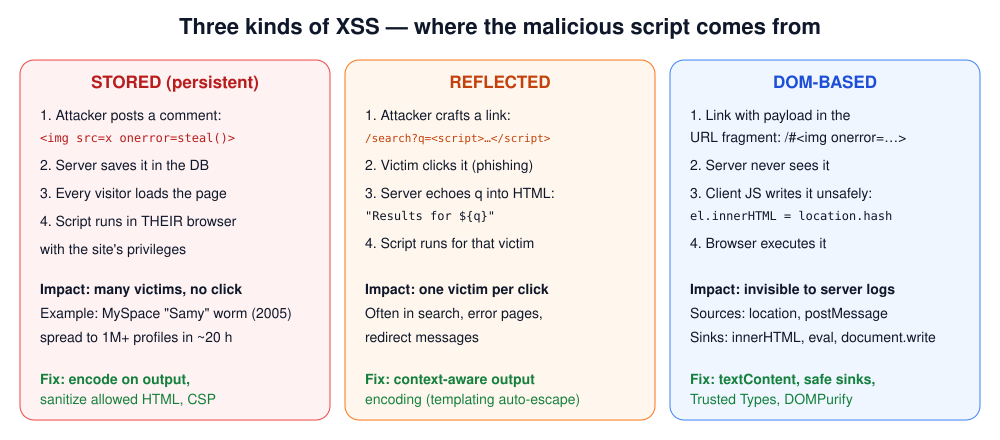
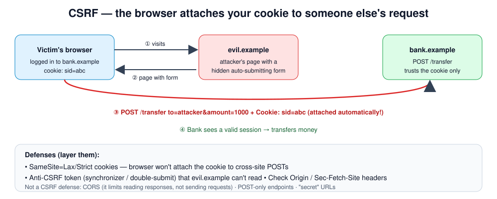
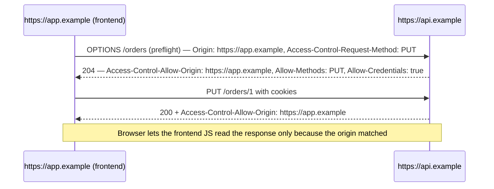

# Week 7 — Browser Security: XSS, CSRF, CORS and Browser Controls

> **Level:** Beginner · **Time:** ~12 h · **Tracking:** [issue #6](https://github.com/mascot200/cybersecurity-roadmap/issues/6)

## 🎯 Objectives

1. Explain the **Same-Origin Policy**, which most browser security is built on.
2. Exploit and fix reflected, stored and DOM-based XSS; apply context-aware output encoding and CSP.
3. Exploit and fix CSRF using SameSite cookies and anti-CSRF tokens.
4. Explain what CORS is (a controlled *relaxation* of SOP) and spot dangerous CORS configurations.
5. Prove every fix with an automated test.

## 🌍 Why it matters

**Real-world scenarios:**
- **British Airways (2018):** attackers modified a JavaScript file on the payment page (a Magecart-style
  attack), skimming the card details of hundreds of thousands of customers. Script integrity and a strict CSP limit this kind of attack.
- **MySpace "Samy" worm (2005):** one stored-XSS payload added more than a million friends in about 20 hours.
- **CSRF in home routers:** for years, visiting a malicious page could silently change a router's DNS
  settings, because the admin panel trusted the browser's cookie or basic-auth session alone.

XSS is the most common serious vulnerability class in web apps. When an attacker can run JavaScript
in your origin, they *are* the user: they can read data, make requests, and change account settings.

---

## 📖 Concepts

### 1. The Same-Origin Policy (SOP)

An **origin** is `scheme + host + port`. `https://app.example.com:443` and `https://api.example.com`
are **different origins**.

SOP says a script from origin A can **send** requests to origin B (forms, images, fetch), but it **cannot
read** B's responses, unless B explicitly allows it (CORS).

| Can JS on `evil.example`… | to `bank.example`? |
|---|---|
| Submit a form / send a request | ✅ yes, and cookies may be attached (→ CSRF) |
| Read the response | ❌ no (unless CORS allows) |
| Read `bank.example` cookies / DOM | ❌ no |

**XSS bypasses SOP entirely**, because the attacker's script runs *inside* `bank.example`.

### 2. Cross-Site Scripting (XSS)



**The fix is context-aware output encoding.** The same data needs different encoding depending on where it's placed:

| Context | Example | Encoding |
|---|---|---|
| HTML body | `<p>USER</p>` | HTML entity encode `& < > " '` |
| HTML attribute (quoted) | `<input value="USER">` | HTML attribute encode, always quote attributes |
| URL parameter | `<a href="/s?q=USER">` | `encodeURIComponent` |
| URL itself | `<a href="USER">` | Validate scheme (`https:` only), since `javascript:alert(1)` has no `<` |
| JavaScript | `<script>var x = USER</script>` | Avoid. Put data in a `data-` attribute or JSON and read it with JS |
| CSS | `style="color: USER"` | Avoid. Use an allowlist of values |

**Frameworks help:** React JSX, Vue `{{ }}`, Angular templates, EJS `<%= %>` and Handlebars `{{ }}`
auto-escape. The danger is in their escape hatches: `dangerouslySetInnerHTML`, `v-html`,
`[innerHTML]`, EJS `<%- %>`, Handlebars `{{{ }}}`.

**If you must allow some HTML** (rich-text comments), sanitize it with a vetted library such as DOMPurify
using an allowlist of tags and attributes. Never write your own regex sanitizer.

**DOM XSS sources and sinks:**

```js
// ❌ source → dangerous sink
document.getElementById('msg').innerHTML = new URLSearchParams(location.search).get('m');
// ✅ safe sink
document.getElementById('msg').textContent = new URLSearchParams(location.search).get('m');
```

Dangerous sinks: `innerHTML`, `outerHTML`, `document.write`, `eval`, `setTimeout(string)`,
`new Function`, `element.setAttribute('on…')`, `location = userInput`, jQuery `$(userInput)`/`.html()`.

### 3. Content Security Policy (CSP): a second layer

CSP tells the browser which sources of script, style and frames are allowed. A good CSP turns many XSS
bugs into non-exploitable ones, because inline `<script>` and `onerror=` handlers don't run.

```
Content-Security-Policy: default-src 'self'; script-src 'self'; object-src 'none';
                         base-uri 'none'; frame-ancestors 'none'
```

- Avoid `'unsafe-inline'` and `'unsafe-eval'` in `script-src`. They cancel most of the protection.
- For apps that need inline scripts, use **nonces** (`'nonce-<random per response>'`) or hashes.
- Roll out with `Content-Security-Policy-Report-Only` first to find breakage.
- CSP is **defense in depth**. Output encoding is still the fix.

### 4. Cross-Site Request Forgery (CSRF)



CSRF works because browsers **automatically attach cookies** to requests to a site, even when the
request was triggered by another site.

Requirements for CSRF: (1) a state-changing action, (2) cookie-based (or other ambient) authentication,
(3) no unpredictable parameter the attacker can't know.

**Defenses:**

| Defense | How it works | Notes |
|---|---|---|
| `SameSite=Lax` (browser default in Chromium if unset) | Cookie isn't sent on cross-site subrequests or POSTs | Still sent on top-level GET navigations, so **never change state with GET** |
| `SameSite=Strict` | Never sent cross-site | Users arriving from links appear logged out |
| **Synchronizer token** | Server puts a random per-session token in forms; checks it on POST | The attacker can't read it (SOP) |
| Double-submit cookie | Token in a cookie and in a header/body; they must match | Use a signed variant |
| Check `Origin` / `Sec-Fetch-Site` | Reject state changes from foreign origins | A good extra layer |
| Re-authentication for critical actions | Password/MFA before changing email, password or payout | Also limits XSS impact |

APIs that use `Authorization: Bearer` headers (not cookies) aren't vulnerable to classic CSRF, because
the browser doesn't attach the token automatically.

### 5. CORS: relaxing SOP, carefully

CORS lets a server say "origin X may **read** my responses".



| Configuration | Risk |
|---|---|
| `Access-Control-Allow-Origin: *` without credentials | OK for truly public data |
| Reflecting any `Origin` + `Allow-Credentials: true` | **Critical:** any site can read logged-in users' data |
| Allowing `null` origin | Sandboxed iframes and `file:` pages send `null`, so attackers can too |
| Regex like `/example\.com$/` | `evil-example.com` matches. Use exact string allowlists |

**CORS is not a CSRF defense.** It controls *reading* responses, not *sending* requests.

### 6. Other browser controls

- **Clickjacking:** framing your site invisibly over a decoy. Fix with CSP `frame-ancestors 'none'` (or `X-Frame-Options: DENY`).
- **Subresource Integrity (SRI):** `<script src="https://cdn…/lib.js" integrity="sha384-…" crossorigin="anonymous">` makes the browser refuse a modified CDN file.
- **Trusted Types:** a CSP feature that blocks strings from reaching DOM XSS sinks unless they've passed through a policy.
- **Cookie prefixes:** `__Host-` (see Month 1 Week 4).

---

## 🧪 Lab — XSS, CSRF and CORS: break, fix, prove (4–5 h)

### Setup

```bash
mkdir -p ~/cybersecurity-journey/labs/browser-lab && cd $_
npm init -y && npm pkg set type=module
npm i express helmet cookie-parser && npm i -D vitest supertest
```

These files were tested: `fixed.js` passes 8/8, and `vulnerable.js` fails the 6 security tests while passing the 2 functional ones.

`vulnerable.js`

```js
// ⚠️ INTENTIONALLY VULNERABLE — localhost lab only
import express from 'express';
import cookieParser from 'cookie-parser';
import crypto from 'node:crypto';

export const app = express();
app.use(express.urlencoded({ extended: false }));
app.use(cookieParser());

const comments = [];
const sessions = new Map();                 // sid -> { user, balance }

app.get('/login', (req, res) => {           // demo "login": gives you a session
  const sid = crypto.randomBytes(16).toString('hex');
  sessions.set(sid, { user: 'alice', balance: 1000 });
  res.cookie('sid', sid, { httpOnly: false, sameSite: 'none', secure: true });   // ❌ readable by JS, sent cross-site
  res.send('logged in as alice');
});

// Reflected XSS: q is inserted into HTML without encoding
app.get('/search', (req, res) => {
  res.send(`<h1>Results for ${req.query.q ?? ''}</h1>`);
});

// Stored XSS: comments saved and rendered raw
app.post('/comments', (req, res) => { comments.push(req.body.text ?? ''); res.redirect('/comments'); });
app.get('/comments', (req, res) => {
  res.send(`<form method="post"><input name="text"><button>Post</button></form>
            <ul>${comments.map(c => `<li>${c}</li>`).join('')}</ul>`);
});

// CSRF: state change trusts the cookie alone
app.post('/transfer', (req, res) => {
  const s = sessions.get(req.cookies.sid);
  if (!s) return res.status(401).send('login first');
  s.balance -= Number(req.body.amount);
  res.send(`sent ${req.body.amount} to ${req.body.to}; balance ${s.balance}`);
});

// CORS: reflects any origin AND allows credentials
app.get('/api/me', (req, res) => {
  const s = sessions.get(req.cookies.sid);
  res.set('Access-Control-Allow-Origin', req.headers.origin ?? '*');
  res.set('Access-Control-Allow-Credentials', 'true');
  res.json(s ?? {});
});
```

`fixed.js`

```js
import express from 'express';
import cookieParser from 'cookie-parser';
import helmet from 'helmet';
import crypto from 'node:crypto';

export const app = express();
app.use(express.urlencoded({ extended: false, limit: '10kb' }));
app.use(cookieParser());
app.use(helmet({
  contentSecurityPolicy: {
    directives: {
      defaultSrc: ["'self'"],
      scriptSrc: ["'self'"],            // no inline scripts, no third-party scripts
      objectSrc: ["'none'"],
      baseUri: ["'none'"],
      frameAncestors: ["'none'"],
    },
  },
}));

// Context-aware output encoding for HTML body/attribute contexts.
// In real apps use a templating engine that auto-escapes (EJS <%= %>, Handlebars {{ }}, React JSX).
const escapeHtml = (s) => String(s).replace(/[&<>"']/g, (c) => (
  { '&': '&amp;', '<': '&lt;', '>': '&gt;', '"': '&quot;', "'": '&#39;' }[c]
));

const comments = [];
const sessions = new Map();               // sid -> { user, balance, csrf }
const ALLOWED_ORIGINS = new Set(['http://127.0.0.1:5173']);   // your real frontend(s)

app.get('/login', (req, res) => {
  const sid = crypto.randomBytes(32).toString('base64url');
  sessions.set(sid, { user: 'alice', balance: 1000, csrf: crypto.randomBytes(32).toString('base64url') });
  res.cookie('sid', sid, { httpOnly: true, secure: true, sameSite: 'lax' });
  res.send('logged in as alice');
});

function session(req, res, next) {
  const s = sessions.get(req.cookies.sid);
  if (!s) return res.status(401).send('login first');
  req.s = s;
  next();
}

// Synchronizer-token CSRF check for every state-changing request
function csrf(req, res, next) {
  const sent = Buffer.from(String(req.body._csrf ?? ''));
  const expected = Buffer.from(req.s.csrf);
  if (sent.length !== expected.length || !crypto.timingSafeEqual(sent, expected)) {
    return res.status(403).send('CSRF check failed');
  }
  next();
}

app.get('/search', (req, res) => {
  res.send(`<h1>Results for ${escapeHtml(req.query.q ?? '')}</h1>`);
});

app.get('/comments', session, (req, res) => {
  res.send(`<form method="post">
              <input type="hidden" name="_csrf" value="${escapeHtml(req.s.csrf)}">
              <input name="text"><button>Post</button></form>
            <ul>${comments.map(c => `<li>${escapeHtml(c)}</li>`).join('')}</ul>`);
});
app.post('/comments', session, csrf, (req, res) => {
  comments.push(String(req.body.text ?? '').slice(0, 500));
  res.redirect('/comments');
});

app.post('/transfer', session, csrf, (req, res) => {
  const amount = Number(req.body.amount);
  if (!Number.isInteger(amount) || amount <= 0 || amount > req.s.balance) {
    return res.status(400).send('invalid amount');
  }
  req.s.balance -= amount;
  res.send(`sent ${amount} to ${escapeHtml(req.body.to)}; balance ${req.s.balance}`);
});

app.get('/api/me', (req, res) => {
  const origin = req.headers.origin;
  if (origin && ALLOWED_ORIGINS.has(origin)) {
    res.set('Access-Control-Allow-Origin', origin);
    res.set('Access-Control-Allow-Credentials', 'true');
    res.set('Vary', 'Origin');
  }
  const s = sessions.get(req.cookies.sid);
  if (!s) return res.status(401).json({});
  res.json({ user: s.user, balance: s.balance });
});
```

`browser.test.js`

```js
import { describe, it, expect } from 'vitest';
import request from 'supertest';

const target = process.env.TARGET ?? 'fixed';
const { app } = await import(`./${target}.js`);

async function login() {
  const res = await request(app).get('/login');
  return res.headers['set-cookie'][0].split(';')[0];        // "sid=..."
}

describe(`browser security (${target})`, () => {
  it('encodes reflected input in /search', async () => {
    const res = await request(app).get('/search').query({ q: '<script>alert(1)</script>' });
    expect(res.text).not.toContain('<script>alert(1)</script>');
    expect(res.text).toContain('&lt;script&gt;');
  });

  it('encodes stored comments', async () => {
    const cookie = await login();
    const page = await request(app).get('/comments').set('Cookie', cookie);
    const token = /name="_csrf" value="([^"]+)"/.exec(page.text)?.[1] ?? '';
    await request(app).post('/comments').set('Cookie', cookie)
      .type('form').send({ text: '', _csrf: token });
    const res = await request(app).get('/comments').set('Cookie', cookie);
    expect(res.text).not.toContain('');
  });

  it('sends a restrictive Content-Security-Policy', async () => {
    const res = await request(app).get('/search');
    const csp = res.headers['content-security-policy'] ?? '';
    expect(csp).toContain("script-src 'self'");
    expect(csp).toContain("frame-ancestors 'none'");
  });

  it('session cookie is HttpOnly and SameSite=Lax', async () => {
    const res = await request(app).get('/login');
    expect(res.headers['set-cookie'][0]).toMatch(/HttpOnly/);
    expect(res.headers['set-cookie'][0]).toMatch(/SameSite=Lax/);
  });

  it('rejects a cross-site transfer without a CSRF token', async () => {
    const cookie = await login();
    const res = await request(app).post('/transfer').set('Cookie', cookie)
      .set('Origin', 'https://evil.example').type('form').send({ to: 'mallory', amount: '500' });
    expect(res.status).toBe(403);
  });

  it('accepts a transfer with a valid CSRF token', async () => {
    const cookie = await login();
    const page = await request(app).get('/comments').set('Cookie', cookie);
    const token = /name="_csrf" value="([^"]+)"/.exec(page.text)?.[1];
    const res = await request(app).post('/transfer').set('Cookie', cookie)
      .type('form').send({ to: 'bob', amount: '10', _csrf: token });
    expect(res.status).toBe(200);
  });

  it('does not grant CORS to an untrusted origin', async () => {
    const cookie = await login();
    const res = await request(app).get('/api/me').set('Cookie', cookie).set('Origin', 'https://evil.example');
    expect(res.headers['access-control-allow-origin']).toBeUndefined();
  });

  it('grants CORS to the allowlisted frontend', async () => {
    const cookie = await login();
    const res = await request(app).get('/api/me').set('Cookie', cookie).set('Origin', 'http://127.0.0.1:5173');
    expect(res.headers['access-control-allow-origin']).toBe('http://127.0.0.1:5173');
  });
});
```

`serve.js`

```js
const target = process.argv[2] ?? 'fixed';
const { app } = await import(`./${target}.js`);
app.listen(3003, 'localhost', () => console.log(`${target} on http://localhost:3003`));
```

### Step 1 — Prove the bugs exist, then that the fixes work

```bash
TARGET=vulnerable npx vitest run   # 6 failed | 2 passed
npx vitest run                     # 8 passed
```

> 🧭 **Browser notes for Steps 2–5:** use Chromium (e.g. Burp's built-in browser). Open the app at
> **`http://localhost:3003`**, because browsers accept `Secure` cookies over plain HTTP only on
> `localhost`. Serve the attacker page from **`http://127.0.0.1:8081`**: `localhost` and `127.0.0.1`
> are different *sites*, so it's a realistic cross-site attack. If something doesn't behave as described,
> check DevTools → Application → Cookies and the Network tab, and write down what you see.

### Step 2 — Reflected XSS in a real browser

```bash
node serve.js vulnerable &
```
Visit `http://localhost:3003/login`, then:
`http://localhost:3003/search?q=`

The alert shows the session cookie, because the vulnerable cookie isn't `HttpOnly`. Try the same URL
against `node serve.js fixed`: the payload is shown as text, and the response carries the CSP header.

### Step 3 — Stored XSS

On the vulnerable `/comments` page, post ``.
Reload the page in another browser profile: it fires for **every** visitor.

### Step 4 — CSRF from an "attacker" site

Create `evil.html`:

```html
<!doctype html>
<h1>You won a prize! 🎉</h1>
<form id="f" action="http://localhost:3003/transfer" method="POST">
  <input type="hidden" name="to" value="mallory">
  <input type="hidden" name="amount" value="500">
</form>
<script>document.getElementById('f').submit();</script>
```

```bash
python3 -m http.server 8081 --bind 127.0.0.1    # in the folder containing evil.html
```

1. **Vulnerable app:** log in at `http://localhost:3003/login`, then visit `http://127.0.0.1:8081/evil.html`.
   Result: `sent 500 to mallory`. The cookie is `SameSite=None`, so the browser attached it to the cross-site POST.
2. **Fixed app:** repeat. Result: `login first`. The `SameSite=Lax` cookie wasn't sent on a cross-site POST.
3. **Same-site attacker:** browse to the attacker page as `http://localhost:8081/evil.html` instead.
   Same-site means scheme + registrable domain; **ports don't count**, so `SameSite` no longer helps.
   Against the fixed app you now get `403 CSRF check failed`, because the token is the layer that held.
   This is why real apps layer both: a subdomain you don't fully control (`blog.example.com`) is
   "same-site" with `app.example.com`.

Write down why the attacker page can't just read the token first. (Hint: SOP.)

### Step 5 — CORS misconfiguration

Open DevTools on the attacker page (`http://127.0.0.1:8081/evil.html` with the auto-submit removed, or
any page on that origin) while logged in to the vulnerable app:

```js
fetch('http://localhost:3003/api/me', { credentials: 'include' }).then(r => r.json()).then(console.log)
```

Vulnerable: your balance is printed, so a foreign site read authenticated data. Fixed: blocked by CORS.
(Some browsers block third-party cookies by default, which hides this bug from *you* but not from
users of other browsers. The automated test is the reliable evidence.)

### Step 6 — DOM XSS (client side only)

Create `public/dom.html`:

```html
<!doctype html>
<p id="greet"></p>
<script>
  const name = new URLSearchParams(location.search).get('name') ?? 'friend';
  document.getElementById('greet').innerHTML = 'Hello ' + name;   // ❌ sink
</script>
```

Serve it, open `dom.html?name=`, then fix it with `textContent` and
confirm. Note that the server never sees anything unusual, because the payload could just as well be in `#fragment`.

### Step 7 — PortSwigger labs

Apprentice labs for **XSS** (reflected, stored, DOM), **CSRF** and **CORS**:
- <https://portswigger.net/web-security/cross-site-scripting>
- <https://portswigger.net/web-security/csrf>
- <https://portswigger.net/web-security/cors>

---

## 📝 Assignment — Safe examples with protections

**Task:** build safe examples and implement appropriate protections.

### Steps
1. Complete the lab in `labs/browser-lab/`.
2. **Add a rich-text comment feature** that allows only `<b>`, `<i>` and `<a href>` (https links only).
   Use `isomorphic-dompurify` (or `sanitize-html`) with an allowlist. Write tests for:
   - `<script>` removed
   - `<a href="javascript:alert(1)">` neutralized
   - `<b>bold</b>` preserved
3. **Switch to a templating engine** (EJS or Handlebars) with auto-escaping, and remove the manual `escapeHtml` from at least one route.
4. **Add an `Origin`/`Sec-Fetch-Site` check** as a second CSRF layer, with a test.
5. **Roll out CSP in report-only mode** on one route, add an inline script, and capture the violation report in the console. Then switch to enforcing mode.
6. Write `README.md` with a table: *vulnerability → exploit used → fix → test name*.

### Acceptance criteria
- [ ] All 8 provided tests pass on `fixed.js`; at least 6 new tests added and passing
- [ ] Rich-text sanitizer with allowlist and the 3 tests above
- [ ] At least one route uses an auto-escaping template engine
- [ ] Second CSRF layer (Origin/Sec-Fetch-Site) tested
- [ ] CSP in enforce mode with no `'unsafe-inline'` in `script-src`
- [ ] PortSwigger XSS, CSRF and CORS apprentice labs complete
- [ ] README table complete

---

## 💼 On the job

- **AppSec review:** search for `dangerouslySetInnerHTML`, `v-html`, `innerHTML`, `<%-`, `{{{`, `cors({ origin: true`, and state-changing GET routes.
- **Bug bounty:** XSS and CORS misconfigurations are among the most reported findings. Impact is proven with a harmless PoC (`alert(document.domain)`), never by stealing real users' data.
- **Platform teams** ship CSP and cookie defaults centrally so individual teams can't forget them.

## ⚠️ Common mistakes

- Escaping on input instead of on output, which double-encodes and still misses contexts.
- Thinking `HttpOnly` prevents XSS. It only prevents cookie theft; the attacker can still act as the user.
- Allowing `'unsafe-inline'` "temporarily".
- Using `GET` for state changes ("GET /delete?id=5").
- Regex-based origin checks.

## 🥊 Drill (pass mark 8/10)

**1.** Are `https://example.com` and `https://example.com:8443` the same origin?
<details><summary>Answer</summary>No. The port differs, so they are different origins (they are the same <em>site</em>, though).</details>

**2.** Why doesn't `HttpOnly` stop XSS from being dangerous?
<details><summary>Answer</summary>The injected script runs as the user in that origin. It can make authenticated requests, read page data and change settings without ever reading the cookie.</details>

**3.** Spot the bug: `<a href="<%= user.website %>">Website</a>` (EJS escaped output)
<details><summary>Answer</summary>HTML escaping doesn't block <code>javascript:alert(1)</code>, which has no special HTML characters. Validate that the URL scheme is http/https before rendering.</details>

**4.** Spot the bug: `res.set('Access-Control-Allow-Origin', req.headers.origin); res.set('Access-Control-Allow-Credentials','true')`
<details><summary>Answer</summary>Origin reflection with credentials means any website can read authenticated responses. Use an exact allowlist and add <code>Vary: Origin</code>.</details>

**5.** Name three conditions that make CSRF possible.
<details><summary>Answer</summary>A state-changing action; authentication the browser sends automatically (cookies, basic auth, client certs); and no unpredictable value (token) the attacker must supply.</details>

**6.** Why can't an attacker's page read your CSRF token from your form?
<details><summary>Answer</summary>The Same-Origin Policy prevents a foreign origin from reading your page's response or DOM.</details>

**7.** Which CSP directive values undermine XSS protection?
<details><summary>Answer</summary><code>'unsafe-inline'</code>, <code>'unsafe-eval'</code>, wildcard sources (<code>*</code>, <code>https:</code>) and overly broad CDNs in <code>script-src</code>.</details>

**8.** What's the difference between DOM XSS and reflected XSS?
<details><summary>Answer</summary>In reflected XSS the server includes the payload in its HTML response. In DOM XSS client-side JavaScript takes the payload from a source (URL, postMessage) and writes it to a dangerous sink; the server may never see it.</details>

**9.** Does `SameSite=Lax` protect `GET /account/delete`?
<details><summary>Answer</summary>No. Lax cookies are sent on top-level GET navigations, so a link or redirect would trigger it. Never change state with GET.</details>

**10.** Scenario: a pentester reports stored XSS in your support ticket system, viewed by admins. Why is this severe?
<details><summary>Answer</summary>The payload executes in admin sessions, so the attacker can perform admin actions, read every customer's data, or create admin accounts. It's high-privilege XSS with a wide blast radius.</details>

## ✅ Checklist
- [ ] Lab steps 1–7
- [ ] Assignment acceptance criteria met
- [ ] Drill ≥ 8/10, weekly log on issue #6

## 📚 Resources
- OWASP XSS Prevention Cheat Sheet — <https://cheatsheetseries.owasp.org/cheatsheets/Cross_Site_Scripting_Prevention_Cheat_Sheet.html>
- OWASP CSRF Prevention Cheat Sheet — <https://cheatsheetseries.owasp.org/cheatsheets/Cross-Site_Request_Forgery_Prevention_Cheat_Sheet.html>
- MDN Same-origin policy — <https://developer.mozilla.org/en-US/docs/Web/Security/Same-origin_policy>
- MDN CORS — <https://developer.mozilla.org/en-US/docs/Web/HTTP/CORS>
- MDN CSP — <https://developer.mozilla.org/en-US/docs/Web/HTTP/CSP>

---
[← Week 6](week-06-sql-injection-input-handling.md) · [Next: Week 8 — Authentication & sessions →](week-08-authentication-sessions.md)
