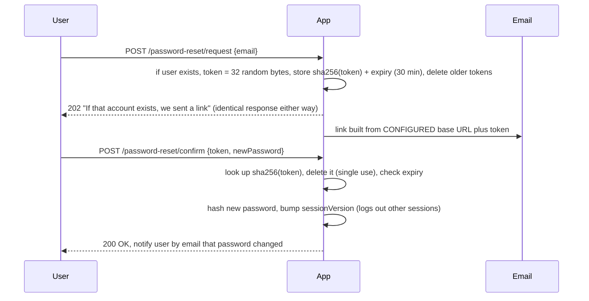

# Week 8 — Authentication and Sessions

> **Level:** Beginner · **Time:** ~10–12 h · **Tracking:** [issue #6](https://github.com/mascot200/cybersecurity-roadmap/issues/6)

## 🎯 Objectives

1. Describe the main attacks on authentication: brute force, credential stuffing, password spraying, user enumeration, session hijacking and account-recovery abuse.
2. Implement login throttling that doesn't make lockout itself an easy denial of service.
3. Design a password reset flow that is single use, expiring, hashed at rest and enumeration-safe.
4. Manage session lifecycle: rotation, idle/absolute expiry, global logout after a password change.
5. Explain where MFA fits and how phishing-resistant MFA (passkeys/WebAuthn) differs from OTP codes.

## 🌍 Why it matters

**Real-world scenarios:**
- **Credential stuffing** is constant: attackers replay billions of leaked email/password pairs against
  login pages. Reused passwords mean a breach at one site becomes account takeover at yours.
- **Uber (2022):** an attacker bought a contractor's stolen password, then spammed MFA push prompts
  ("MFA fatigue") until one was accepted. Push-to-approve MFA without number matching was the weak point.
- **Password reset bugs** keep appearing in bug bounty programs: predictable tokens, tokens that never expire,
  reset links built from the attacker-controlled `Host` header (password-reset poisoning), and
  responses that leak whether an account exists.

Authentication is the front door. Recovery flows are the side door, and they're often weaker.

---

## 📖 Concepts

### 1. Attacks on login

| Attack | Pattern | Detection signal | Primary defenses |
|---|---|---|---|
| Brute force | Many passwords → **one** account | Many failures on one account | Per-account throttling, MFA |
| Password spraying | **One** common password → many accounts | Failures across accounts from same source(s) | Per-IP/ASN throttling, breached/common password ban, MFA |
| Credential stuffing | Leaked pairs → many accounts | High failure ratio, many IPs, bot fingerprints | Breached-password checks, bot detection, MFA, rate limits |
| User enumeration | Different responses/timing for unknown users | Many unknown-user attempts | Identical responses and similar timing |
| Session hijacking | Steal/guess session token | Same session from new IP/device | `HttpOnly`/`Secure`, rotation, short expiry |
| MFA fatigue | Spam push prompts | Many denied pushes | Number matching, phishing-resistant MFA, rate-limit prompts |

### 2. Throttling without self-inflicted DoS

Hard lockout ("account locked for 24 h after 5 failures") lets an attacker lock out any user they like.
Better options, often combined:

- **Progressive delays** or temporary lockout (e.g. 15 min) per account.
- **Per-IP and per-account** limits, so spraying from one IP and brute force against one account are both slowed.
- **CAPTCHA/step-up** after N failures, instead of a hard block.
- Notify the user of suspicious attempts.
- Store counters in a shared store (Redis), not process memory, when you run multiple instances.

### 3. Password policy that actually helps (per NIST SP 800-63B)

- At least **15 characters** when the password is the only factor, at least 8 when it is part of MFA (SP 800-63B rev. 4), with long passphrases allowed (64+ characters).
- **Check new passwords against breached/common lists** (e.g. HIBP k-anonymity API).
- No arbitrary composition rules ("1 symbol, 1 uppercase") and no forced periodic rotation. Force a change only on evidence of compromise.
- Allow paste and password managers.

### 4. Password reset done right



| Rule | Prevents |
|---|---|
| CSPRNG token, ≥ 128 bits | Guessing |
| Store **hash** of token | DB leak → mass account takeover |
| Short expiry, single use, one live token | Replay, old leaked links |
| Identical response for unknown emails | Enumeration |
| Base URL from config, **never `Host` header** | Password-reset poisoning (token sent to attacker's domain) |
| Invalidate sessions after reset | Attacker who's already logged in stays logged in |
| Notify the user | Silent takeover |
| Don't log the token or put it in analytics | Leaks via logs/referrers |

**Security questions** ("mother's maiden name") are weak: answers are guessable or public. Avoid them.

### 5. Session lifecycle checklist

- New session ID at login and at privilege change (prevents fixation).
- Idle timeout (e.g. 15–30 min for sensitive apps) **and** absolute timeout (e.g. 8–12 h).
- Server-side invalidation on logout.
- **Global logout** on password change or reset: store a `sessionVersion` (or a list of sessions) per user and reject sessions with an older version.
- Show users their active sessions and let them revoke them.
- Re-authenticate before sensitive actions (change email/password, add payout account).

### 6. MFA

| Factor type | Example | Phishable? |
|---|---|---|
| SMS / voice OTP | 6-digit code | Yes, plus SIM-swap risk |
| TOTP app | Authenticator app code | Yes, real-time phishing proxies can relay it |
| Push approval | "Approve sign-in?" | Yes (fatigue); number matching helps |
| **WebAuthn / passkeys / FIDO2 keys** | Device-bound key pair, origin-bound | **No**: the browser won't sign for a fake domain |

---

## 🧪 Lab — Throttling, reset flow and tests (4 h)

```bash
mkdir -p ~/cybersecurity-journey/labs/auth-flows && cd $_
npm init -y && npm pkg set type=module
npm i express argon2 && npm i -D vitest supertest
```

The app takes an injectable clock (`now`) and email sender (`sendEmail`), so tests can fast-forward
time and read the "inbox". These files are tested (9/9 passing), and the tests were mutation-checked:
removing the lockout or the single-use deletion makes them fail.

`app.js`

```js
import express from 'express';
import crypto from 'node:crypto';
import argon2 from 'argon2';

const sha256 = (s) => crypto.createHash('sha256').update(s).digest('hex');

export function createApp({ now = () => Date.now(), sendEmail = () => {} } = {}) {
  const app = express();
  app.use(express.json({ limit: '10kb' }));

  const users = new Map();          // email -> { id, email, pwHash, sessionVersion }
  const resetTokens = new Map();    // sha256(token) -> { email, expires }
  const failures = new Map();       // key -> [timestamps]

  const MAX_FAILS = 5;
  const WINDOW_MS = 15 * 60 * 1000;
  const RESET_TTL_MS = 30 * 60 * 1000;
  const dummyHash = argon2.hash('timing-equalizer', { type: argon2.argon2id });

  // --- throttling helpers (in-memory; use Redis in production) ---
  const recent = (key) => (failures.get(key) ?? []).filter((t) => now() - t < WINDOW_MS);
  const recordFailure = (key) => failures.set(key, [...recent(key), now()]);
  const isLocked = (key) => recent(key).length >= MAX_FAILS;

  app.post('/signup', async (req, res) => {
    const { email, password } = req.body ?? {};
    if (typeof email !== 'string' || typeof password !== 'string' || password.length < 12 || password.length > 128) {
      return res.status(400).json({ error: 'Invalid input' });
    }
    const key = email.toLowerCase();
    if (!users.has(key)) {
      users.set(key, { id: crypto.randomUUID(), email: key, pwHash: await argon2.hash(password, { type: argon2.argon2id }), sessionVersion: 1 });
    }
    res.status(202).json({ message: 'Check your email to continue' });     // same response either way
  });

  app.post('/login', async (req, res) => {
    const { email, password } = req.body ?? {};
    if (typeof email !== 'string' || typeof password !== 'string') return res.status(400).end();
    const key = email.toLowerCase();
    const ipKey = `ip:${req.ip}`;
    if (isLocked(`acct:${key}`) || isLocked(ipKey)) {
      return res.status(429).json({ error: 'Too many attempts. Try again later.' });
    }
    const user = users.get(key);
    const ok = await argon2.verify(user ? user.pwHash : await dummyHash, password);
    if (!user || !ok) {
      recordFailure(`acct:${key}`);
      recordFailure(ipKey);
      return res.status(401).json({ error: 'Invalid email or password' });
    }
    failures.delete(`acct:${key}`);
    res.json({ ok: true, sessionVersion: user.sessionVersion });
  });

  // Step 1: request a reset — never reveal whether the account exists
  app.post('/password-reset/request', (req, res) => {
    const email = String(req.body?.email ?? '').toLowerCase();
    const user = users.get(email);
    if (user) {
      const token = crypto.randomBytes(32).toString('base64url');          // 256-bit, CSPRNG
      for (const [h, t] of resetTokens) if (t.email === email) resetTokens.delete(h);   // one live token
      resetTokens.set(sha256(token), { email, expires: now() + RESET_TTL_MS });         // store only a hash
      sendEmail(email, `https://app.example/reset?token=${token}`);         // link built from config, not Host header
    }
    res.status(202).json({ message: 'If that account exists, we sent a reset link' });
  });

  // Step 2: confirm — single use, expiring, invalidates existing sessions
  app.post('/password-reset/confirm', async (req, res) => {
    const { token, newPassword } = req.body ?? {};
    if (typeof token !== 'string' || typeof newPassword !== 'string' || newPassword.length < 12 || newPassword.length > 128) {
      return res.status(400).json({ error: 'Invalid input' });
    }
    const h = sha256(token);
    const entry = resetTokens.get(h);
    resetTokens.delete(h);                                                   // single use, even on failure
    if (!entry || entry.expires < now()) return res.status(400).json({ error: 'Invalid or expired link' });
    const user = users.get(entry.email);
    user.pwHash = await argon2.hash(newPassword, { type: argon2.argon2id });
    user.sessionVersion += 1;                                                // logs out all other sessions
    failures.delete(`acct:${entry.email}`);
    res.json({ ok: true });
  });

  app._test = { users, resetTokens };
  return app;
}
```

`auth.test.js`

```js
import { describe, it, expect } from 'vitest';
import request from 'supertest';
import { createApp } from './app.js';

const email = 'alice@example.com';
const password = 'correct horse battery staple';

function setup() {
  let clock = 1_700_000_000_000;
  const outbox = [];
  const app = createApp({ now: () => clock, sendEmail: (to, link) => outbox.push({ to, link }) });
  return { app, outbox, advance: (ms) => { clock += ms; } };
}
const tokenFrom = (link) => new URL(link).searchParams.get('token');

describe('login throttling', () => {
  it('returns 429 after 5 failed attempts for one account', async () => {
    const { app } = setup();
    await request(app).post('/signup').send({ email, password });
    for (let i = 0; i < 5; i++) {
      expect((await request(app).post('/login').send({ email, password: 'wrong-password-' + i })).status).toBe(401);
    }
    const locked = await request(app).post('/login').send({ email, password });
    expect(locked.status).toBe(429);              // even the right password is refused while locked
  });

  it('unlocks after the window passes', async () => {
    const { app, advance } = setup();
    await request(app).post('/signup').send({ email, password });
    for (let i = 0; i < 5; i++) await request(app).post('/login').send({ email, password: 'nope-nope-nope' });
    advance(15 * 60 * 1000 + 1);
    expect((await request(app).post('/login').send({ email, password })).status).toBe(200);
  });

  it('uses the same error for unknown users and wrong passwords', async () => {
    const { app } = setup();
    await request(app).post('/signup').send({ email, password });
    const a = await request(app).post('/login').send({ email, password: 'wrong-password-x' });
    const b = await request(app).post('/login').send({ email: 'ghost@example.com', password: 'whatever-123456' });
    expect(a.body).toEqual(b.body);
    expect(a.status).toBe(b.status);
  });
});

describe('password reset', () => {
  it('gives the same response whether or not the account exists', async () => {
    const { app, outbox } = setup();
    await request(app).post('/signup').send({ email, password });
    const known = await request(app).post('/password-reset/request').send({ email });
    const unknown = await request(app).post('/password-reset/request').send({ email: 'ghost@example.com' });
    expect(known.status).toBe(unknown.status);
    expect(known.body).toEqual(unknown.body);
    expect(outbox).toHaveLength(1);
  });

  it('stores only a hash of the token', async () => {
    const { app, outbox } = setup();
    await request(app).post('/signup').send({ email, password });
    await request(app).post('/password-reset/request').send({ email });
    const token = tokenFrom(outbox[0].link);
    expect([...app._test.resetTokens.keys()]).not.toContain(token);
  });

  it('resets the password with a valid token, and the token is single use', async () => {
    const { app, outbox } = setup();
    await request(app).post('/signup').send({ email, password });
    await request(app).post('/password-reset/request').send({ email });
    const token = tokenFrom(outbox[0].link);
    const newPassword = 'a brand new long passphrase';
    expect((await request(app).post('/password-reset/confirm').send({ token, newPassword })).status).toBe(200);
    expect((await request(app).post('/password-reset/confirm').send({ token, newPassword: 'attacker reuse 123' })).status).toBe(400);
    expect((await request(app).post('/login').send({ email, password: newPassword })).status).toBe(200);
    expect((await request(app).post('/login').send({ email, password })).status).toBe(401);
  });

  it('rejects expired tokens', async () => {
    const { app, outbox, advance } = setup();
    await request(app).post('/signup').send({ email, password });
    await request(app).post('/password-reset/request').send({ email });
    advance(31 * 60 * 1000);
    const res = await request(app).post('/password-reset/confirm')
      .send({ token: tokenFrom(outbox[0].link), newPassword: 'too late but long enough' });
    expect(res.status).toBe(400);
  });

  it('invalidates older tokens when a new one is requested', async () => {
    const { app, outbox } = setup();
    await request(app).post('/signup').send({ email, password });
    await request(app).post('/password-reset/request').send({ email });
    await request(app).post('/password-reset/request').send({ email });
    const res = await request(app).post('/password-reset/confirm')
      .send({ token: tokenFrom(outbox[0].link), newPassword: 'using the old link here' });
    expect(res.status).toBe(400);
  });

  it('bumps the session version so existing sessions are invalidated', async () => {
    const { app, outbox } = setup();
    await request(app).post('/signup').send({ email, password });
    const before = (await request(app).post('/login').send({ email, password })).body.sessionVersion;
    await request(app).post('/password-reset/request').send({ email });
    await request(app).post('/password-reset/confirm')
      .send({ token: tokenFrom(outbox[0].link), newPassword: 'another long passphrase!' });
    const after = (await request(app).post('/login').send({ email, password: 'another long passphrase!' })).body.sessionVersion;
    expect(after).toBe(before + 1);
  });
});
```

### Steps

1. Run `npx vitest run`. Expect **9 passed**.
2. **Mutation test it yourself:** break one control at a time and confirm a test fails:
   - change `isLocked` to always return `false`
   - remove `resetTokens.delete(h)`
   - store the raw token instead of `sha256(token)`
   - return `404 "No such user"` for unknown emails

   If a mutation doesn't make any test fail, **write the missing test**.
3. **Timing check:** measure average `/login` response time for a known email with a wrong password vs an unknown email (10 requests each). Are they similar? What does `dummyHash` do?
4. **Password-reset poisoning demo:** temporarily build the link with `` `https://${req.headers.host}/reset?token=...` ``, then send the request with `-H 'Host: evil.example'`. Look at the outbox. Then revert.
5. **PortSwigger:** Authentication apprentice labs (username enumeration via different responses, 2FA simple bypass, password reset broken logic): <https://portswigger.net/web-security/authentication>

---

## 📝 Assignment — Abuse-resistant auth tests

**Task:** write tests for invalid credentials, session expiry and abuse-resistant recovery flows.

### Steps
1. Merge this lab with your Month 1 `auth-demo` (sessions + cookies), so you have one app with signup, login, sessions, logout and reset.
2. Use `sessionVersion` to make password reset **log out existing sessions**, and prove it with a test that uses an old session cookie after the reset.
3. Add **per-IP throttling** for password reset requests (e.g. 5 per hour) with a test.
4. Add a **breached-password check** at signup and reset. Offline is fine: reject passwords from a top-1000 common list file. Test it.
5. Add **"password changed" notification** via `sendEmail` and test it's sent.
6. Write `README.md` with a table of every abuse case → control → test name.

### Acceptance criteria
- [ ] Tests for: wrong password, unknown user (same response), lockout + unlock, idle expiry, absolute expiry, logout invalidation
- [ ] Reset tests: enumeration-safe, hashed token, single use, expiry, older tokens invalidated, sessions invalidated, notification sent
- [ ] Reset-request throttling test
- [ ] Common-password rejection test
- [ ] At least 3 mutations tried and recorded (mutation → which test failed)
- [ ] PortSwigger authentication apprentice labs complete

---

## 💼 On the job

- Identity is a top attack target, and companies often have dedicated IAM/identity security teams.
- Detection engineers write rules for spraying (many accounts, few attempts each) and stuffing (high failure ratio across many IPs). You'll do this in Month 10.
- Product security reviews often focus on recovery flows and support-desk processes, because social engineering of helpdesks is a common takeover path.

## ⚠️ Common mistakes

- Different messages: "No account with that email" vs "Wrong password".
- Reset tokens stored in plaintext, never expiring, or reusable.
- Building links from the `Host` header.
- Not invalidating sessions after a password change.
- Throttling only by IP (stuffing uses many IPs) or only by account (spraying hits many accounts).
- Logging request bodies on `/login`.

## 🥊 Drill (pass mark 8/10)

**1.** Difference between password spraying and credential stuffing?
<details><summary>Answer</summary>Spraying tries a few common passwords against many accounts. Stuffing replays known leaked email/password pairs.</details>

**2.** Why store only a hash of the reset token?
<details><summary>Answer</summary>If the database or a backup leaks, live tokens can't be used to take over accounts.</details>

**3.** What is password-reset poisoning?
<details><summary>Answer</summary>The app builds the reset link from the attacker-controlled Host (or X-Forwarded-Host) header, so the victim's email contains a link to the attacker's domain and the token leaks when it's clicked. Fix: base URL from configuration.</details>

**4.** Why might a hard 24-hour lockout be harmful?
<details><summary>Answer</summary>Attackers can deliberately lock out users (denial of service), including executives or support staff, at scale.</details>

**5.** Spot the bug: `if (!user) return res.status(404).json({error:'User not found'})` in `/login`.
<details><summary>Answer</summary>User enumeration. Return the same 401 and message as for a wrong password, with similar timing.</details>

**6.** Which MFA type resists phishing, and why?
<details><summary>Answer</summary>WebAuthn/FIDO2 (passkeys, security keys). The credential is bound to the real origin, so the browser won't produce a valid signature for a look-alike domain.</details>

**7.** After a password reset, what should happen to existing sessions?
<details><summary>Answer</summary>They should be invalidated (except possibly the current one after re-authentication), e.g. by bumping a session version.</details>

**8.** What does NIST SP 800-63B say about forced periodic password changes?
<details><summary>Answer</summary>Don't require them; only require a change when there's evidence of compromise.</details>

**9.** Why does the lab compare against a dummy Argon2 hash for unknown users?
<details><summary>Answer</summary>To keep response timing similar for existing and non-existing users, so timing doesn't reveal which emails are registered.</details>

**10.** Scenario: you see 40,000 failed logins in an hour across 38,000 accounts from 9,000 IPs, with a 0.3% success rate. What is it, and what do you do?
<details><summary>Answer</summary>Credential stuffing. Respond by forcing resets or step-up auth for the accounts that logged in successfully, invalidating their sessions, adding or tightening bot defenses and rate limits, checking passwords against breach lists, notifying affected users, and monitoring for fraud.</details>

## ✅ Checklist
- [ ] Lab steps 1–5
- [ ] Assignment acceptance criteria met
- [ ] Drill ≥ 8/10, weekly log on issue #6

## 📚 Resources
- OWASP Authentication Cheat Sheet — <https://cheatsheetseries.owasp.org/cheatsheets/Authentication_Cheat_Sheet.html>
- OWASP Forgot Password Cheat Sheet — <https://cheatsheetseries.owasp.org/cheatsheets/Forgot_Password_Cheat_Sheet.html>
- OWASP Credential Stuffing Prevention — <https://cheatsheetseries.owasp.org/cheatsheets/Credential_Stuffing_Prevention_Cheat_Sheet.html>
- NIST SP 800-63B — <https://pages.nist.gov/800-63-4/sp800-63b.html>
- PortSwigger Authentication — <https://portswigger.net/web-security/authentication>

---
[← Week 7](week-07-browser-security.md) · [Month project →](project.md)
