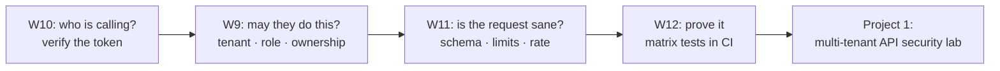

# Month 3 — Backend and API Security

> 🟢 **Level 1 · Beginner** · Weeks 9–12 · ~40 h · Tracking issue: [#7](https://github.com/mascot200/cybersecurity-roadmap/issues/7)

**Goal:** apply security principles to backend APIs, identity and multi-tenant systems.

This month is about building the controls an API needs and proving them with tests. Each lab here
contains the secure implementation and a test suite that sends the requests an attacker would send
(another tenant's ID, a forged or expired token, extra fields in the body) and shows they're rejected.

## Weekly plan

| Week | Lesson | Lab (tested) | Est. time |
|---|---|---|---|
| 9 | [Authorization and multi-tenancy](week-09-authorization-multi-tenancy.md) | [`labs/authz`](labs/authz/): tenant/role/ownership policy, PostgreSQL RLS | 10–12 h |
| 10 | [Tokens and identity protocols](week-10-tokens-identity-protocols.md) | [`labs/jwt`](labs/jwt/): strict JWT verification | 10 h |
| 11 | [API abuse and validation](week-11-api-abuse-validation.md) | [`labs/api-limits`](labs/api-limits/): schemas, limits, rate limiting | 10 h |
| 12 | [API security test suite](week-12-api-security-test-suite.md) | [`labs/authz/authz-matrix.test.js`](labs/authz/authz-matrix.test.js): table-driven matrix, CI | 10 h |
| — | [Month project](project.md) | **Project 1: multi-tenant API security lab** | woven into weeks |
| — | [Monthly drill](drill.md) | ≥ 80% | 45 min |

## Lab status

| Lab | Tests | How it was checked |
|---|---|---|
| `authz` | 28/28 (9 behaviour + 19 matrix rows) | Real PostgreSQL 16; mutation-tested (unscoped query, missing role check) |
| `jwt` | 9/9 | Expired, wrong key, tampered, `alg: none`, wrong `aud`/`iss`, no `exp`, malformed |
| `api-limits` | 9/9 | Mass assignment, output allowlist, types, 413, page cap, 429 |

## How the month fits together

## Milestone (must demonstrate before Month 4)

- [ ] The API has an **explicit, written authorization model** (policy table)
- [ ] **Repeatable security regression tests** run in CI and cover authentication, cross-tenant access, privilege escalation and data exposure
- [ ] You can explain each control and point to the test that proves it

## Recommended resources

- **OWASP API Security Project** — <https://owasp.org/www-project-api-security/>
- **OWASP Web Security Testing Guide** — <https://owasp.org/www-project-web-security-testing-guide/>

---
[← Month 2](../month-02-web-security-fundamentals/README.md) · [Course home](../../../README.md) · [Start Week 9 →](week-09-authorization-multi-tenancy.md)
