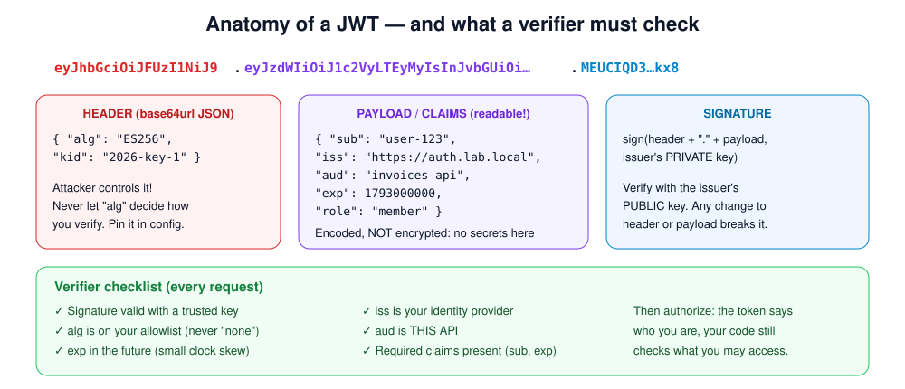
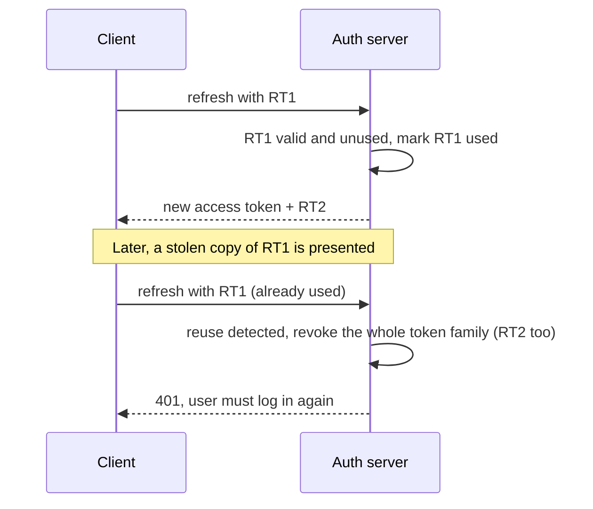
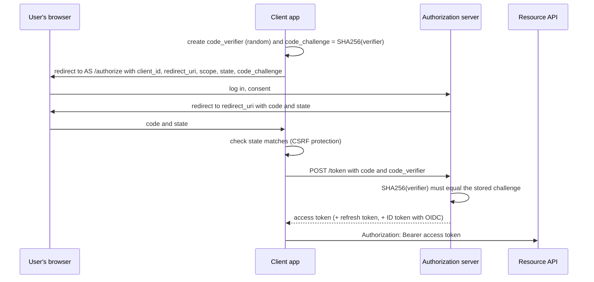

# Week 10 — Tokens and Identity Protocols

> **Level:** Beginner · **Time:** ~10 h · **Tracking:** [issue #7](https://github.com/mascot200/cybersecurity-roadmap/issues/7)
> **Lab code:** [`labs/jwt/`](labs/jwt/) (tested: 9/9 passing)

## 🎯 Objectives

1. Explain what a JWT is, what its signature guarantees, and what it doesn't.
2. Verify access tokens correctly: pinned algorithm, issuer, audience, expiry and required claims.
3. Design refresh-token rotation with reuse detection.
4. Describe the OAuth 2.0 Authorization Code flow with PKCE, and what OpenID Connect adds.
5. Write a **trust model**: who issues tokens, who verifies them, and what each party trusts.

## 🌍 Why it matters

Most modern APIs authenticate with bearer tokens issued by an identity provider (Auth0, Cognito, Entra ID,
Keycloak, Okta…). A verifier that skips one check accepts tokens it should reject. Common gaps are not
pinning the algorithm, not checking the audience (so a token meant for another API works here), and
accepting tokens that never expire. Each one turns a single leaked or misissued token into broad access.

---

## 📖 Concepts

### 1. JWT anatomy



- **Header:** algorithm and key ID. The *client* controls this, so it must never decide how you verify.
- **Payload (claims):** `sub` (subject), `iss` (issuer), `aud` (audience), `exp` (expiry), `iat`, plus custom claims. Base64url-encoded, **readable by anyone**: never put secrets in it.
- **Signature:** proves the issuer's key signed exactly this header and payload.

| Algorithm family | Key | Use when |
|---|---|---|
| `HS256` (HMAC) | One shared secret signs **and** verifies | The issuer and verifier are the same service |
| `RS256` / `PS256` (RSA), `ES256` (ECDSA), `EdDSA` | Private key signs, public key verifies | An identity provider issues tokens to many APIs (the usual case) |

### 2. Verifying an access token

The lab's verifier ([`verify.js`](labs/jwt/verify.js)) uses the [`jose`](https://github.com/panva/jose) library.
Everything it trusts comes from **configuration**:

```js
const { payload } = await jwtVerify(token, publicKey, {
  issuer,                       // who must have issued it
  audience,                     // which API it is for
  algorithms: ['ES256'],        // pinned
  requiredClaims: ['exp', 'sub'],
  clockTolerance: 5,
});
```

In production, fetch the issuer's public keys from its **JWKS endpoint** with `createRemoteJWKSet`
(it caches keys and handles rotation through `kid`). Never take the key URL from the token itself.

**What the tests prove** ([`jwt.test.js`](labs/jwt/jwt.test.js)), each one a token an attacker or a bug might produce:

| Test | Token | Expected |
|---|---|---|
| positive control | valid, correctly signed | accepted |
| expired | `exp` in the past | rejected |
| wrong key | signed by a different private key | rejected |
| tampered payload | claims changed after signing | rejected |
| `alg: none` | unsigned token | rejected |
| wrong audience | issued for `billing-api` | rejected |
| wrong issuer | issued by an unknown issuer | rejected |
| no expiry | missing `exp` | rejected |
| malformed | not a JWT | rejected |

> **After verification, you still authorize.** A valid token tells you *who* the caller is. Week 9's
> policy still decides *what* they can access. Don't treat a `role` claim as permission to skip
> object-level checks.

### 3. Access tokens, refresh tokens and revocation

| | Access token | Refresh token |
|---|---|---|
| Lifetime | Short (5–15 min) | Longer (hours to days) |
| Sent to | Every API call | Only the token endpoint |
| Verified by | Signature (stateless) | Lookup in the issuer's store (stateful) |
| Revocable? | Not before expiry, which is why it's short | Yes: delete or mark it in the store |

**Refresh-token rotation with reuse detection:**



Store refresh tokens **hashed** (like reset tokens in Week 8), bind them to a client, and give them an absolute lifetime.

**Browser apps:** keeping tokens in `localStorage` exposes them to any XSS. Common safer patterns are
an `HttpOnly` session cookie with a backend-for-frontend (BFF) holding the tokens, or short-lived
in-memory access tokens. Either way, XSS remains serious (Week 7).

### 4. OAuth 2.0 and OpenID Connect

- **OAuth 2.0** is *delegated authorization*: a user lets an app access an API on their behalf, with limited **scopes**.
- **OpenID Connect (OIDC)** adds *authentication* on top: an **ID token** says who the user is. ID tokens are for the client app. Don't send them to APIs as access tokens.

Authorization Code flow with **PKCE**, the recommended flow for web, mobile and single-page apps:



| Control | Prevents |
|---|---|
| Exact-match `redirect_uri` allowlist | Codes and tokens being sent to an attacker's URL |
| `state` parameter | Login CSRF (an attacker logging you into *their* account) |
| PKCE | An intercepted authorization code being exchanged by someone else |
| Short-lived, single-use codes | Code replay |
| Minimal scopes | Over-broad access if a token leaks |
| No implicit flow / no tokens in URLs | Tokens leaking via history, logs and referrers |

### 5. Trust model

Write it as a short table for any system that uses tokens:

| Party | Issues | Verifies | Trusts | Secrets it holds |
|---|---|---|---|---|
| Identity provider | Access, refresh, ID tokens | Client credentials, refresh tokens | Its own user store | Signing private key |
| Invoices API | — | Access tokens (`iss`, `aud`, `exp`, signature) | IdP's public keys (JWKS) | None for tokens |
| Web client (BFF) | — | ID token at login | IdP | Client secret, refresh tokens |

---

## 🧪 Lab — Verify, then extend (3 h)

```bash
cd curriculum/01-beginner/month-03-api-security/labs/jwt
npm install && npx vitest run    # expect: 9 passed
```

1. Read [`verify.js`](labs/jwt/verify.js) and [`jwt.test.js`](labs/jwt/jwt.test.js). For each test, write one sentence on what would happen in production if that check were missing.
2. **Mutation test:** remove one option at a time from `jwtVerify` (`audience`, `issuer`, `algorithms`, `requiredClaims`). Which tests fail? Are any options covered by no test? If so, add one.
3. **Key rotation:** generate a second key pair, put both public keys in a local JWKS with `createLocalJWKSet`, and sign with `kid` headers. Test that tokens from both keys verify, and that a token whose `kid` is unknown is rejected.
4. **Wire it into Week 9:** replace `auth.js`'s opaque token lookup with this verifier. Read `tenant_id` and `role` from claims, or better, look the user up by `sub`. Make sure the Week 9 tests still pass.

---

## 📝 Assignment — Token tests and trust model

**Task:** test expired, malformed and incorrectly signed tokens; document the trust model.

1. Keep all 9 tests and add: unknown `kid`, a token not yet valid (`nbf` in the future), and an HS256 token when only ES256 is allowed.
2. Implement **refresh-token rotation** in a small module: hashed storage, single use, reuse detection that revokes the family. Test the sequence in the diagram above.
3. Write `TRUST_MODEL.md` for your Week 9 API: the trust-model table, token lifetimes, where tokens are stored in the client, and how revocation works.

### Acceptance criteria
- [ ] ≥ 12 verifier tests, all passing; mutation results recorded
- [ ] Refresh rotation with a reuse-detection test
- [ ] Week 9 API authenticates with the verifier and its tests still pass
- [ ] `TRUST_MODEL.md` complete

---

## 💼 On the job

- Reviewing JWT middleware configuration is a routine AppSec task. The checks are always the same: algorithm pinned, issuer and audience checked, keys from a trusted JWKS, short lifetimes.
- Choosing an OAuth flow for a new client (web app, mobile app, machine-to-machine) is a common design-review question.
- Token lifetimes and revocation come up in every incident involving a leaked credential (Month 10).

## ⚠️ Common mistakes

- Decoding a token (reading claims) without verifying it.
- Letting the token's `alg` or `jku`/`kid` choose the verification key or method.
- Skipping the `aud` check, so tokens for one API are accepted by another.
- Long-lived access tokens with no revocation plan.
- Putting sensitive data in claims.
- Exact-match redirect URIs replaced by prefix or wildcard matching.

## 🥊 Drill (pass mark 8/10)

**1.** Does signing a JWT make its payload confidential?
<details><summary>Answer</summary>No. A signature gives integrity and authenticity. The payload is only base64url-encoded and anyone can read it.</details>

**2.** Why must the verifier pin the allowed algorithms?
<details><summary>Answer</summary>The header is attacker-controlled. If the verifier lets it pick the algorithm, an attacker could request <code>none</code> or a different algorithm and bypass signature checks.</details>

**3.** What does the `aud` check prevent?
<details><summary>Answer</summary>A token issued for a different API (or client) being accepted by this one.</details>

**4.** Why are access tokens short-lived?
<details><summary>Answer</summary>They're verified statelessly and usually can't be revoked before expiry, so a short lifetime limits how long a leaked token works.</details>

**5.** What does refresh-token reuse detection do?
<details><summary>Answer</summary>If an already-used refresh token is presented again, the server assumes theft and revokes the whole token family, forcing a fresh login.</details>

**6.** What problem does PKCE solve?
<details><summary>Answer</summary>An intercepted authorization code can't be exchanged for tokens without the original <code>code_verifier</code>, which only the legitimate client has.</details>

**7.** What is the `state` parameter for?
<details><summary>Answer</summary>Tying the authorization response to the request the client started, which protects against login CSRF.</details>

**8.** ID token vs access token: which one should an API accept?
<details><summary>Answer</summary>The access token, issued with that API as its audience. The ID token is for the client to learn who the user is.</details>

**9.** Where should the verifier get the issuer's public keys?
<details><summary>Answer</summary>From the issuer's configured JWKS endpoint (or local configuration), never from a URL or key embedded in the token.</details>

**10.** Scenario: a refresh token leaks from a mobile app's logs. What limits the damage?
<details><summary>Answer</summary>Rotation with reuse detection, short refresh-token lifetimes, binding to the client, the ability to revoke a user's token family, and monitoring for refreshes from unusual locations. Also fix the logging.</details>

## ✅ Checklist
- [ ] Lab tests pass; mutations recorded
- [ ] Assignment acceptance criteria met
- [ ] Drill ≥ 8/10, weekly log on issue #7

## 📚 Resources
- RFC 8725 — JWT Best Current Practices — <https://www.rfc-editor.org/rfc/rfc8725>
- RFC 9700 — OAuth 2.0 Security Best Current Practice — <https://www.rfc-editor.org/rfc/rfc9700>
- OpenID Connect Core — <https://openid.net/specs/openid-connect-core-1_0.html>
- OWASP JSON Web Token Cheat Sheet — <https://cheatsheetseries.owasp.org/cheatsheets/JSON_Web_Token_for_Java_Cheat_Sheet.html>
- `jose` library docs — <https://github.com/panva/jose>

---
[← Week 9](week-09-authorization-multi-tenancy.md) · [Next: Week 11 — API abuse & validation →](week-11-api-abuse-validation.md)
