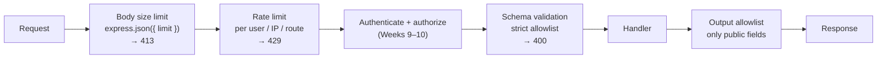

# Week 11 — API Abuse and Validation

> **Level:** Beginner · **Time:** ~10 h · **Tracking:** [issue #7](https://github.com/mascot200/cybersecurity-roadmap/issues/7)
> **Lab code:** [`labs/api-limits/`](labs/api-limits/) (tested: 9/9 passing)

## 🎯 Objectives

1. Validate every request against a strict schema: types, lengths, formats, and no unknown fields.
2. Prevent mass assignment by allowlisting writable fields, and filter responses with an output allowlist.
3. Bound resource use: body size, page size, rate limits, timeouts.
4. Return safe, consistent errors that don't leak internals.
5. Test every limit, including the legitimate request just under it.

## 🌍 Why it matters

An API that is fully authenticated and authorized can still be abused. A client might set fields it
shouldn't (`role`, `tenantId`), receive fields it shouldn't see (`passwordHash`, internal flags), request
100,000 rows at once, or call an expensive endpoint in a loop. The OWASP API Security Top 10 covers
these as **API3 Broken Object Property Level Authorization** and **API4 Unrestricted Resource Consumption**.
The fixes are cheap if they're built into the framework from the start.

---

## 📖 Concepts

### 1. Defense layers for each request



Order matters: reject oversized bodies and excess requests **before** doing expensive work such as
parsing, database lookups or password hashing.

### 2. Schema validation and mass assignment

Mass assignment happens when the server copies the request body onto a model, so any field the client
sends gets saved. The fix is an **allowlist**: a strict schema of the fields this endpoint accepts.

From [`app.js`](labs/api-limits/app.js), using [zod](https://zod.dev/):

```js
const UpdateMe = z.object({
  name: z.string().trim().min(1).max(100).optional(),
  email: z.string().email().max(254).optional(),
}).strict();                       // unknown keys such as role or tenantId → 400
```

- `.strict()` rejects unknown keys. The alternative, silently stripping them, is also safe, but rejecting makes client bugs visible.
- Type checks block objects where strings are expected, which also closes NoSQL operator injection (Week 6).
- Use **separate schemas per operation**: what a user may set at signup, on profile update, and what an admin may set are different lists.
- Validate on the server even if the client validates too.

**Output allowlist:** build the response from named fields (`const { id, name, email } = me`) or a
response schema, instead of returning the database row. Then a new column such as `password_hash` or
`internal_notes` can't leak by accident.

### 3. Bounding resource use

| Limit | Lab setting | Status code | Notes |
|---|---|---|---|
| Body size | `express.json({ limit: '10kb' })` | 413 | Set per route if uploads need more |
| Page size | `limit` max 100, `offset` max 10,000 | 400 | Prefer cursor-based pagination for large tables |
| Rate limit | 5 per minute on `POST /reports` | 429 | Use a shared store (Redis) when running several instances |
| String lengths | `max(100)`, `max(254)` | 400 | Every string field gets a maximum |
| Timeouts | — | 503/504 | Set server, database statement and upstream HTTP timeouts |

Rate-limit keys: per authenticated user for logged-in endpoints, per IP for anonymous ones, and stricter
limits for expensive operations (exports, report generation, password hashing). The lab uses
[`express-rate-limit`](https://express-rate-limit.mintlify.app/) and sends standard `RateLimit` headers so
well-behaved clients can back off.

### 4. Errors

- Map known failures to safe messages: 400 *Invalid request* (with field names, no internals), 413, 429.
- Everything else becomes 500 *Internal error*. Log details on the server with a correlation ID (Week 5).
- Make validation failures **fail closed**: if parsing throws, the request is rejected.

---

## 🧪 Lab — Run, read, extend (3 h)

```bash
cd curriculum/01-beginner/month-03-api-security/labs/api-limits
npm install && npx vitest run    # expect: 9 passed
```

What the tests in [`api-limits.test.js`](labs/api-limits/api-limits.test.js) prove:

| Test | Request | Expected |
|---|---|---|
| positive control | `PATCH /me {name}` | 200, name updated |
| mass assignment of `role` | body includes `role: "admin"` | 400 |
| changing `tenantId` | body includes `tenantId` | 400 |
| no internal fields | normal update | response has no `role` / `tenantId` |
| wrong types | `name` is an object | 400 |
| oversized body | 50 KB name | 413 |
| page size cap | `limit=100000` | 400 |
| normal page | `limit=10` | 10 items |
| rate limit | 7 calls to `POST /reports` | first 5 → 202, 7th → 429 |

1. **Mutation test:** remove `.strict()`, remove the output allowlist, raise the body limit to `50mb`, remove `.max(100)` from `limit`. Record which test catches each change.
2. **Boundary tests:** add tests for exactly `limit=100` (allowed) and `limit=101` (rejected), and a name of exactly 100 characters.
3. **Per-user rate limiting:** add a fake `req.user` and set `keyGenerator` so each user has their own budget. Test that user A hitting the limit doesn't block user B.

---

## 📝 Assignment — Request limits and unsafe-field tests

**Task:** add request limits and tests for unsafe fields and excessive request sizes.

1. Apply these controls to your Week 9 invoices API:
   - strict schemas for `POST /invoices` and `PATCH /invoices/:id` (no `tenant_id`, `owner_id` or `id` from the client)
   - an output allowlist for invoice responses
   - body limit, pagination caps on the list endpoint, and a rate limit on writes
2. Write tests for every control, including the legitimate request just under each limit.
3. Add a database **statement timeout** for the app role (`ALTER ROLE api_app SET statement_timeout = '2s'`) and explain in your README why it matters.
4. Document each limit in a table: *limit → value → why this value → status code → test name*.

### Acceptance criteria
- [ ] Strict input schemas on every write endpoint; tests for unknown fields and wrong types
- [ ] Output allowlist with a test that internal fields never appear
- [ ] Body size, page size and rate limits with boundary tests
- [ ] Statement timeout configured and explained
- [ ] Limits table in the README

---

## 💼 On the job

- API design reviews check for request and response schemas (often OpenAPI), pagination limits and rate limits.
- Platform teams set safe defaults centrally (body limits, timeouts, a validation library) so individual services inherit them.
- Incident reviews of outages caused by one client's traffic often end with "add a rate limit and a page-size cap".

## ⚠️ Common mistakes

- `Object.assign(model, req.body)` or ORM `update(req.body)`.
- Returning database rows directly as JSON.
- Rate limits stored in memory on a multi-instance deployment, so each instance has its own budget.
- Limits without tests, which tend to get loosened over time without anyone noticing.
- Validation error messages that echo internal details (SQL, stack traces).

## 🥊 Drill (pass mark 8/10)

**1.** What is mass assignment?
<details><summary>Answer</summary>The server binds all request fields to a model, so a client can set fields it shouldn't (e.g. <code>role</code>, <code>tenantId</code>).</details>

**2.** Two ways to prevent it?
<details><summary>Answer</summary>A strict input schema or allowlist per operation, or explicitly copying only permitted fields. Never bind the whole body.</details>

**3.** Why add an output allowlist if the input is validated?
<details><summary>Answer</summary>Input validation controls what clients can write. The output allowlist controls what they can read, so new or internal columns don't leak.</details>

**4.** What status codes do you use for an oversized body, too many requests, and an invalid field?
<details><summary>Answer</summary>413, 429, 400.</details>

**5.** Why put rate limiting before expensive work?
<details><summary>Answer</summary>So excess requests are rejected cheaply, before they consume CPU (e.g. hashing), database connections or downstream calls.</details>

**6.** Why does an in-memory rate limiter fail with several app instances?
<details><summary>Answer</summary>Each instance counts separately, so the real limit is multiplied by the number of instances. Use a shared store.</details>

**7.** What's the risk of `?limit=100000`?
<details><summary>Answer</summary>Very large responses: heavy database load, memory use and bulk data extraction. Cap the page size.</details>

**8.** Why test the request just under a limit as well?
<details><summary>Answer</summary>To show the limit doesn't block legitimate use. A limit that's off by one, or far too strict, is also a bug.</details>

**9.** How does strict type validation help against NoSQL injection?
<details><summary>Answer</summary>Operator objects like <code>{"$ne": null}</code> fail a "must be a string" check, so they never reach the query.</details>

**10.** Scenario: a new `internal_notes` column is added to `invoices`. What stops it from appearing in the API?
<details><summary>Answer</summary>The output allowlist or response schema only includes named public fields, plus the test asserting internal fields never appear.</details>

## ✅ Checklist
- [ ] Lab tests pass; mutations recorded
- [ ] Assignment acceptance criteria met
- [ ] Drill ≥ 8/10, weekly log on issue #7

## 📚 Resources
- OWASP API Security Top 10 — <https://owasp.org/API-Security/>
- OWASP Mass Assignment Cheat Sheet — <https://cheatsheetseries.owasp.org/cheatsheets/Mass_Assignment_Cheat_Sheet.html>
- OWASP Input Validation Cheat Sheet — <https://cheatsheetseries.owasp.org/cheatsheets/Input_Validation_Cheat_Sheet.html>
- zod — <https://zod.dev/>

---
[← Week 10](week-10-tokens-identity-protocols.md) · [Next: Week 12 — API security test suite →](week-12-api-security-test-suite.md)
