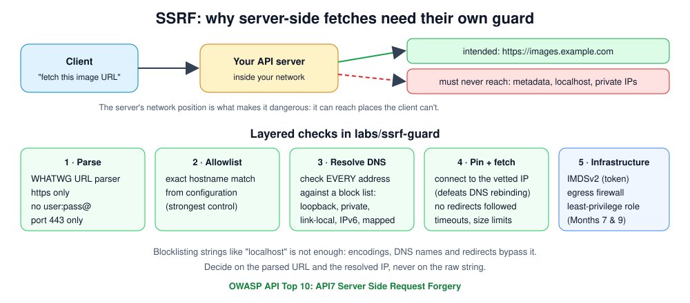

# Month 4 — Advanced Web Testing

> 🟢 **Level 1 · Beginner** · Weeks 13–16 · ~40 h · Tracking issue: [#8](https://github.com/mascot200/cybersecurity-roadmap/issues/8) · **Level 1 gate**

**Goal:** understand the vulnerabilities that basic automated scanners miss, and how to prevent them.

Scanners are good at known patterns. They're weak at features that make the **server** act for the user
(fetching URLs, handling files) and at **business rules** that only make sense if you know the product.
This month covers those, from the defender's side: each lab ships the protection and tests that show the
risky requests being refused.

## Weekly plan

| Week | Lesson | Lab (tested) | Est. time |
|---|---|---|---|
| 13 | [Server-side request forgery](week-13-ssrf.md) | [`labs/ssrf-guard`](labs/ssrf-guard/): layered URL guard, 27/27 | 10 h |
| 14 | [File and parser risks](week-14-file-parser-risks.md) | [`labs/uploads`](labs/uploads/): safe upload pipeline, 8/8 | 10 h |
| 15 | [Business logic](week-15-business-logic.md) | [`labs/booking`](labs/booking/): race-safe booking + idempotency, 5/5 | 10 h |
| 16 | [Assessment workflow](week-16-assessment-workflow.md) | *Lesson not yet written*: assignment and resources only | 10 h |
| — | [Month project](project.md) | **Assessment report: ≥ 5 findings from your labs** | woven into weeks |
| — | [Level 1 checkpoint drill](drill.md) | ≥ 80% + practical task | 75 min |

## Lab status

| Lab | Tests | How it was checked |
|---|---|---|
| `ssrf-guard` | 27/27 | Fake DNS resolver, so no network needed: internal, metadata, IPv6, mapped-IPv6 and mixed answers refused |
| `uploads` | 8/8 | Mutation-checked: removing the path checks makes the traversal test fail |
| `booking` | 5/5 | Against PostgreSQL 16. The check-then-act version fails the 20-concurrent-requests test |

## Milestone (Level 1 gate)

- [ ] Explain why scanners miss SSRF exposure, file-handling flaws and business-logic flaws, and how each is prevented
- [ ] Month project report with ≥ 5 findings, evidence, remediation and retest
- [ ] **Level 1 checkpoint drill ≥ 80%**, then close the Level 1 epic [#2](https://github.com/mascot200/cybersecurity-roadmap/issues/2)

## Recommended resources

- **PortSwigger learning paths** — <https://portswigger.net/web-security/learning-paths>
- **OWASP Web Security Testing Guide** — <https://owasp.org/www-project-web-security-testing-guide/>

---
[← Month 3](../month-03-api-security/README.md) · [Course home](../../../README.md) · [Start Week 13 →](week-13-ssrf.md)
