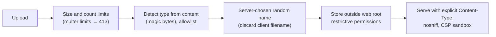

# Week 14 — File and Parser Risks

> **Level:** Beginner · **Time:** ~10 h · **Tracking:** [issue #8](https://github.com/mascot200/cybersecurity-roadmap/issues/8)
> **Lab code:** [`labs/uploads/`](labs/uploads/) (tested: 8/8 passing, mutation-checked)

## 🎯 Objectives

1. Handle file uploads safely: size limits, content-based type checks, server-chosen names, storage outside the web root, safe serving headers.
2. Prevent path traversal when reading or writing files based on user input.
3. Configure XML parsers so external entities can't be loaded (XXE).
4. Avoid unsafe deserialization: accept data formats, never executable object formats.
5. Prove each control with a test.

## 🌍 Why it matters

Files and parsers turn user data into something the server stores, opens or interprets. If the server trusts
the filename, it can be tricked into writing outside its folder. If it trusts the declared type, an HTML or
script file can be served from your domain. If a parser is too powerful, a document can make the server
read local files or run code.

**Real-world scenario:** **Log4Shell (2021, CVE-2021-44228)** showed how a powerful feature in a common
library (message lookups that could load remote code via JNDI) turned ordinary logged strings into remote
code execution across a huge range of products. The general lesson: features that interpret data are
attack surface, so turn off what you don't need.

---

## 📖 Concepts

### 1. Safe upload pipeline



| Control | In [`app.js`](labs/uploads/app.js) | Prevents |
|---|---|---|
| Size/count limits | `limits: { fileSize: 1 MB, files: 1 }` | Disk and memory exhaustion |
| Content-based type check | PNG/JPEG magic bytes; the client's `Content-Type` and extension are ignored | Script/HTML disguised as an image |
| Random server-side name | `crypto.randomUUID()` + detected extension | Overwrites, traversal via filename, guessable names |
| Storage outside the static directory | `storageDir` is never served by `express.static` | Uploaded files being executed or rendered by the web server |
| Safe serving | Fixed `Content-Type`, `X-Content-Type-Options: nosniff`, `Content-Security-Policy: default-src 'none'; sandbox` | Browser rendering an upload as a page |

Further hardening for production:
- Re-encode images (e.g. with `sharp`) to strip metadata and any embedded content.
- Scan with antivirus where required (e.g. ClamAV) and quarantine before processing.
- Serve user content from a **separate domain** (`usercontent.example.net`) so it can't share cookies or origin with your app.
- Use object storage (S3) with private buckets and short-lived signed URLs (Month 7).

### 2. Path traversal

If a path is built from user input, `../` sequences can climb out of the intended folder. Two layers in the lab:

```js
if (!STORED_NAME.test(id)) return res.status(404).end();        // 1. strict format: uuid + allowed extension
const file = path.resolve(root, id);
if (path.dirname(file) !== root) return res.status(404).end();  // 2. resolved path must stay in root
```

The general rule when a strict format isn't possible: `path.resolve` the result and check it starts with
the root directory **plus a path separator** (so `/srv/uploads-old` doesn't pass a check for `/srv/uploads`).
Better still, don't use user input in paths at all: look up a database record by ID and read its stored path.

The test plants a `secret.txt` next to the storage directory, so the traversal tests actually have
something to protect. Removing both checks makes the `..%2Fsecret.txt` test fail.

### 3. XML External Entities (XXE)

XML supports entities that can reference external files or URLs. A parser that resolves them can be made
to read local files or make server-side requests (SSRF).

- Prefer JSON for APIs.
- If you must parse XML, use a parser with external entities and DTDs **disabled**. Many Node parsers
  (e.g. `fast-xml-parser`) don't resolve external entities. With `libxmljs`, keep `noent: false` and
  don't enable network access. In Java/.NET/Python, follow the OWASP XXE cheat sheet settings for your parser.
- Watch for XML hiding inside other formats: SVG images, DOCX/XLSX (zipped XML), SAML.

### 4. Unsafe deserialization

Formats that can describe *objects with behaviour* (Java serialization, Python `pickle`, PHP `unserialize`,
YAML with custom tags, the Node `node-serialize` package) can run code while being loaded.

- Accept **plain data formats** (JSON) and validate them with a schema (Week 11).
- Never deserialize untrusted input with object-capable formats. For YAML, use safe loaders (`yaml.load` in js-yaml v4 is safe by default; in Python use `yaml.safe_load`).
- Sign data you send to clients and read back later (e.g. with an HMAC), and verify before use.
- Never use `eval` or `new Function` on input.

---

## 🧪 Lab — Run, read, extend (3 h)

```bash
cd curriculum/01-beginner/month-04-advanced-web-testing/labs/uploads
npm install && npx vitest run    # expect: 8 passed
```

What the tests in [`upload.test.js`](labs/uploads/upload.test.js) prove:

| Test | Expected |
|---|---|
| real PNG → random name, stored (positive control) | 201, one file named `<uuid>.png` |
| client filename `../../evil.png` | 201, file stored under a random name inside storage only |
| HTML with `.png` name and `image/png` type | 415, nothing stored |
| file over 1 MB | 413 |
| serving a stored file | `image/png`, `nosniff` |
| `..%2Fsecret.txt`, `..%2F..%2Fetc%2Fpasswd`, bad name | 404, secret never returned |

1. **Mutation test:** remove the magic-byte check; remove both path checks; raise the size limit. Record which test fails for each.
2. **Add GIF and WebP** to the allowlist (look up their signatures) with positive and negative tests.
3. **Re-encode:** add `sharp` to re-encode accepted images to PNG and strip metadata. Test that a JPEG with EXIF GPS data has no EXIF after upload.
4. **Parser check:** pick an XML parser for Node, write a test that parses a document containing an external entity reference, and confirm the entity is **not** resolved.

---

## 📝 Assignment — Isolated lab cases for files and parsers

**Task:** create isolated lab cases and validate file type, storage and parser protections.

1. Add avatar upload to your Month 3 API using this pipeline, with the file record (owner, tenant, stored name) in PostgreSQL. The download route looks up the record by ID and applies Week 9 authorization.
2. Tests: type spoofing rejected, oversize rejected, traversal impossible, another tenant's file unreachable (404), positive controls.
3. Add a JSON import endpoint that validates against a strict schema, and a test proving that unexpected properties (including `__proto__`) are rejected.
4. Document in `FILES.md`: each control, what it prevents, and its test.

### Acceptance criteria
- [ ] Upload pipeline with all five controls, tested
- [ ] Download authorized per tenant/owner
- [ ] XML parser test proving external entities aren't resolved
- [ ] Strict JSON import with prototype-pollution test
- [ ] `FILES.md` complete; mutation results recorded

---

## 💼 On the job

- Upload features are a standard design-review checklist item: size, type, storage, serving domain, scanning.
- Dependency and code scanners (Month 5) flag known unsafe deserializers and parser settings.
- Incident responders look for unexpected files in web roots and for parser errors in logs.

## ⚠️ Common mistakes

- Trusting the file extension or the `Content-Type` header.
- Storing uploads inside a directory the web server serves or executes.
- Using the client's filename on disk.
- Checking `path.startsWith(root)` without a trailing separator.
- Enabling parser features (DTDs, custom YAML tags) "because the library supports it".

## 🥊 Drill (pass mark 8/10)

**1.** Why not trust the `Content-Type` of an upload?
<details><summary>Answer</summary>The client sets it. Determine the type from the file's content and check it against an allowlist.</details>

**2.** Why give uploaded files server-chosen names?
<details><summary>Answer</summary>It prevents path traversal and overwrites through crafted filenames, and avoids guessable names.</details>

**3.** What do `X-Content-Type-Options: nosniff` and a sandbox CSP do for served uploads?
<details><summary>Answer</summary><code>nosniff</code> stops the browser from guessing a different type. The sandbox CSP stops the response from running scripts or acting as a page in your origin.</details>

**4.** Why serve user content from a separate domain?
<details><summary>Answer</summary>Anything that does execute there can't access your main app's cookies or origin.</details>

**5.** What's wrong with `if (!resolved.startsWith('/srv/uploads')) deny()`?
<details><summary>Answer</summary><code>/srv/uploads-old/...</code> also passes. Compare against the root plus a path separator, or compare <code>path.dirname</code> exactly.</details>

**6.** What is XXE and the main fix?
<details><summary>Answer</summary>An XML parser resolving external entities, which can read local files or make requests. Fix: disable DTDs and external entities, or use JSON.</details>

**7.** Name two formats where XML can hide.
<details><summary>Answer</summary>Any two of: SVG, DOCX/XLSX/PPTX, SAML, RSS, SOAP.</details>

**8.** Why is deserializing untrusted data with object-capable formats dangerous?
<details><summary>Answer</summary>Those formats can instantiate objects or trigger code during loading, which can lead to remote code execution.</details>

**9.** What should you use instead?
<details><summary>Answer</summary>Plain data formats like JSON with strict schema validation, and signed data when it round-trips through clients.</details>

**10.** Scenario: a team wants to accept SVG avatars. What's your advice?
<details><summary>Answer</summary>SVG is XML and can contain scripts and external references. Prefer converting to PNG on upload; if SVG must be kept, sanitize it with a vetted SVG sanitizer, serve it from a separate domain with a sandbox CSP, and never inline it into your pages.</details>

## ✅ Checklist
- [ ] Lab steps 1–4
- [ ] Assignment acceptance criteria met
- [ ] Drill ≥ 8/10, weekly log on issue #8

## 📚 Resources
- OWASP File Upload Cheat Sheet — <https://cheatsheetseries.owasp.org/cheatsheets/File_Upload_Cheat_Sheet.html>
- OWASP XXE Prevention Cheat Sheet — <https://cheatsheetseries.owasp.org/cheatsheets/XML_External_Entity_Prevention_Cheat_Sheet.html>
- OWASP Deserialization Cheat Sheet — <https://cheatsheetseries.owasp.org/cheatsheets/Deserialization_Cheat_Sheet.html>
- multer — <https://github.com/expressjs/multer>

---
[← Week 13](week-13-ssrf.md) · [Next: Week 15 — Business logic →](week-15-business-logic.md)
