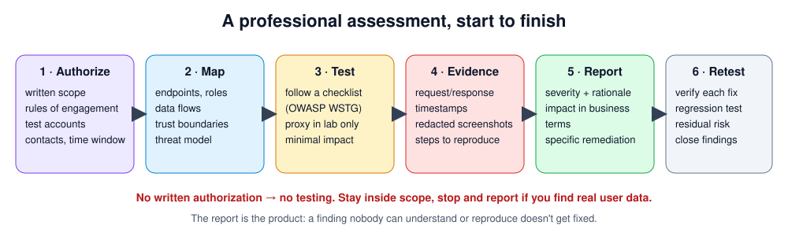

# Week 16 — Assessment Workflow

> **Level:** Beginner · **Time:** ~10 h · **Tracking:** [issue #8](https://github.com/mascot200/cybersecurity-roadmap/issues/8)

> 📝 **This lesson hasn't been written yet.** This page holds the week's assignment and the resources to
> use in the meantime. If you write the lesson yourself, follow the structure of the other weeks
> (objectives, why it matters, concepts, lab, assignment, drill, checklist) and open a PR.

## Roadmap assignment

**Topics:** request interception, evidence capture, severity rationale and remediation reports.

**Assignment:** use Burp Suite Community Edition in **authorized labs only** (your own local lab apps,
PortSwigger Web Security Academy labs, OWASP Juice Shop on `127.0.0.1`) and write a structured
assessment report. The report format is in this month's [project brief](project.md).

## Resources to use until the lesson exists

- [Safety & ethics](../../../docs/safety-and-ethics.md): authorization and lab isolation rules
- PortSwigger, Burp Suite documentation — <https://portswigger.net/burp/documentation>
- PortSwigger Web Security Academy — <https://portswigger.net/web-security>
- OWASP Web Security Testing Guide — <https://owasp.org/www-project-web-security-testing-guide/>
- FIRST CVSS v3.1 calculator — <https://www.first.org/cvss/calculator/3.1>
- Month 11 (Level 3) covers the full professional assessment process: rules of engagement, test plans, report template and a tested CVSS calculator

## ✅ Checklist
- [ ] Assignment done in authorized labs only
- [ ] Report written in the [project](project.md) format
- [ ] Monthly drill ≥ 80%, weekly log on issue #8

---
[← Week 15](week-15-business-logic.md) · [Month project →](project.md)
