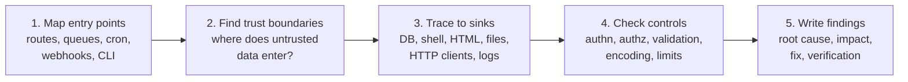

# Week 17 — Secure Code Review

> **Level:** Intermediate · **Time:** ~10 h · **Tracking:** [issue #9](https://github.com/mascot200/cybersecurity-roadmap/issues/9)

## 🎯 Objectives

1. Review a Node.js codebase systematically: entry points, trust boundaries, then sinks.
2. Recognize the patterns behind the bugs from Months 2–4 (injection, broken authorization, data exposure, unsafe defaults).
3. Write findings that state the **root cause**, the impact, the fix and how to verify it.
4. Give review feedback developers act on.

## 🌍 Why it matters

Tools find patterns. People find **missing** things: a route with no authorization check, a price taken
from the client, a tenant ID read from a header. Most serious application bugs are of the second kind.
Security code review is a core AppSec skill. It's how you scale your judgment across many teams.

---

## 📖 Concepts

### 1. A review method that scales

Don't read files top to bottom. Follow the data:



**Entry points in an Express app:** `app.get/post/...`, `router.*`, middleware order in `app.use`,
message consumers, scheduled jobs, webhook receivers.

**Sinks to search for:**

| Sink | Search for | Ask |
|---|---|---|
| SQL | `query(`, `raw(`, `$queryRawUnsafe`, `knex.raw`, `sequelize.query` | Parameterized? Identifiers allowlisted? |
| Shell | `exec(`, `execSync`, `spawn(` with `shell: true` | Argument array, no shell? |
| HTML | `innerHTML`, `dangerouslySetInnerHTML`, `v-html`, `<%-`, `{{{` | Encoded or sanitized? |
| Files | `fs.*` with request data, `path.join(` | Server-chosen names? Root check? |
| HTTP clients | `fetch(`, `axios`, `got`, `http.request` with user URLs | URL guard (Week 13)? |
| Deserialization | `eval`, `new Function`, `vm`, YAML/XML loaders | Data-only formats? |
| Responses | `res.json(row)`, `res.send(user)` | Output allowlist? |
| Logs | `logger.*(req.body)` | Secrets/PII redacted? |

### 2. What to check at each endpoint

| Control | Questions |
|---|---|
| Authentication | Is the auth middleware applied to this route (and before it, in `app.use` order)? |
| Authorization | Object, function and property level: where's the check? Does the tenant come from the identity? |
| Validation | Strict schema? Types, lengths, unknown fields? |
| Business rules | Server-side prices and state transitions? Atomic updates? |
| Limits | Body size, pagination, rate limits? |
| Errors | Generic to client, details to logs, fail closed? |
| Secrets | Any hard-coded keys or passwords? Secrets in logs? |
| Crypto | Vetted libraries, CSPRNG, password hashing, constant-time comparison? |

### 3. Writing a finding

```markdown
### F-03: Invoice update has no tenant check (High)

**Where:** `src/routes/invoices.js:42` — `PATCH /invoices/:id`
**Root cause:** the UPDATE filters only by `id`; `req.user.tenant_id` is never used.
**Impact:** any authenticated user can change the status of any tenant's invoice (integrity of billing data).
**Fix:** route the query through the shared `scope(user)` policy, e.g.
`UPDATE invoices SET status = $1 WHERE id = $2 AND tenant_id = $3`.
**Verify:** add matrix rows for cross-tenant PATCH (expect 404, row unchanged).
**Also check:** the same pattern in `DELETE /invoices/:id` and `POST /invoices/:id/send`.
```

Good findings are **specific** (file and line), explain the **root cause** (not just the symptom), and
make the fix and its verification obvious. "Also check" turns one finding into a fix for the whole pattern.

### 4. Review etiquette

- Lead with impact, in the team's terms ("any customer can change another customer's invoices").
- Suggest the fix, ideally as a code suggestion.
- Separate **blocking** issues from **suggestions**.
- Praise good security decisions. It reinforces them.
- Prefer fixing the pattern (shared helper, lint rule) over fixing one line.

---

## 🧪 Lab — Review your own Month 2–4 code (4 h)

1. Pick the **fixed** labs you built in Months 2–4 and review them as if a teammate wrote them. Use the sink table and control table above. Even fixed code usually has something to improve (missing limits, a broad error handler, a log line that includes the body).
2. For your Month 3 project, build an **endpoint inventory**: every route, its auth middleware, its authorization check, its schema and its limits. Mark any cell that's empty.
3. Search your code for each sink in the table with `grep -rn` (or your editor), and note every hit and whether it's safe.
4. Write at least **5 findings** in the format above (they can be low severity).

---

## 📝 Assignment — Review a small codebase

**Task:** review a small codebase and document issues, root causes and fixes.

1. Choose a codebase you're allowed to review: your Month 3 project, an older side project, or an intentionally vulnerable training app's source (OWASP Juice Shop's repository is a good choice, and its known issues are documented, so you can check your work).
2. Produce `REVIEW.md` with: scope, method, endpoint inventory, findings (format above), and a summary table (ID, title, severity, status).
3. Fix at least three findings in your own code, each with a regression test.

### Acceptance criteria
- [ ] Endpoint inventory complete
- [ ] ≥ 8 findings with root cause, impact, fix, verification
- [ ] ≥ 3 fixed with regression tests
- [ ] Summary table and a short "patterns to fix centrally" section

---

## 💼 On the job

- AppSec engineers review high-risk changes (auth, payments, file handling) and build guardrails so most changes don't need them.
- Findings are often turned into Semgrep rules (Week 18) so the same bug is caught automatically next time.

## ⚠️ Common mistakes

- Reading code linearly instead of tracing data from entry points to sinks.
- Only looking for "bad" code and missing *absent* checks.
- Vague findings ("validate input better").
- Reporting a symptom and not searching for the same pattern elsewhere.

## 🥊 Drill (pass mark 8/10)

**1.** What are the steps of a data-flow-based review?
<details><summary>Answer</summary>Map entry points, find trust boundaries, trace untrusted data to sinks, check the controls on the way, write findings.</details>

**2.** Why do people find authorization bugs that tools miss?
<details><summary>Answer</summary>They're missing checks that depend on business rules (who owns what). A tool can't know the intended policy.</details>

**3.** Name five sinks to search for in a Node.js app.
<details><summary>Answer</summary>Any five of: SQL query/raw calls, shell exec/spawn, HTML sinks (innerHTML, dangerouslySetInnerHTML), file system paths, outbound HTTP clients, eval/new Function, responses returning whole rows, log calls with request data.</details>

**4.** What makes a finding actionable?
<details><summary>Answer</summary>Exact location, root cause, impact, a specific fix, and how to verify it (plus where else the pattern appears).</details>

**5.** Why does middleware order matter in Express reviews?
<details><summary>Answer</summary>Middleware runs in order. A route registered before the auth middleware, or a router mounted without it, is unauthenticated.</details>

**6.** Spot the issue: `router.get('/admin/users', listUsers)` in a router mounted with only `authenticate`.
<details><summary>Answer</summary>No function-level authorization: any authenticated user can list all users. Add an admin role check (and a test).</details>

**7.** Spot the issue: `logger.info({ body: req.body }, 'login attempt')`
<details><summary>Answer</summary>Logs the password. Log only safe fields (e.g. email hash, outcome) or use redaction.</details>

**8.** What's the difference between a blocking issue and a suggestion?
<details><summary>Answer</summary>Blocking issues must be fixed before merge (exploitable or policy-breaking); suggestions improve quality or defense in depth and can be done later.</details>

**9.** How do you stop the same bug from returning?
<details><summary>Answer</summary>Fix the pattern centrally (shared helper), add a regression test, and add an automated rule (SAST/lint) for it.</details>

**10.** Scenario: you find the same missing tenant check in 6 routes. What do you recommend?
<details><summary>Answer</summary>Fix all six through a shared authorization/scoping helper, add matrix tests for every route, add a Semgrep rule or test that flags unscoped queries, and consider RLS as a safety net.</details>

## ✅ Checklist
- [ ] Lab steps 1–4
- [ ] Assignment acceptance criteria met
- [ ] Drill ≥ 8/10, weekly log on issue #9

## 📚 Resources
- OWASP Code Review Guide — <https://owasp.org/www-project-code-review-guide/>
- OWASP Secure Coding Practices — <https://owasp.org/www-project-secure-coding-practices-quick-reference-guide/>
- OWASP Juice Shop source — <https://github.com/juice-shop/juice-shop>

---
[← Month overview](README.md) · [Next: Week 18 — SAST & dependency analysis →](week-18-sast-dependency-analysis.md)
