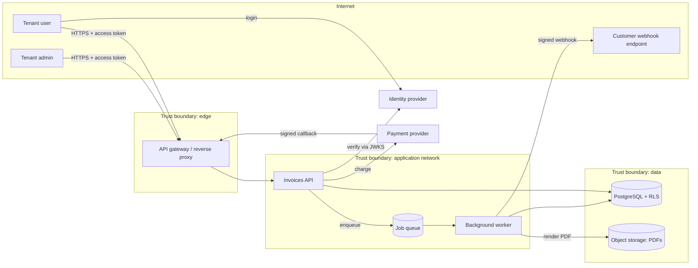

# Week 19 — Threat Modeling

> **Level:** Intermediate · **Time:** ~10 h · **Tracking:** [issue #9](https://github.com/mascot200/cybersecurity-roadmap/issues/9)

## 🎯 Objectives

1. Draw a data-flow diagram (DFD) of a multi-tenant system with processes, stores, external entities, flows and trust boundaries.
2. Apply **STRIDE per element** to produce a complete threat list.
3. Turn threats into **security requirements** and tracked work items.
4. Keep the model current as the system changes.

## 🌍 Why it matters

In Month 1 you threat-modeled a single login API. Real systems have queues, workers, third-party
integrations, admin tools and several data stores, and the most damaging flaws are usually in how those
pieces trust each other. Threat modeling at design time is the cheapest point to fix them: changing a
diagram costs minutes; changing a deployed architecture costs months.

---

## 📖 Concepts

### 1. A DFD for a multi-tenant SaaS

Every arrow crossing a boundary is a place to ask: who is on each side, what do they trust, and how is
that trust checked?

### 2. STRIDE per element

| Element type | Applicable STRIDE | Example from the DFD |
|---|---|---|
| External entity (user, provider) | S, R | Forged payment callback pretending to be the provider (S) |
| Process (API, worker) | S, T, R, I, D, E | Worker processes a job for the wrong tenant (E/I) |
| Data store (DB, storage) | T, I, D (R for logs) | Object storage bucket readable by other tenants (I) |
| Data flow (arrow) | T, I, D | Webhook payload tampered in transit (T) |

### 3. From threats to requirements

| # | Threat | STRIDE | Element | Requirement (testable) | Verification |
|---|---|---|---|---|---|
| T1 | Forged payment callback marks invoice paid | S | PAY → GW | Verify callback signature with HMAC + timestamp; reject replays older than 5 min | Unit tests for bad/old signatures |
| T2 | Worker runs job with another tenant's ID | E | Q → WK | Jobs carry tenant ID set by API from the token; worker sets RLS tenant before queries | Integration test: tampered job is rejected |
| T3 | Customer webhook URL points at internal service | I | WK → WH | URL guard + egress proxy (Week 13) | Guard tests |
| T4 | PDFs readable across tenants | I | OS | Private bucket; object keys prefixed by tenant; short-lived signed URLs after authorization | Test: other tenant's PDF → 404 |
| T5 | Admin actions denied later | R | AD → API | Audit log of admin actions with user, tenant, time, request ID | Test: action writes audit row |
| T6 | Queue flooding by one tenant | D | API → Q | Per-tenant rate limits and job quotas | Rate-limit tests |

Rules:
- A requirement must be **testable**. "Be secure" isn't a requirement; "reject callbacks with an invalid HMAC" is.
- Map requirements to a standard where useful (OWASP ASVS chapter numbers).
- Track each mitigation as an **issue** with an owner. A threat model whose actions aren't tracked is shelfware.

### 4. Keep it alive

Update the model when you: add a new external integration, add a data store, change authentication,
expose a new interface (public API, admin UI), or after an incident. Store it in the repo next to the
code (Markdown + Mermaid) so changes go through review.

---

## 🧪 Lab — Model the system you've built (3 h)

1. Draw the DFD of your Month 3 project plus the features from Month 4 (uploads, URL import, bookings). Mark trust boundaries.
2. Apply STRIDE per element. Aim for 20+ raw threats.
3. Merge duplicates, score with likelihood × impact (Month 1), and keep the top 10.
4. For each, write a testable requirement and the test or evidence that verifies it.
5. Compare with your Week 17 review and Week 18 scan results: which threats did they already cover?

---

## 📝 Assignment — Threat-model a multi-tenant application

**Task:** threat-model a multi-tenant application and track mitigations.

1. Commit `THREAT_MODEL.md` to your project: scope, assumptions, DFD, assets, STRIDE table, top 10 with requirements, and residual risks.
2. Open a GitHub issue for each mitigation not yet implemented (label `security`), linking back to the threat ID.
3. Implement at least two mitigations with tests, and close their issues with links to the PRs.

### Acceptance criteria
- [ ] DFD with ≥ 3 trust boundaries
- [ ] STRIDE-per-element table with ≥ 20 threats
- [ ] Top 10 with testable requirements and verification
- [ ] Mitigations tracked as issues; ≥ 2 implemented and closed
- [ ] Residual risks stated

---

## 💼 On the job

- AppSec teams run threat-modeling sessions at design review for new features and integrations.
- Lightweight formats (a 1-hour session, a diagram, a table in the repo) get adopted; heavyweight documents get skipped.

## ⚠️ Common mistakes

- Modeling only the happy path and only the main API.
- Generic threats with no element or flow attached.
- Requirements that can't be tested.
- Not tracking mitigations, or never updating the model.

## 🥊 Drill (pass mark 8/10)

**1.** Name the four DFD element types plus the boundary marker.

Answer
External entity, process, data store, data flow; trust boundary.

**2.** Which STRIDE categories apply to a data store?

Answer
Tampering, Information disclosure, Denial of service (and Repudiation for audit logs).

**3.** What makes a security requirement good?

Answer
It's specific and testable, with a clear verification method.

**4.** Why must webhook/callback receivers verify signatures?

Answer
Anyone can send a request to the endpoint; without a signature check, an attacker can spoof the provider (e.g. mark invoices paid).

**5.** Why include a timestamp in signed callbacks?

Answer
To reject replays of old, validly signed messages.

**6.** How do you stop a background worker from acting for the wrong tenant?

Answer
Jobs carry a tenant ID set by the API from the authenticated identity; the worker re-applies tenant scoping (and RLS) for every job; tests verify it.

**7.** When should a threat model be updated?

Answer
When integrations, data stores, authentication or exposed interfaces change, and after incidents.

**8.** Why store the threat model in the repository?

Answer
It's versioned with the code, reviewed in PRs, and easy to keep current.

**9.** What is a residual risk?

Answer
Risk that remains after the planned controls.

**10.** Scenario: a team adds "export all invoices to CSV via email". Name three threats.

Answer
Any three of: export includes other tenants' data (I/E); email sent to an attacker-controlled address (I); CSV formula injection when opened in a spreadsheet (T); export abused to load the system (D); no audit trail of exports (R).

## ✅ Checklist
- [ ] Lab steps 1–5
- [ ] Assignment acceptance criteria met
- [ ] Drill ≥ 8/10, weekly log on issue #9

## 📚 Resources
- Microsoft Threat Modeling — <https://learn.microsoft.com/en-us/training/paths/tm-threat-modeling-fundamentals/>
- OWASP Threat Modeling Cheat Sheet — <https://cheatsheetseries.owasp.org/cheatsheets/Threat_Modeling_Cheat_Sheet.html>
- OWASP ASVS — <https://owasp.org/www-project-application-security-verification-standard/>
- Threat Modeling Manifesto — <https://www.threatmodelingmanifesto.org/>

---
[← Week 18](week-18-sast-dependency-analysis.md) · [Next: Week 20 — Secure CI/CD →](week-20-secure-ci-cd.md)
