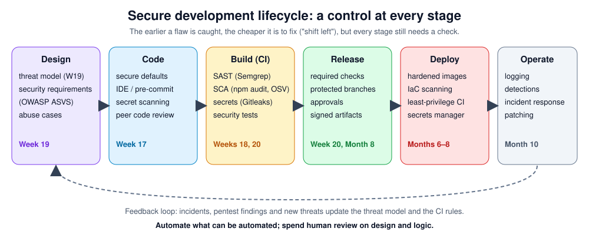

# Week 20 — Secure CI/CD

> **Level:** Intermediate · **Time:** ~10 h · **Tracking:** [issue #9](https://github.com/mascot200/cybersecurity-roadmap/issues/9)
> **Lab file:** [`labs/ci/security.yml`](labs/ci/security.yml): GitHub Actions security workflow (YAML-validated; run it in your own repo)

## 🎯 Objectives

1. Add security checks to CI: SAST, dependency scanning, dependency review, secret scanning and security tests.
2. Decide and document **when a build must fail** (severity thresholds) and how exceptions work.
3. Harden the pipeline itself: least-privilege tokens, pinned actions, safe triggers, protected branches.
4. Protect deployments with required checks, reviews and environments.

## 🌍 Why it matters

The pipeline has write access to your code, your packages and often your production environment, which
makes it a high-value target. **Codecov (2021):** attackers modified Codecov's Bash uploader script, which
many companies ran in CI, to send environment variables (including credentials) to an attacker's server.
**tj-actions/changed-files (2025):** a popular GitHub Action was compromised and changed to print CI
secrets into build logs, affecting thousands of repositories that referenced it by a mutable tag. A secure
pipeline both **runs** security checks and **is** secure.

---

## 📖 Concepts

### 1. Security gates



The lab workflow ([`security.yml`](labs/ci/security.yml)) runs five jobs on every push to `main` and every PR:

| Job | Tool | Fails the build when |
|---|---|---|
| `sast` | Semgrep (community + custom rules) | Any `ERROR`-severity finding |
| `dependencies` | `npm audit --omit=dev --audit-level=high` | High/critical advisory in production dependencies |
| `dependency-review` | GitHub dependency-review action (PRs only) | The PR *adds* a dependency with a high-severity advisory |
| `secrets` | Gitleaks over full history | Any secret found |
| `tests` | Your security regression tests | Any test fails |

> ⚠️ **Not yet run.** The workflow parses as valid YAML and follows each tool's documentation, but it
> hasn't been run on GitHub Actions while this course was written. Running it in your repo and fixing
> anything that breaks is part of the assignment.

### 2. When should a build fail?

Write the policy down (`SECURITY_GATES.md`):

| Finding | New in this PR | Already on main |
|---|---|---|
| Critical/high, fix available | **Block** | Fix within SLA (e.g. 7 days) |
| Critical/high, no fix | Block unless exception approved | Exception with owner + review date |
| Medium | Warn | Backlog |
| Low / informational | Report only | Report only |
| Secret detected | **Block** + rotate | Rotate immediately |

Blocking only **new** issues keeps the pipeline useful on a codebase with old findings, while the
backlog is worked down.

**Exceptions:** inline suppression with a reason for false positives; for accepted risks, a tracked
issue with owner, justification and expiry date. Review exceptions regularly.

### 3. Hardening the pipeline

| Control | How (GitHub Actions) | Why |
|---|---|---|
| Least-privilege token | `permissions: contents: read` at the top; grant more per job only if needed | Limits what a compromised step can do |
| Pin actions to a commit SHA | `uses: actions/checkout@<40-char SHA>  # v4.x.y`; let Dependabot update | Tags can be moved to malicious code (tj-actions) |
| Careful triggers | Avoid `pull_request_target` with checkout of PR code; never run untrusted code with secrets | Fork PRs can't steal secrets |
| No secrets in logs | Use `secrets.*`; never `echo` them; mask derived values | Logs are widely readable |
| Short-lived cloud credentials | OIDC federation to AWS/GCP/Azure instead of stored keys (Month 8) | No long-lived keys to leak |
| Script injection | Don't put `${{ github.event.* }}` (PR titles, branch names) directly in `run:`; pass via `env:` | Attacker-controlled text would become shell code |
| Install safety | `npm ci --ignore-scripts` where possible | Dependency install scripts run arbitrary code |
| Isolated runners | Ephemeral GitHub-hosted runners; avoid self-hosted runners on public repos | Persistence between jobs |

Script-injection example:

```yaml
# ❌ the PR title is pasted into the shell script
- run: echo "Checking ${{ github.event.pull_request.title }}"

# ✅ passed as an environment variable, treated as data
- env:
    TITLE: ${{ github.event.pull_request.title }}
  run: echo "Checking $TITLE"
```

### 4. Protecting the main branch and deployments

- **Branch protection / rulesets:** require PRs, at least one approval, required status checks (`sast`, `dependencies`, `secrets`, `tests`), and up-to-date branches. Restrict force pushes.
- **CODEOWNERS:** security-sensitive paths (auth, payments, workflows) need review from the right people. Include `.github/workflows/` so pipeline changes are reviewed.
- **Environments:** a `production` environment with required reviewers and environment-scoped secrets; only `main` can deploy.
- **Dependabot:** keep dependencies and pinned action SHAs updated.

---

## 🧪 Lab — Put the gates in place (4 h)

1. Copy [`security.yml`](labs/ci/security.yml) to `.github/workflows/` in your Month 3 project repo. Copy your Semgrep rules to `.semgrep/`.
2. Push and fix whatever fails, until all jobs are green.
3. Open a PR that deliberately adds a known-vulnerable package version (use an old version with a published advisory) and confirm `dependency-review` blocks it. Close the PR without merging.
4. Pin every `uses:` to a commit SHA (look it up on the action's releases page) with the version in a comment. Add `.github/dependabot.yml` for `npm` and `github-actions`.
5. Turn on branch protection with the jobs as required checks.
6. Run [`actionlint`](https://github.com/rhysd/actionlint) on your workflows and fix any warnings.

---

## 📝 Assignment — Security checks in GitHub Actions

**Task:** add automated security checks to GitHub Actions and document when builds should fail.

- `SECURITY_GATES.md`: each job, its tool, the fail threshold, the exception process, and who approves exceptions.
- Evidence: links to a green run, and to the blocked PR from lab step 3.
- Pipeline hardening checklist (table above) with each item marked done or not applicable, with a reason.

### Acceptance criteria
- [ ] All five jobs run and pass on `main`
- [ ] Failing-case evidence (a PR blocked by a gate)
- [ ] Actions pinned to SHAs; Dependabot configured
- [ ] Branch protection with required checks
- [ ] `SECURITY_GATES.md` complete

---

## 💼 On the job

- DevSecOps engineers own these pipelines: tuning thresholds so they block real risk without blocking every PR.
- CI/CD compromise is now a standard part of threat models and incident response playbooks.

## ⚠️ Common mistakes

- Workflows with default write permissions.
- Referencing third-party actions by tag or branch.
- Making scanners "warn only" forever.
- Long-lived cloud keys stored as repository secrets.
- Running untrusted PR code with access to secrets.

## 🥊 Drill (pass mark 8/10)

**1.** Why pin actions to a commit SHA rather than a tag?
<details><summary>Answer</summary>Tags can be moved to different code (as in the tj-actions compromise); a full commit SHA can't change.</details>

**2.** What does `permissions: contents: read` do?
<details><summary>Answer</summary>Restricts the job's GITHUB_TOKEN to read-only repository contents, limiting damage if a step is compromised.</details>

**3.** What's the risk in `run: echo "${{ github.event.pull_request.title }}"`?
<details><summary>Answer</summary>Script injection: an attacker-controlled PR title becomes part of the shell command. Pass it through <code>env:</code> instead.</details>

**4.** Why block only *new* findings in PRs?
<details><summary>Answer</summary>So existing backlog doesn't block every PR (which makes teams disable gates), while still stopping new risk.</details>

**5.** What does the dependency-review action check?
<details><summary>Answer</summary>Dependencies added or changed in a PR, failing if they have advisories above the configured severity.</details>

**6.** What should every exception have?
<details><summary>Answer</summary>Owner, justification, and an expiry/review date (tracked in an issue).</details>

**7.** Why include `.github/workflows/` in CODEOWNERS?
<details><summary>Answer</summary>Workflow changes can alter security gates or exfiltrate secrets, so they need review from the right people.</details>

**8.** What's the risk of `pull_request_target` with a checkout of the PR's code?
<details><summary>Answer</summary>It runs with the base repository's secrets and write token, so untrusted code from a fork could steal secrets or push changes.</details>

**9.** Why prefer OIDC to stored cloud keys?
<details><summary>Answer</summary>Credentials are short-lived and issued per job; there's no long-lived secret to leak.</details>

**10.** Scenario: a popular action you use is reported compromised. What do you do?
<details><summary>Answer</summary>Check whether your workflows used it (and by tag or SHA), review run logs for leaked secrets in the affected window, rotate any exposed secrets, pin to a known-good SHA or remove it, and record the incident.</details>

## ✅ Checklist
- [ ] Lab steps 1–6
- [ ] Assignment acceptance criteria met
- [ ] Drill ≥ 8/10, weekly log on issue #9

## 📚 Resources
- GitHub Actions security hardening — <https://docs.github.com/en/actions/security-for-github-actions/security-guides/security-hardening-for-github-actions>
- GitHub security features — <https://docs.github.com/en/code-security/getting-started/github-security-features>
- OpenSSF Scorecard (checks repo/pipeline practices) — <https://github.com/ossf/scorecard>
- Microsoft Security Development Lifecycle — <https://learn.microsoft.com/en-us/compliance/assurance/assurance-microsoft-security-development-lifecycle>

---
[← Week 19](week-19-threat-modeling.md) · [Month project →](project.md)
