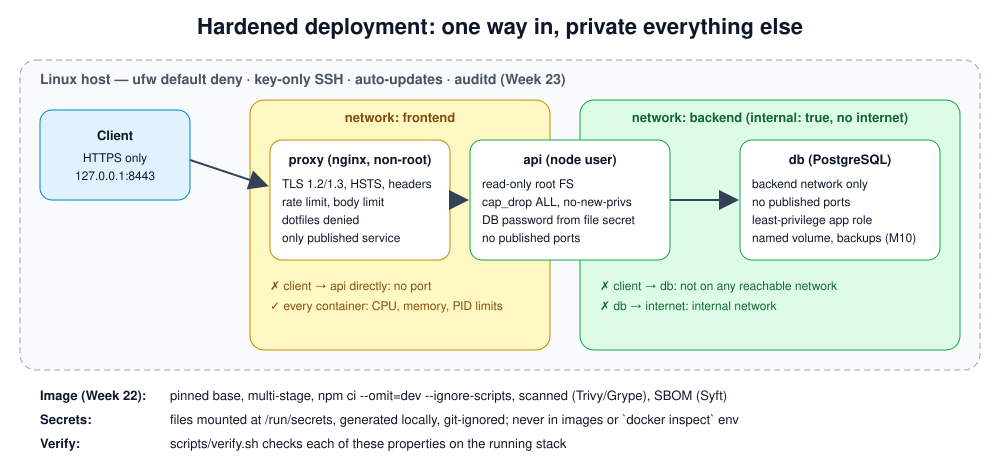
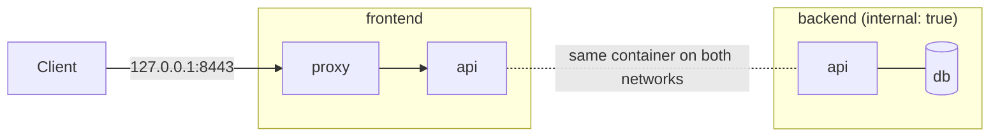

# Week 24 — Reverse Proxy and Runtime

> **Level:** Intermediate · **Time:** ~10 h · **Tracking:** [issue #10](https://github.com/mascot200/cybersecurity-roadmap/issues/10)
> **Lab files:** [`labs/hardened-deploy/`](labs/hardened-deploy/): [`proxy/nginx.conf`](labs/hardened-deploy/proxy/nginx.conf), [`compose.yaml`](labs/hardened-deploy/compose.yaml), [`scripts/`](labs/hardened-deploy/scripts/)

## 🎯 Objectives

1. Put a reverse proxy in front of the API: TLS termination, security headers, request limits.
2. Segment the network so the database is unreachable from outside and can't reach the internet.
3. Handle secrets at runtime without leaking them into images, environment listings or logs.
4. Set resource limits and timeouts.
5. Verify the whole deployment with a script.

## 🌍 Why it matters

Most exposed-database incidents aren't clever attacks. A database port was published "temporarily", or a
service listened on all interfaces. A single, well-configured entry point and private networks for
everything else remove whole classes of mistakes. The proxy also gives you one place to enforce TLS,
headers and limits for every service behind it.

---

## 📖 Concepts



### 1. The reverse proxy

From [`nginx.conf`](labs/hardened-deploy/proxy/nginx.conf):

| Setting | Purpose |
|---|---|
| `nginx-unprivileged` image, ports 8080/8443 | No root, no privileged ports needed |
| HTTP server returns `301` to HTTPS | No plaintext use |
| `ssl_protocols TLSv1.2 TLSv1.3` | Old protocols off |
| `Strict-Transport-Security` | Browsers stick to HTTPS (Month 1 W2) |
| `X-Content-Type-Options`, `Referrer-Policy`, CSP | Browser protections (Month 2) |
| `server_tokens off` | Don't advertise the version |
| `client_max_body_size 1m`, header/body timeouts | Limits slow or huge requests |
| `limit_req` zone per IP | Basic rate limiting at the edge |
| `location ~ /\. { deny all; }` | Never serve `.env`, `.git` |
| `X-Request-Id $request_id` to the API | Correlation IDs for logs (Month 10) |
| `*_temp_path /tmp/...` | Works with a read-only root filesystem |

**Trusting forwarded headers:** the API should trust `X-Forwarded-For`/`X-Forwarded-Proto` only from the
proxy (in Express: `app.set('trust proxy', 1)` when exactly one proxy is in front). Otherwise clients can
spoof their IP and defeat IP-based rate limits.

**TLS certificates:** the lab uses a self-signed certificate for `localhost` from `scripts/setup.sh`. In
production, use Let's Encrypt (ACME) or your cloud's certificate manager, and test with
[SSL Labs](https://www.ssllabs.com/ssltest/) or `testssl.sh`.

### 2. Network segmentation



| Rule | Implemented by |
|---|---|
| Only the proxy is published, only on localhost | `ports: "127.0.0.1:8443:8443"` |
| API reachable only from the proxy | No `ports:` on `api`; shares `frontend` with proxy |
| DB reachable only from the API | `db` only on `backend` |
| DB can't reach the internet | `backend` has `internal: true` |

### 3. Runtime secrets

| Approach | Risk |
|---|---|
| Hard-coded in code or image | Anyone with the image or repo has it |
| `environment:` variables | Visible in `docker inspect`, `/proc/<pid>/environ`, crash reports, debug endpoints |
| **Mounted files** (`secrets:` → `/run/secrets/…`, `*_FILE` variables) | Better: not in inspect output; can have file permissions |
| **Secrets manager** (AWS Secrets Manager, Vault) with short-lived credentials | Best for production; supports rotation and audit (Month 8) |

The lab's API reads `DB_PASSWORD_FILE`; PostgreSQL reads `POSTGRES_PASSWORD_FILE`. `setup.sh` generates the
password locally (git-ignored). `verify.sh` checks the password doesn't appear in the API container's
environment.

A trade-off to know: Compose file secrets are bind mounts that keep host permissions, so `setup.sh` makes
them readable (`644`) for the non-root container users. On a shared host that's weaker. Production
orchestrators (Swarm, Kubernetes, ECS) let you set the owner and mode of mounted secrets.

### 4. Resource limits and timeouts

- Per-container CPU, memory and PID limits (`deploy.resources.limits`).
- Proxy timeouts (`proxy_read_timeout`), DB `statement_timeout`, pool size limits in the app.
- Log rotation (`max-size`, `max-file`) so logs can't fill the disk.

---

## 🧪 Lab — Deploy and verify (4 h)

```bash
cd curriculum/02-intermediate/month-06-docker-host-deployment-security/labs/hardened-deploy
(cd api && npm install)
./scripts/setup.sh
docker compose up -d --build
./scripts/verify.sh
```

1. Get `verify.sh` fully passing. It covers each control in this lesson and Week 21.
2. Check from the host: `curl -vk https://127.0.0.1:8443/healthz` (TLS version, headers), `curl -I http://127.0.0.1:8080/` (redirect), `curl -sk https://127.0.0.1:8443/.env` (403).
3. Prove segmentation: `nc -zv 127.0.0.1 5432` from the host fails; `docker compose exec api sh -c 'nc -zv db 5432'` succeeds; `docker compose exec db sh -c 'wget -T 3 https://example.com'` fails.
4. Send 100 quick requests (`for i in $(seq 100); do curl -sk -o /dev/null -w '%{http_code}\n' https://127.0.0.1:8443/healthz; done | sort | uniq -c`) and observe `503` from nginx's rate limit.
5. Add `app.set('trust proxy', 1)` and a log line with `req.ip`. Confirm the logged IP is the client's, not the proxy's.

> ⚠️ What was checked when this was written: `docker compose config` validates the file; `setup.sh` was
> run (secret and certificate generated, safe to rerun); the API was run against PostgreSQL (health,
> readiness, secret read from file, clean SIGTERM shutdown). The images were **not** built and `nginx.conf`
> and `verify.sh` were **not** run (no Docker daemon or nginx available). Step 1 is where you confirm it.

---

## 📝 Assignment — Hardened API behind a reverse proxy

**Task:** deploy a hardened API with a reverse proxy and private database connectivity.

Deploy your own API (Month 3/5) with this pattern and write `DEPLOYMENT.md`: architecture diagram, each
control and what it prevents, `verify.sh` output, segmentation evidence, and limitations.

### Acceptance criteria
- [ ] Only the proxy is published (localhost in the lab)
- [ ] TLS with modern protocols, HSTS and security headers
- [ ] Database on an internal network, no published port, no internet access
- [ ] Secrets from files or a manager, never in images or environment
- [ ] Limits and timeouts at proxy, container and database levels
- [ ] `verify.sh` passes; evidence committed

---

## 💼 On the job

- Platform teams provide the proxy/ingress layer with these defaults so services inherit them.
- In the cloud, the same pattern becomes a load balancer in public subnets, services and databases in private subnets, and security groups between them (Month 7).

## ⚠️ Common mistakes

- Publishing database or admin ports "temporarily".
- Trusting `X-Forwarded-For` from anyone.
- Secrets in `environment:` because it's easier.
- No timeouts, so slow clients or queries tie up resources.

## 🥊 Drill (pass mark 8/10)

**1.** Why put a reverse proxy in front of the API?
<details><summary>Answer</summary>One hardened entry point: TLS termination, security headers, request limits, rate limiting and routing, while the app and database stay private.</details>

**2.** What does `internal: true` on a Docker network do?
<details><summary>Answer</summary>Containers on it get no route to external networks (no internet access).</details>

**3.** Why are environment variables a weak place for secrets?
<details><summary>Answer</summary>They show up in <code>docker inspect</code>, <code>/proc</code>, child processes, crash dumps and debug output.</details>

**4.** When should the app trust `X-Forwarded-For`?
<details><summary>Answer</summary>Only when it comes from a known proxy, configured explicitly (e.g. <code>trust proxy</code> with the exact number of hops).</details>

**5.** What does `server_tokens off` change?
<details><summary>Answer</summary>nginx stops including its version in headers and error pages.</details>

**6.** Why set `client_max_body_size` at the proxy if the app limits bodies too?
<details><summary>Answer</summary>Defense in depth, and huge bodies are rejected before reaching the app, saving resources.</details>

**7.** Which TLS protocol versions should be enabled today?
<details><summary>Answer</summary>TLS 1.2 and 1.3 only.</details>

**8.** Why does the proxy pass `X-Request-Id` to the API?
<details><summary>Answer</summary>So proxy and app logs for the same request can be correlated during debugging and investigations.</details>

**9.** Why do Compose file secrets need readable permissions in this lab, and what's the trade-off?
<details><summary>Answer</summary>They're bind-mounted with host permissions, so the non-root container user must be able to read them. On a shared host, other local users could read them too; orchestrators that set owner/mode are better.</details>

**10.** Scenario: an engineer adds `ports: ["5432:5432"]` to debug a query in staging. What do you suggest instead?
<details><summary>Answer</summary>Use <code>docker compose exec db psql</code>, or publish on <code>127.0.0.1</code> only via an SSH tunnel, and remove it afterwards. Never expose the database on all interfaces.</details>

## ✅ Checklist
- [ ] Lab steps 1–5
- [ ] Assignment acceptance criteria met
- [ ] Drill ≥ 8/10, weekly log on issue #10

## 📚 Resources
- nginx docs — <https://nginx.org/en/docs/>
- Mozilla SSL Configuration Generator — <https://ssl-config.mozilla.org/>
- Docker Compose secrets — <https://docs.docker.com/compose/how-tos/use-secrets/>
- Express behind proxies — <https://expressjs.com/en/guide/behind-proxies.html>

---
[← Week 23](week-23-linux-host-hardening.md) · [Month project →](project.md)
