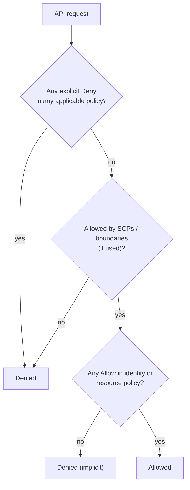

# Week 25 — IAM and Identity

> **Level:** Intermediate · **Time:** ~10 h · **Tracking:** [issue #11](https://github.com/mascot200/cybersecurity-roadmap/issues/11)
> **Lab files:** [`labs/policies/`](labs/policies/) (sample policies) and [`labs/policy-lint/`](labs/policy-lint/) (linter, 9/9 tests passing)

> 💸 **Before any cloud lab:** read [Safety & budget](../../../docs/safety-and-ethics.md#cloud-budget-protection-checklist). Set a budget alert first. Destroy resources after each lab.

## 🎯 Objectives

1. Explain AWS identities: root user, IAM users, roles, identity providers, and temporary credentials.
2. Read and write IAM policies: Effect, Action, Resource, Condition, Principal.
3. Explain how AWS evaluates permissions: explicit deny → allow → implicit deny, across policy types.
4. Set up separate identities for administration (SSO + MFA) and applications (roles).
5. Find over-permissive policies with a linter and IAM Access Analyzer.

## 🌍 Why it matters

In the cloud, **identity is the perimeter**. Anyone with valid credentials can call the API from anywhere.
Leaked access keys (committed to GitHub, left in a public image, found on a laptop) are one of the most
common causes of cloud breaches, and over-broad permissions decide how bad a leak becomes. A key that can
only read one bucket prefix is a minor incident; a key with `AdministratorAccess` can be a company-ending one.

---

## 📖 Concepts

### 1. Identities

| Identity | What it is | Rule |
|---|---|---|
| **Root user** | Owner of the account; can do everything, including close it | MFA on; no access keys; used only for the few tasks that need it |
| **IAM Identity Center (SSO) users** | People, via your identity provider | Preferred for humans: MFA, short-lived sessions |
| **IAM users** | Long-lived usernames/keys | Avoid for humans and apps; legacy only |
| **IAM roles** | Identities assumed for a while; no long-term keys | Use for apps (EC2/ECS/Lambda), CI (OIDC), cross-account access |
| **Temporary credentials (STS)** | Access key + secret + session token, expiring | What roles hand out |

### 2. Policy anatomy

From [`app-task-role.json`](labs/policies/app-task-role.json):

```json
{
  "Sid": "ReadWriteOwnUploadsPrefix",
  "Effect": "Allow",
  "Action": ["s3:GetObject", "s3:PutObject"],
  "Resource": "arn:aws:s3:::invoices-app-uploads-111122223333/tenants/*"
}
```

| Element | Meaning |
|---|---|
| `Effect` | `Allow` or `Deny` |
| `Action` | API operations (`service:Operation`) |
| `Resource` | ARNs the actions apply to |
| `Condition` | Extra requirements (MFA present, source IP, TLS, tags, source account) |
| `Principal` | Who (only in resource-based and trust policies) |

**Policy types:** identity-based (attached to users/roles), resource-based (S3 bucket policies, KMS key
policies), **trust policies** (who may assume a role), permissions boundaries, session policies, and
organization-level **SCPs** (guardrails for whole accounts).

### 3. How evaluation works



Default is **deny**. An explicit `Deny` always wins, which is why guardrails like
[`require-mfa.json`](labs/policies/require-mfa.json) use `Deny`.

### 4. Least privilege in practice

| Pattern | Example in the lab |
|---|---|
| Specific actions, not `service:*` | `s3:GetObject`, `s3:PutObject` only |
| Specific resources, not `*` | One bucket prefix, one KMS key, one secret |
| Conditions on trust policies | ECS trust limited by `aws:SourceAccount` / `aws:SourceArn` (stops the "confused deputy" problem) |
| Separate identities per purpose | Admin (SSO + MFA), app task role, CI deploy role (Month 8) |
| Start narrow, widen with evidence | Use CloudTrail and IAM Access Analyzer's policy generation to see what's actually used |

**Dangerous permissions** to treat like admin: `iam:PassRole` on `*`, `iam:CreatePolicyVersion`,
`iam:AttachRolePolicy`, `iam:PutRolePolicy`, `sts:AssumeRole` on `*`, `lambda:UpdateFunctionCode` on
functions with powerful roles. Each can be used to gain more privileges (Month 9 covers these paths).

### 5. The policy linter

[`lint_policies.py`](labs/policy-lint/lint_policies.py) flags common over-permissive patterns in `Allow` statements:

| Rule | Severity | Catches |
|---|---|---|
| `WILDCARD_ACTION` | CRITICAL | `"Action": "*"` |
| `PUBLIC_PRINCIPAL` | CRITICAL | `"Principal": "*"` with no condition |
| `ALLOW_WITH_NOTACTION` | HIGH | Allow everything except a list |
| `WILDCARD_RESOURCE` | HIGH | `"Resource": "*"` with non-read actions |
| `PASSROLE_ANY` | HIGH | `iam:PassRole` on any role |
| `SERVICE_WILDCARD_ACTION` | MEDIUM | `s3:*`, `ec2:*`… |

`Deny` statements are ignored, since they only remove access. The 9 tests prove the good sample policies
produce no findings and the broad example triggers each rule. It's a teaching tool. In real accounts use
**IAM Access Analyzer** (policy validation, unused access, external access findings).

---

## 🧪 Lab — Identities and policies (3–4 h)

**Part A: offline (no AWS needed)**

```bash
cd curriculum/02-intermediate/month-07-cloud-security-foundations/labs/policy-lint
python3 -m unittest -v             # 9 tests
python3 lint_policies.py ../policies/*.json
```

1. Read each sample policy and explain every statement in one sentence.
2. Add a rule to the linter (e.g. flag `sts:AssumeRole` on `*`, or a trust policy whose principal is a whole other account without an `sts:ExternalId` condition). Write the test first.

**Part B: in your AWS account** (free tier; budget alert set; delete afterwards)

1. Root user: enable MFA; confirm there are no root access keys.
2. Enable **IAM Identity Center**; create your admin user with MFA; stop using root.
3. Create a role for an ECS task using [`ecs-task-trust.json`](labs/policies/ecs-task-trust.json) and an inline policy based on [`app-task-role.json`](labs/policies/app-task-role.json) (replace account ID, region, bucket and key ARNs).
4. Use the **IAM policy simulator** to confirm the role can `s3:GetObject` under `tenants/` but not elsewhere, and can't `s3:DeleteObject`.
5. Run **IAM Access Analyzer → policy validation** on your policies, and compare with the linter.

---

## 📝 Assignment — Separate admin and application identities

**Task:** create separate lab identities for administrative and application tasks.

`IAM.md` with:
- identity inventory: who/what, type, how they authenticate, MFA, permissions summary
- the app role's trust policy and permissions, and why each statement is needed
- simulator evidence (allowed and denied actions)
- linter and Access Analyzer results with any fixes

### Acceptance criteria
- [ ] Root has MFA and no access keys; daily admin via SSO + MFA
- [ ] App role with specific actions and resources, and a conditioned trust policy
- [ ] Simulator evidence for allowed and denied cases
- [ ] No HIGH/CRITICAL linter findings on your policies
- [ ] Budget alert configured

---

## 💼 On the job

- Cloud security engineers spend much of their time on IAM: reviewing policies in PRs, removing unused permissions, investigating credential use.
- Organizations use SCPs as guardrails (e.g. deny disabling CloudTrail, deny regions you don't use).

## ⚠️ Common mistakes

- Using root or long-lived IAM user keys day to day.
- `AdministratorAccess` on application roles "to get it working".
- Trust policies that let any principal in another account assume a role.
- Keys in code, `.env` files in images, or CI variables (Month 8 replaces them with OIDC).

## 🥊 Drill (pass mark 8/10)

**1.** What wins: an Allow in an identity policy or a Deny in a bucket policy?
<details><summary>Answer</summary>The explicit Deny. An explicit deny in any applicable policy always wins.</details>

**2.** Why prefer roles over IAM users for applications?
<details><summary>Answer</summary>Roles provide short-lived, automatically rotated credentials; there are no long-term keys to leak.</details>

**3.** What is a trust policy?
<details><summary>Answer</summary>A resource-based policy on a role saying which principals may assume it (and under what conditions).</details>

**4.** Why is `iam:PassRole` on `*` dangerous?
<details><summary>Answer</summary>It lets the holder give any role (including admin roles) to a service like EC2 or Lambda, then use that service to act with the role's permissions.</details>

**5.** What problem do `aws:SourceAccount`/`aws:SourceArn` conditions solve in service trust policies?
<details><summary>Answer</summary>The confused-deputy problem: they stop a service acting on behalf of another account from assuming your role.</details>

**6.** What's the default decision when no policy mentions an action?
<details><summary>Answer</summary>Implicit deny.</details>

**7.** Name two things to do with the root user.
<details><summary>Answer</summary>Enable MFA, delete/never create access keys, use it only for tasks that require root, monitor its use.</details>

**8.** Why does the linter ignore Deny statements?
<details><summary>Answer</summary>Deny statements can only remove access; broad denies (like the MFA guardrail) are often intentional.</details>

**9.** What does IAM Access Analyzer add beyond a linter?
<details><summary>Answer</summary>Validation against AWS's full grammar and best practices, findings for resources shared outside your account, unused-access findings, and policy generation from CloudTrail activity.</details>

**10.** Scenario: a developer's IAM user access key appears in a public repo. Your steps?
<details><summary>Answer</summary>Deactivate/delete the key immediately; check CloudTrail for its use since exposure; contain anything it created or changed; rotate related secrets; move the developer to SSO with no long-lived keys; enable secret scanning and push protection.</details>

## ✅ Checklist
- [ ] Lab parts A and B
- [ ] Assignment acceptance criteria met
- [ ] Drill ≥ 8/10, weekly log on issue #11
- [ ] Cloud resources deleted / billing checked

## 📚 Resources
- AWS IAM best practices — <https://docs.aws.amazon.com/IAM/latest/UserGuide/best-practices.html>
- Policy evaluation logic — <https://docs.aws.amazon.com/IAM/latest/UserGuide/reference_policies_evaluation-logic.html>
- IAM Access Analyzer — <https://docs.aws.amazon.com/IAM/latest/UserGuide/what-is-access-analyzer.html>
- AWS Skill Builder — <https://skillbuilder.aws/>

---
[← Month overview](README.md) · [Next: Week 26 — Cloud networking →](week-26-cloud-networking.md)
