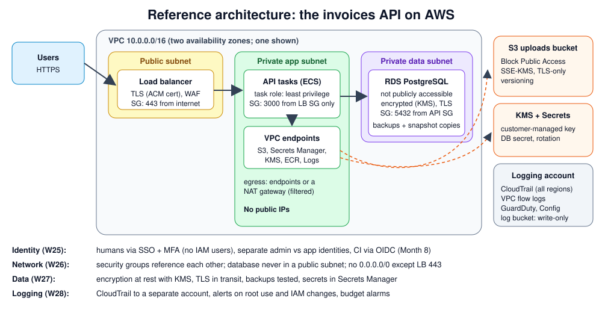
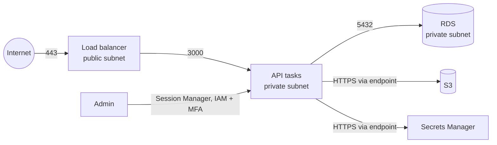

# Week 26 — Cloud Networking

> **Level:** Intermediate · **Time:** ~10 h · **Tracking:** [issue #11](https://github.com/mascot200/cybersecurity-roadmap/issues/11)

## 🎯 Objectives

1. Design a VPC with public and private subnets, route tables, internet and NAT gateways.
2. Use security groups (stateful, allow-only) and network ACLs (stateless) correctly.
3. Keep databases and app servers private; expose only the load balancer.
4. Use VPC endpoints to reach AWS services without the internet.
5. Diagram how requests reach the app and database, and remove unnecessary paths.

## 🌍 Why it matters

Many cloud data exposures come down to one network setting: a database marked "publicly accessible", a
security group with `0.0.0.0/0` on port 22 or 5432, an admin interface on a public IP. Attackers scan the
whole IPv4 internet continuously, so an exposed service is usually found within hours. Good network design
means a single mistake in one layer isn't enough to expose data.

---

## 📖 Concepts

### 1. Building blocks

| Component | What it does | Security note |
|---|---|---|
| **VPC** | Your private network (e.g. `10.0.0.0/16`) | Plan CIDRs so environments don't overlap |
| **Subnet** | A slice of the VPC in one availability zone | "Public" only means its route table points to an internet gateway |
| **Internet gateway (IGW)** | Path between public subnets and the internet | Only public subnets route to it |
| **NAT gateway** | Lets private subnets make *outbound* connections | No inbound; consider egress filtering |
| **Route table** | Where traffic for each destination goes | Private subnets: no `0.0.0.0/0 → IGW` route |
| **Security group (SG)** | Stateful allow-list firewall on each network interface | Reference other SGs instead of CIDRs |
| **Network ACL** | Stateless rules at the subnet edge | Coarse guardrail; remember return traffic |
| **VPC endpoint** | Private path to AWS services (S3, Secrets Manager, KMS…) | Traffic stays on AWS's network; endpoint policies can restrict it |
| **VPC flow logs** | Records of accepted/rejected connections | Essential for investigations (Week 28) |

### 2. Security groups that reference each other

| SG | Inbound | Why |
|---|---|---|
| `lb-sg` | TCP 443 from `0.0.0.0/0` | The only public entry point |
| `api-sg` | TCP 3000 from **`lb-sg`** | Only the load balancer can reach the API |
| `db-sg` | TCP 5432 from **`api-sg`** | Only API tasks can reach the database |

Referencing security groups (instead of IP ranges) means the rule follows the resources as they scale or
change IPs. Outbound rules matter too: restrict where app tasks can connect if you can.

### 3. Admin access without open ports

Don't open SSH (22) or RDP (3389) to the internet. Use **AWS Systems Manager Session Manager** (no inbound
ports, IAM-controlled, logged) or a VPN. For databases, connect through Session Manager port forwarding
or a bastion that's locked down and logged.

### 4. Request paths: draw them, then remove extras

Every arrow should be intentional. Anything not on this diagram, such as a public IP on a task, a route
from the data subnet to the internet, or a DB security group rule from `0.0.0.0/0`, should be removed.

---

## 🧪 Lab — Build and inspect a VPC (3–4 h, AWS; delete afterwards)

> NAT gateways and load balancers cost money per hour. Do this lab in one sitting and delete everything at the end.

1. Use the VPC console's **"VPC and more"** wizard: 2 AZs, public + private subnets, **no NAT gateway** for now.
2. Create the three security groups above, referencing each other.
3. Launch a small instance (free tier) in a **private** subnet with no public IP. Connect with **Session Manager** (it needs the `AmazonSSMManagedInstanceCore` role and either a NAT or VPC endpoints for `ssm`, `ssmmessages`, `ec2messages`). Note what you had to add, and why.
4. Enable **VPC flow logs** to CloudWatch Logs. Try connecting to the instance on port 22 from your laptop and find the `REJECT` record.
5. Add a gateway endpoint for S3. From the instance, list a bucket you own without any internet route.
6. Use **Reachability Analyzer** to confirm there's no path from the internet gateway to the instance.
7. Delete everything (instance, endpoints, VPC). Check the billing console the next day.

---

## 📝 Assignment — Diagram the request path and restrict it

**Task:** diagram how requests reach the application and database; restrict unnecessary paths.

`NETWORK.md` with:
- your diagram (subnets, route tables, gateways, SGs, endpoints)
- a table of every allowed path: source → destination, port, why it's needed
- a list of paths you removed or blocked, with evidence (Reachability Analyzer, flow logs)

### Acceptance criteria
- [ ] App and database in private subnets with no public IPs
- [ ] SG rules reference SGs; no `0.0.0.0/0` except the load balancer on 443
- [ ] Admin access without inbound SSH (Session Manager)
- [ ] Flow logs enabled and a REJECT record found
- [ ] Resources deleted and billing checked

---

## 💼 On the job

- Cloud security reviews check for public databases, open admin ports and missing flow logs first, because they're the most common serious findings.
- Infrastructure is usually defined in Terraform (Month 8), so network rules are reviewed in PRs.

## ⚠️ Common mistakes

- Opening `0.0.0.0/0` "temporarily" for SSH or a database.
- Putting everything in public subnets because it's easier.
- Forgetting that a NAT gateway allows *all* outbound traffic unless you filter it.
- Not enabling flow logs until after an incident.

## 🥊 Drill (pass mark 8/10)

**1.** What makes a subnet "public"?

Answer
Its route table has a route to an internet gateway.

**2.** Security group vs network ACL?

Answer
SGs are stateful, allow-only, attached to network interfaces. NACLs are stateless, have allow and deny rules, and apply at the subnet level.

**3.** Why reference security groups instead of CIDRs?

Answer
The rule follows the resources as IPs change or they scale, and it expresses intent ("only the API") precisely.

**4.** What does a NAT gateway allow and not allow?

Answer
Outbound connections from private subnets to the internet; no inbound connections initiated from the internet.

**5.** Why use VPC endpoints?

Answer
To reach AWS services privately without internet routes, and to restrict access with endpoint policies.

**6.** How do you administer private instances without opening SSH?

Answer
AWS Systems Manager Session Manager (IAM-controlled, logged, no inbound ports), or a VPN.

**7.** What do VPC flow logs record?

Answer
Metadata about IP traffic: source/destination, ports, protocol, bytes, and ACCEPT/REJECT, not packet contents.

**8.** Where should RDS live, and with what setting?

Answer
Private subnets, "publicly accessible" = No, SG allowing only the app's SG.

**9.** Why is "temporary" `0.0.0.0/0` on port 5432 dangerous?

Answer
Internet-wide scanners find exposed databases within hours, and temporary rules are often forgotten.

**10.** Scenario: flow logs show an app task connecting to an unknown external IP on port 4444. What do you do?

Answer
Treat it as a possible compromise: identify the task and image, capture evidence, isolate it (restrictive SG), check CloudTrail for its role's activity, and investigate. Then add egress restrictions so tasks can only reach what they need.

## ✅ Checklist
- [ ] Lab steps 1–7
- [ ] Assignment acceptance criteria met
- [ ] Drill ≥ 8/10, weekly log on issue #11
- [ ] Cloud resources deleted / billing checked

## 📚 Resources
- Amazon VPC security best practices — <https://docs.aws.amazon.com/vpc/latest/userguide/vpc-security-best-practices.html>
- Security groups — <https://docs.aws.amazon.com/vpc/latest/userguide/vpc-security-groups.html>
- Session Manager — <https://docs.aws.amazon.com/systems-manager/latest/userguide/session-manager.html>
- VPC Reachability Analyzer — <https://docs.aws.amazon.com/vpc/latest/reachability/what-is-reachability-analyzer.html>

---
[← Week 25](week-25-iam-identity.md) · [Next: Week 27 — Data protection →](week-27-data-protection.md)
