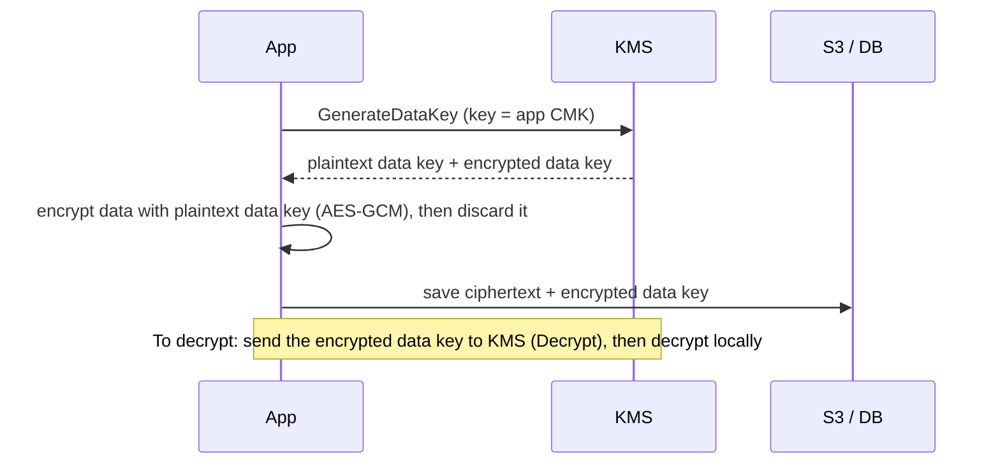

# Week 27 — Data Protection

> **Level:** Intermediate · **Time:** ~10 h · **Tracking:** [issue #11](https://github.com/mascot200/cybersecurity-roadmap/issues/11)
> **Lab files:** [`labs/policies/uploads-bucket-policy.json`](labs/policies/uploads-bucket-policy.json)

## 🎯 Objectives

1. Lock down S3: Block Public Access, bucket policies, encryption, versioning, presigned URLs.
2. Explain KMS: customer-managed keys, key policies, envelope encryption, rotation.
3. Store and rotate secrets with AWS Secrets Manager.
4. Protect databases: encryption at rest, TLS in transit, backups and snapshot sharing.
5. Verify access boundaries in a lab.

## 🌍 Why it matters

Misconfigured cloud storage has exposed billions of records over the years: backups, customer exports and
logs left readable to anyone with the bucket URL. In **2023**, Microsoft AI researchers accidentally exposed
about 38 TB of internal data through an over-permissive Azure storage SAS token shared in a public GitHub
repository. Data protection isn't one setting. It's access control, encryption, key management and backups
working together.

---

## 📖 Concepts

### 1. S3 controls

| Control | What it does |
|---|---|
| **Block Public Access** (account + bucket) | Overrides any policy or ACL that would make data public. Turn it on at the account level. |
| **Object Ownership: bucket owner enforced** | Disables ACLs; access is controlled only by policies |
| **Bucket policy** | Resource-based rules, e.g. deny non-TLS, require a specific KMS key |
| **Default encryption (SSE-KMS)** | Every object encrypted with your key |
| **Versioning** (+ MFA delete / Object Lock for critical data) | Recover from deletion or ransomware-style overwrites |
| **Presigned URLs** | Time-limited access to one object, generated by the app after authorization |
| **Access logs / CloudTrail data events** | Who read or wrote what |

The lab's [`uploads-bucket-policy.json`](labs/policies/uploads-bucket-policy.json) has two `Deny` statements:
1. `DenyNonTLS`: any request without `aws:SecureTransport` is denied.
2. `DenyWrongKmsKey`: uploads that **specify** a different KMS key are denied. Its two conditions are ANDed: the key-ID header is present (`Null: false`) **and** it isn't the app key (`StringNotEquals`). Uploads that send no key header still work and get the bucket's default key.
   > Why not `StringNotEqualsIfExists`? An `...IfExists` condition evaluates to **true** when the key is missing, so that Deny would also block uploads relying on default encryption. Condition-key edge cases like this are why you test bucket policies with real requests (lab step 4).

**Multi-tenant objects:** prefix keys by tenant (`tenants/<tenant-id>/...`), keep the bucket private, and
have the API authorize the request (Month 3) before issuing a short-lived presigned URL. Never put
tenant IDs in a way that lets one tenant construct another's URL without the API's check.

### 2. KMS and envelope encryption



- The master key never leaves KMS. Every `Decrypt` is authorized by IAM **and** the key policy, and is logged in CloudTrail.
- **Key policies** decide who can administer vs use a key. Separate the two roles.
- Enable automatic **rotation** for customer-managed keys.
- Encryption at rest protects against lost disks and some storage-level access. It doesn't protect against someone with valid credentials and `kms:Decrypt`. Access control still matters most.

### 3. Secrets Manager

- Store DB passwords and API keys in Secrets Manager, encrypted with your KMS key.
- The app role gets `secretsmanager:GetSecretValue` on **one** secret ([`app-task-role.json`](labs/policies/app-task-role.json)).
- Enable **rotation** (RDS has managed rotation). The app must handle rotation: re-fetch on authentication failure, or cache with a short TTL.
- Even better for RDS: **IAM database authentication** or RDS-managed master passwords, so fewer long-lived passwords exist at all.

### 4. Databases and backups

| Control | Setting |
|---|---|
| Encryption at rest | RDS encryption with a customer-managed KMS key (set at creation) |
| TLS in transit | `rds.force_ssl=1` (PostgreSQL parameter); clients verify the RDS CA |
| Not public | `PubliclyAccessible = false`, private subnets, SG from the app only |
| Backups | Automated backups with retention; copy snapshots to another account/region for ransomware resilience |
| Snapshot sharing | Never share snapshots publicly; check with AWS Config rules |
| Least-privilege DB users | App user without superuser rights (Month 3) |

---

## 🧪 Lab — Prove the boundaries (3 h, AWS; delete afterwards)

1. Confirm **account-level Block Public Access** is on (S3 console → Block Public Access settings for this account).
2. Create a customer-managed KMS key and a bucket with default SSE-KMS using it, versioning on, ACLs disabled.
3. Apply [`uploads-bucket-policy.json`](labs/policies/uploads-bucket-policy.json) (replace bucket name, account ID and key ARN).
4. Prove the boundaries with the AWS CLI:
   ```bash
   aws s3 cp test.txt s3://<bucket>/tenants/t1/test.txt                       # works (default key)
   aws s3api head-object --bucket <bucket> --key tenants/t1/test.txt          # shows SSEKMSKeyId
   aws s3 cp test.txt s3://<bucket>/tenants/t1/x.txt --sse aws:kms --sse-kms-key-id <other-key-arn>   # AccessDenied
   aws s3 presign s3://<bucket>/tenants/t1/test.txt --expires-in 60           # works for 60 s, then expires
   ```
5. Try making the bucket public with a policy granting `Principal: "*"`. Block Public Access should refuse it.
6. Create a secret in Secrets Manager; give a test role access to only that secret; confirm it can't read another one (policy simulator).
7. Delete the bucket contents, bucket, secret (with a short recovery window) and schedule the key for deletion.

---

## 📝 Assignment — Data-protection design

**Task:** document a data-protection design and verify access boundaries in a lab.

`DATA_PROTECTION.md` with:
- a data inventory: what data, where it lives, sensitivity, who/what can access it
- controls per store (S3, RDS, secrets): access, encryption, keys, backups, logging
- key management: key owners vs users, rotation
- evidence from the lab (allowed and denied operations)
- backup and restore plan with RPO/RTO targets (tested in Month 10)

### Acceptance criteria
- [ ] Data inventory and classification
- [ ] Block Public Access on at account level; bucket policy with TLS and key requirements
- [ ] Evidence of denied operations (wrong key, public policy, other secret)
- [ ] Secrets in Secrets Manager with rotation plan
- [ ] Backup plan with targets
- [ ] Lab resources deleted

---

## 💼 On the job

- Cloud posture tools (AWS Security Hub, Config rules) continuously flag public buckets, unencrypted volumes and shared snapshots.
- Data classification decides which controls apply where. It's often driven by compliance (GDPR, PCI DSS, HIPAA).

## ⚠️ Common mistakes

- Relying on obscure bucket names instead of access control.
- Assuming encryption at rest stops someone with valid credentials.
- One KMS key used by everything, with admins able to decrypt everything.
- Backups in the same account as production, deletable by the same credentials.
- Secrets in environment variables or task definitions in plain text.

## 🥊 Drill (pass mark 8/10)

**1.** What does S3 Block Public Access do?
<details><summary>Answer</summary>It overrides bucket policies and ACLs that would grant public access, preventing data from being made public.</details>

**2.** What is envelope encryption?
<details><summary>Answer</summary>Data is encrypted with a data key; the data key is encrypted with a master key in KMS; only the encrypted data key is stored with the data.</details>

**3.** Does encryption at rest protect against a stolen app role credential with `kms:Decrypt`?
<details><summary>Answer</summary>No. The credential can read and decrypt the data. Access control and least privilege matter most.</details>

**4.** How does the lab's bucket policy enforce TLS?
<details><summary>Answer</summary>A Deny statement for all actions when <code>aws:SecureTransport</code> is false.</details>

**5.** Why use presigned URLs for user downloads?
<details><summary>Answer</summary>The bucket stays private; the app authorizes each request and issues a short-lived URL for exactly one object.</details>

**6.** Why copy backups to another account?
<details><summary>Answer</summary>So an attacker (or mistake) with production credentials can't delete both data and backups.</details>

**7.** What should a key policy separate?
<details><summary>Answer</summary>Key administrators (manage the key) from key users (encrypt/decrypt).</details>

**8.** What must an app do to cope with secret rotation?
<details><summary>Answer</summary>Fetch the secret at runtime (with a short cache) and refresh it when authentication fails, instead of reading it once at deploy time.</details>

**9.** How do you enforce TLS to RDS PostgreSQL?
<details><summary>Answer</summary>Set the parameter <code>rds.force_ssl=1</code>, and have clients verify the server certificate against the RDS CA bundle.</details>

**10.** Scenario: a security tool reports an RDS snapshot shared publicly. What do you do?
<details><summary>Answer</summary>Remove public sharing immediately, check CloudTrail for who shared it and whether it was copied, assess the data exposed, rotate credentials stored in it, follow incident/notification procedures, and add a guardrail (Config rule / SCP) to prevent it.</details>

## ✅ Checklist
- [ ] Lab steps 1–7
- [ ] Assignment acceptance criteria met
- [ ] Drill ≥ 8/10, weekly log on issue #11
- [ ] Cloud resources deleted / billing checked

## 📚 Resources
- S3 security best practices — <https://docs.aws.amazon.com/AmazonS3/latest/userguide/security-best-practices.html>
- AWS KMS concepts — <https://docs.aws.amazon.com/kms/latest/developerguide/concepts.html>
- Secrets Manager rotation — <https://docs.aws.amazon.com/secretsmanager/latest/userguide/rotating-secrets.html>
- RDS security — <https://docs.aws.amazon.com/AmazonRDS/latest/UserGuide/UsingWithRDS.html>

---
[← Week 26](week-26-cloud-networking.md) · [Next: Week 28 — Logging & governance →](week-28-logging-governance.md)
