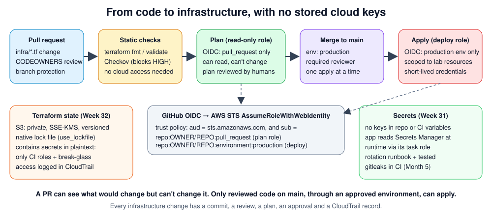

# Month 8 — Terraform, Secrets and Secure Delivery

> 🔵 **Level 2 · Intermediate** · Weeks 29–32 · ~40 h · Tracking issue: [#12](https://github.com/mascot200/cybersecurity-roadmap/issues/12) · **Level 2 gate**

**Goal:** make infrastructure security repeatable and reduce deployment mistakes.

Month 7 secured cloud resources by hand. This month every one of those controls becomes reviewed,
scanned code, deployed by a pipeline that holds no long-lived keys.

> 💸 Destroy everything at the end of each session (`terraform destroy`) and check billing.

## Weekly plan

| Week | Lesson | You will build / prove | Est. time |
|---|---|---|---|
| 29 | [Terraform foundations](week-29-terraform-foundations.md) | Encrypted private bucket as code, plan reviews, drift fix | 10 h |
| 30 | [Infrastructure scanning](week-30-infrastructure-scanning.md) | Checkov in CI, custom policy, documented gates | 10 h |
| 31 | [Secret and identity management](week-31-secrets-identity-management.md) | GitHub OIDC plan/deploy roles, secrets at runtime, a tested rotation | 10 h |
| 32 | [State and recovery](week-32-state-recovery.md) | Protected state, restore and lock drills, teardown procedure | 10 h |
| — | [Month project](project.md) | **Project 4: Terraform deployment with least-privilege CI** | woven into weeks |
| — | [Level 2 checkpoint drill](drill.md) | ≥ 80% + practical task | 75 min |

## Lab files and what was verified

| File | Verified when this was written |
|---|---|
| [`labs/oidc/*.json`](labs/oidc/) | Valid JSON; linted with the Month 7 policy linter. Trust and plan policies are clean. The deploy role has one known false positive (`kms:CreateKey` needs `Resource: "*"`; limited by a request-tag condition), used as a triage example in Week 30 |
| [`labs/ci/terraform.yml`](labs/ci/terraform.yml) | Valid YAML. **Not run** on GitHub Actions |
| [`labs/terraform/*.tf`](labs/terraform/) | Structure checked (balanced blocks). **`terraform validate`/`plan` not run**: Terraform couldn't be installed in the build environment. Running them is Week 29's first step |

## Milestone (Level 2 gate)

- [ ] Explain how code becomes infrastructure, where secrets can leak, and which checks block unsafe deployments
- [ ] Project 4 complete
- [ ] **Level 2 checkpoint drill ≥ 80%**, then close the Level 2 epic [#3](https://github.com/mascot200/cybersecurity-roadmap/issues/3)

## Recommended resources

- **Terraform sensitive data** — <https://developer.hashicorp.com/terraform/language/manage-sensitive-data>
- **GitHub security features** — <https://docs.github.com/en/code-security/getting-started/github-security-features>

---
[← Month 7](../month-07-cloud-security-foundations/README.md) · [Course home](../../../README.md) · [Start Week 29 →](week-29-terraform-foundations.md)
