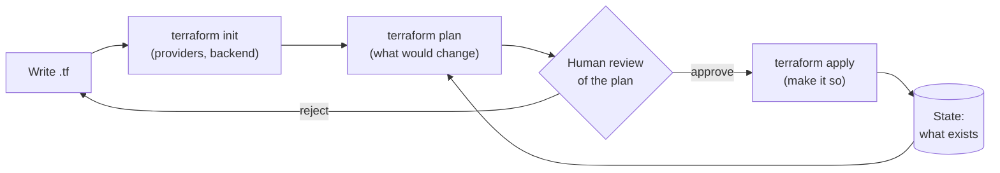

# Week 29 — Terraform Foundations

> **Level:** Intermediate · **Time:** ~10 h · **Tracking:** [issue #12](https://github.com/mascot200/cybersecurity-roadmap/issues/12)
> **Lab files:** [`labs/terraform/`](labs/terraform/) (an encrypted, private S3 bucket and KMS key)

> 💸 KMS keys cost about $1/month each while they exist. Run `terraform destroy` at the end of each session.

## 🎯 Objectives

1. Explain Terraform's workflow: write → `init` → `plan` → review → `apply` → `destroy`.
2. Use providers, resources, data sources, variables (with validation), outputs and modules.
3. Read a plan carefully, and spot risky changes (replacements, deletions, policy changes) before applying.
4. Express the Month 7 security controls as code.

## 🌍 Why it matters

Clicking in a console is fast for one resource and terrible for security at scale: changes aren't reviewed,
can't be repeated exactly, and drift silently. Infrastructure as code (IaC) puts infrastructure through the
same process as application code: version control, review, automated checks and history. It also means a
security fix ("block public access on every bucket") is applied everywhere at once, and a review can catch
a public database before it exists.

---

## 📖 Concepts

### 1. The workflow

Terraform compares **configuration** (what you want) with **state** (what it created) and the real
infrastructure, then proposes changes.

### 2. Building blocks (from the lab)

| Block | Example in [`labs/terraform/`](labs/terraform/) |
|---|---|
| `terraform {}` | Required versions, S3 backend with native locking ([`versions.tf`](labs/terraform/versions.tf)) |
| `provider` | AWS region + `default_tags` so every resource is tagged `project = cyber-lab` |
| `variable` | `name_prefix` with a `validation` rule ([`variables.tf`](labs/terraform/variables.tf)) |
| `data` | `aws_caller_identity` (account ID), `aws_iam_policy_document` (policy built in HCL) |
| `resource` | KMS key with rotation; bucket; Block Public Access; ownership controls; versioning; SSE-KMS; TLS-only policy ([`main.tf`](labs/terraform/main.tf)) |
| `output` | Bucket name and key ARN ([`outputs.tf`](labs/terraform/outputs.tf)) |
| `module` | Reusable groups of resources, e.g. a "secure bucket" module used everywhere |

The lab is Week 27's bucket design as code: every control from that lesson is a resource here, so it can
be reviewed and scanned.

### 3. Reading a plan like a reviewer

| Symbol | Meaning | Ask |
|---|---|---|
| `+` create | New resource | Is it private by default? Tagged? |
| `~` update in place | Attribute change | Does it open access (CIDR, principal, public flag)? |
| `-/+` replace | Destroy and recreate | Data loss? Downtime? (databases, buckets) |
| `-` destroy | Deletion | Intended? Backups? |

Watch especially for changes to: security groups, IAM policies and trust policies, bucket policies and
public access blocks, `publicly_accessible`, encryption settings, and logging resources.

Save the plan and apply exactly that: `terraform plan -out=tfplan` then `terraform apply tfplan`, so what
was reviewed is what gets applied.

### 4. Good habits

- Pin provider versions (`~> 5.0`) and commit `.terraform.lock.hcl`.
- `terraform fmt` and `terraform validate` before every commit.
- Use `default_tags` for ownership and cost tracking.
- Variables with `validation` blocks to reject bad inputs early.
- Never commit `*.tfstate` or `*.tfvars` with secrets (see the lab's [`.gitignore`](labs/terraform/.gitignore)).
- `force_destroy = true` is for labs only. In production it lets a destroy delete all objects.

---

## 🧪 Lab — Provision, inspect, destroy (3–4 h, AWS)

> The lab's Terraform was written to the AWS provider's documentation and checked for structure, but it
> **wasn't run** where this course was written (no Terraform or AWS available). `terraform validate` and
> `terraform plan` are your first checks. Fixing anything they report is part of the exercise.

1. Install Terraform (≥ 1.10). Create the state bucket by hand for now (private, versioned, SSE): Week 32 covers bootstrapping it properly. Put its name in `versions.tf`.
2. `terraform init`, `terraform fmt -check`, `terraform validate`.
3. `terraform plan -out=tfplan`. Read every resource and explain each security-relevant attribute.
4. `terraform apply tfplan`. In the console, confirm Block Public Access, SSE-KMS with your key, versioning and the bucket policy.
5. **Drift:** in the console, turn off one Block Public Access setting. Run `terraform plan` again: Terraform should propose changing it back. Apply to fix the drift.
6. **Review practice:** change `restrict_public_buckets` to `false` and run `plan`. Write the review comment you'd leave on that PR. Revert.
7. `terraform destroy`. Confirm the bucket is gone and the key is scheduled for deletion.

---

## 📝 Assignment — Provision a lab and review the plan first

**Task:** provision a small lab environment and review the plan before applying it.

1. Extend the lab with a VPC from Week 26 (public/private subnets, no NAT) and the three security groups, or with your Week 25 app role.
2. Turn the bucket into a reusable module (`modules/secure-bucket`) with inputs for name and KMS key.
3. For each apply, save the plan output and write a short review: what changes, security impact, approve/reject.

### Acceptance criteria
- [ ] `fmt` and `validate` pass; provider versions pinned; lock file committed
- [ ] Secure-bucket module used by the root config
- [ ] Plan reviews written before each apply
- [ ] Drift detected and corrected
- [ ] Everything destroyed at the end; billing checked

---

## 💼 On the job

- Cloud security engineers review Terraform PRs daily; reading plans quickly is a core skill.
- Shared modules (secure bucket, standard VPC) make the secure option the easy option.

## ⚠️ Common mistakes

- Applying without reading the plan.
- Making manual console changes that drift from code.
- Unpinned providers, so a new provider version changes behaviour.
- Committing state files or secrets in `tfvars`.

## 🥊 Drill (pass mark 8/10)

**1.** What does Terraform state contain?

Answer
A record of the resources Terraform manages and their attributes, mapping configuration to real infrastructure (including sensitive values).

**2.** What does `-/+` mean in a plan, and why care?

Answer
The resource will be destroyed and recreated, which can mean data loss or downtime (e.g. for databases).

**3.** Why `plan -out` then `apply <planfile>`?

Answer
So exactly the reviewed changes are applied, not a new plan computed later.

**4.** What is drift?

Answer
Differences between real infrastructure and the code/state, usually from manual changes.

**5.** Why commit `.terraform.lock.hcl`?

Answer
It pins exact provider versions and checksums, so everyone and CI use the same, verified providers.

**6.** Why is `force_destroy = true` dangerous in production?

Answer
A destroy (or a replacement) would delete the bucket and all its objects.

**7.** Which plan changes deserve the closest security review?

Answer
Security groups, IAM and trust policies, bucket policies and public access blocks, public flags (<code>publicly_accessible</code>), encryption and logging resources.

**8.** What does `default_tags` give you?

Answer
Consistent tags on every resource for ownership, cost tracking and tag-based policies.

**9.** What's a variable `validation` block for?

Answer
Rejecting invalid inputs at plan time with a clear message.

**10.** Scenario: a PR's plan shows `~ cidr_blocks = ["10.0.0.0/16"] -> ["0.0.0.0/0"]` on the database security group. Your review?

Answer
Block it: it exposes the database to the internet. Ask what access is needed; use a security-group reference from the app SG or Session Manager for admin access. Add a Checkov/policy rule so it's caught automatically (Week 30).

## ✅ Checklist
- [ ] Lab steps 1–7
- [ ] Assignment acceptance criteria met
- [ ] Drill ≥ 8/10, weekly log on issue #12
- [ ] `terraform destroy` run; billing checked

## 📚 Resources
- Terraform tutorials (AWS) — <https://developer.hashicorp.com/terraform/tutorials/aws-get-started>
- AWS provider docs — <https://registry.terraform.io/providers/hashicorp/aws/latest/docs>
- Terraform S3 backend — <https://developer.hashicorp.com/terraform/language/backend/s3>

---
[← Month overview](README.md) · [Next: Week 30 — Infrastructure scanning →](week-30-infrastructure-scanning.md)
