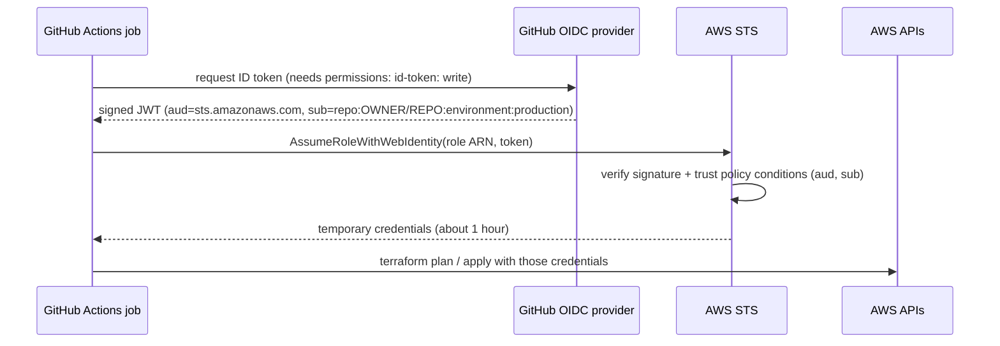

# Week 31 — Secret and Identity Management

> **Level:** Intermediate · **Time:** ~10 h · **Tracking:** [issue #12](https://github.com/mascot200/cybersecurity-roadmap/issues/12)
> **Lab files:** [`labs/oidc/`](labs/oidc/): GitHub OIDC trust policies and role permissions (JSON-validated, linted)

## 🎯 Objectives

1. Replace long-lived cloud keys in CI with **OIDC federation** and short-lived role credentials.
2. Write trust policies that accept only the right repository, branch or environment.
3. Separate a read-only plan role from a deploy role.
4. Remove secrets from source code and inject them at runtime.
5. Write and test a rotation procedure.

## 🌍 Why it matters

CI systems are attractive targets because they hold keys to production. In the **CircleCI incident
(January 2023)**, malware on an engineer's laptop led to theft of a session token and then of customer
secrets stored in CircleCI; CircleCI told customers to rotate every secret stored there. Teams using
OIDC had far less to rotate, since there were no long-lived cloud keys to steal. The fewer standing
secrets you have, the smaller every incident gets.

---

## 📖 Concepts

### 1. OIDC federation from GitHub Actions to AWS



This is the JWT verification from Month 3 Week 10, with AWS as the verifier: it checks the issuer, the
audience and the subject claim against the role's trust policy.

### 2. Trust policies: the subject claim is the security boundary

From [`github-deploy-trust.json`](labs/oidc/github-deploy-trust.json):

```json
"Condition": {
  "StringEquals": {
    "token.actions.githubusercontent.com:aud": "sts.amazonaws.com",
    "token.actions.githubusercontent.com:sub": "repo:YOUR-GITHUB-USER/YOUR-REPO:environment:production"
  }
}
```

| `sub` value | Who can assume the role |
|---|---|
| `repo:OWNER/REPO:environment:production` | Only jobs using the `production` environment (which can require reviewers and restrict branches) |
| `repo:OWNER/REPO:ref:refs/heads/main` | Only jobs running on `main` |
| `repo:OWNER/REPO:pull_request` | PR jobs ([`github-plan-trust.json`](labs/oidc/github-plan-trust.json)), so give this role read-only permissions |
| `repo:OWNER/*` (wildcard with `StringLike`) | ⚠️ Every repo and branch of that owner |
| no `sub` condition | ⛔ **Any** GitHub repository in the world could assume the role |

Always use `StringEquals` with a specific subject, and use **environments** for anything that can change production.

### 3. Two roles, two jobs

| Role | Trust | Permissions | Lint result |
|---|---|---|---|
| Plan | `pull_request` | Read state, take/release the lock file, read lab resources ([`plan-role-permissions.json`](labs/oidc/plan-role-permissions.json)) | Clean |
| Deploy | `environment:production` | Manage `invoices-lab-*` buckets, lab-tagged KMS keys, write state ([`deploy-role-permissions.json`](labs/oidc/deploy-role-permissions.json)) | One known false positive (`kms:CreateKey` on `*`, limited by a request-tag condition) |

Two details that came out of writing these:
- With S3 native locking, `terraform plan` **writes** a lock file (`*.tflock`), so even the read-only role needs `PutObject`/`DeleteObject` on that one key pattern, and nothing else in the bucket.
- Deploy permissions are scoped by **name prefix** (buckets) and **tags** (KMS keys). Tag-based conditions only work if the tag can't be changed by someone without permission. Protect `project` tags with an SCP or by not granting `TagResource` broadly.

### 4. Secrets in applications

| Instead of | Use |
|---|---|
| Secret in code or `.env` committed to git | Secrets Manager / Parameter Store, read at runtime by the app's role |
| AWS keys for the app | The task/instance role (automatic short-lived credentials) |
| DB password in Terraform variables | RDS-managed master password (`manage_master_user_password = true`) or IAM DB auth |
| Long-lived CI keys | OIDC federation (above) |

**Keeping secrets out of Terraform state:** state stores resource attributes in plaintext, including
generated passwords. Prefer resources where AWS generates and stores the secret (RDS managed passwords), and
look at Terraform's ephemeral values and write-only arguments (Terraform 1.10+/1.11+) for secrets that must
pass through Terraform.

### 5. Rotation procedure

A rotation runbook every team should have and test:

1. **Inventory:** where is the secret stored, who and what uses it?
2. **Create** the new credential (both old and new valid at once if the system supports it).
3. **Deploy** consumers with the new value (or let them re-fetch from Secrets Manager).
4. **Verify** everything works with the new credential (health checks, logs).
5. **Revoke** the old credential.
6. **Confirm** the old one fails, and check logs for any use after revocation.
7. **Record** date, who, and what was rotated.

Automate it where the platform supports it (Secrets Manager rotation for RDS).

---

## 🧪 Lab — Keys out, OIDC in (3–4 h, AWS + GitHub)

1. In AWS IAM, add GitHub's OIDC identity provider (`token.actions.githubusercontent.com`, audience `sts.amazonaws.com`).
2. Create the plan and deploy roles from [`labs/oidc/`](labs/oidc/) (replace account ID, repo, state bucket name).
3. In your repo, create a `production` environment with yourself as required reviewer and "selected branches: main".
4. Store the role ARNs as repository **variables** (`TF_PLAN_ROLE_ARN`, `TF_DEPLOY_ROLE_ARN`). They're identifiers, not secrets.
5. Run the [`terraform.yml`](labs/ci/terraform.yml) workflow: open a PR (plan runs), merge (apply waits for your approval).
6. **Negative tests:**
   - From a branch, add a workflow job that tries the deploy role without the environment. It should fail with `Not authorized to perform sts:AssumeRoleWithWebIdentity`.
   - Try `terraform apply` with the plan role. It should be denied.
7. Search your repos and CI settings for remaining long-lived AWS keys (`gitleaks`, repo secrets list). Delete them.

---

## 📝 Assignment — Secrets out of code, rotation procedure

**Task:** remove secrets from source code and implement a rotation procedure.

1. Your Month 5/6 API reads its DB password from Secrets Manager at runtime (or uses RDS IAM auth).
2. CI uses OIDC only; no AWS keys remain in GitHub secrets.
3. Write `ROTATION.md` using the 7-step procedure and **perform one rotation**, with evidence (timestamps, health checks, failed use of the old credential).

### Acceptance criteria
- [ ] No long-lived cloud keys in repo, CI or app config (gitleaks clean)
- [ ] Plan and deploy roles with specific `sub` conditions; negative tests recorded
- [ ] App reads secrets at runtime via its role
- [ ] One rotation performed and documented

---

## 💼 On the job

- Moving CI to OIDC is one of the highest-value, lowest-effort cloud security improvements.
- Secret sprawl (the same secret in many places) is what makes rotation painful. Inventories fix that.

## ⚠️ Common mistakes

- Trust policies without a `sub` condition, or with wildcards.
- The same role for PR plans and production applies.
- Treating role ARNs as secrets while storing real keys as plain variables.
- Rotation plans that have never been tested.

## 🥊 Drill (pass mark 8/10)

**1.** Why is OIDC better than storing AWS keys in CI?
<details><summary>Answer</summary>No long-lived secret exists to steal; each job gets short-lived credentials limited by the trust policy.</details>

**2.** What does `permissions: id-token: write` do in a GitHub workflow?
<details><summary>Answer</summary>Allows the job to request an OIDC ID token from GitHub.</details>

**3.** What happens if a trust policy has no `sub` condition?
<details><summary>Answer</summary>Any GitHub Actions workflow in any repository could assume the role.</details>

**4.** Why use an environment-based subject for the deploy role?
<details><summary>Answer</summary>Environments can require reviewers and restrict branches, so only approved runs from main can deploy.</details>

**5.** Why does the read-only plan role need `PutObject` at all?
<details><summary>Answer</summary>With S3 native locking, <code>terraform plan</code> creates and deletes a lock file; the permission is limited to <code>*.tflock</code> keys.</details>

**6.** Where do secrets end up in Terraform, and how do you limit it?
<details><summary>Answer</summary>In state, in plaintext. Use AWS-managed secrets (e.g. RDS managed passwords), ephemeral values/write-only arguments, and protect the state (Week 32).</details>

**7.** Name the seven steps of the rotation procedure.
<details><summary>Answer</summary>Inventory, create new, deploy consumers, verify, revoke old, confirm old fails, record.</details>

**8.** Why can tag-based IAM conditions be weak?
<details><summary>Answer</summary>Anyone who can change the tag can satisfy the condition; protect the tag keys.</details>

**9.** What's the risk of `StringLike` with `repo:OWNER/*`?
<details><summary>Answer</summary>Every repository and branch of that owner (including forks' workflows in some setups and future repos) can assume the role.</details>

**10.** Scenario: your CI vendor reports a breach. What do you rotate if you use OIDC for AWS?
<details><summary>Answer</summary>Any secrets still stored in the CI system (third-party API tokens, signing keys, webhooks). AWS needs no key rotation, but review CloudTrail for role sessions from unexpected runs during the incident window, and tighten trust policies if needed.</details>

## ✅ Checklist
- [ ] Lab steps 1–7
- [ ] Assignment acceptance criteria met
- [ ] Drill ≥ 8/10, weekly log on issue #12

## 📚 Resources
- GitHub: configuring OIDC in AWS — <https://docs.github.com/en/actions/security-for-github-actions/security-hardening-your-deployments/configuring-openid-connect-in-amazon-web-services>
- aws-actions/configure-aws-credentials — <https://github.com/aws-actions/configure-aws-credentials>
- Terraform sensitive data — <https://developer.hashicorp.com/terraform/language/manage-sensitive-data>
- OWASP Secrets Management Cheat Sheet — <https://cheatsheetseries.owasp.org/cheatsheets/Secrets_Management_Cheat_Sheet.html>

---
[← Week 30](week-30-infrastructure-scanning.md) · [Next: Week 32 — State & recovery →](week-32-state-recovery.md)
