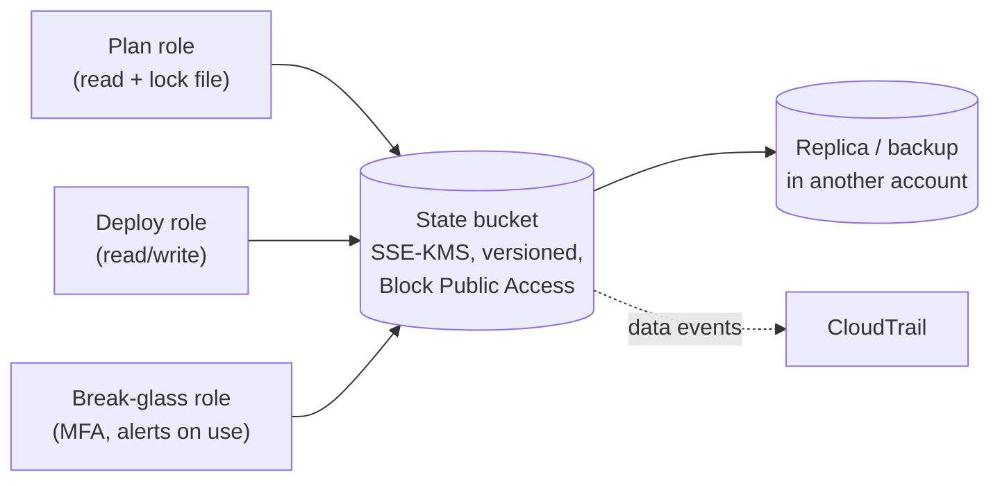

# Week 32 — State and Recovery

> **Level:** Intermediate · **Time:** ~10 h · **Tracking:** [issue #12](https://github.com/mascot200/cybersecurity-roadmap/issues/12)

## 🎯 Objectives

1. Explain why Terraform state is sensitive and what an attacker could do with read or write access to it.
2. Store state remotely: encrypted, versioned, locked, with tightly restricted and logged access.
3. Bootstrap the state bucket safely.
4. Recover from common state problems: a bad apply, a corrupted or deleted state file, a stuck lock.
5. Document state storage, access, backup and recovery, and a full teardown procedure.

## 🌍 Why it matters

State is a map of your infrastructure, often with secrets in plaintext: database passwords, private keys,
tokens. **Read** access leaks those. **Write** access is worse: someone who edits state can trick the next
`apply` into changing or destroying real resources. And if state is lost, Terraform no longer knows what
it manages, which turns routine changes into risky manual imports.

---

## 📖 Concepts

### 1. Threats to state

| Threat | Impact | Control |
|---|---|---|
| State readable by too many people | Secrets exposed; full infrastructure map | Restrict to CI roles + break-glass; SSE-KMS with a key only they can use |
| State modified | Next apply changes/destroys real resources | Restrict writes to CI roles; versioning; review CloudTrail data events |
| State deleted or corrupted | Terraform loses track of resources | Versioning, MFA delete / Object Lock, cross-account backup |
| Two applies at once | Corrupted state, conflicting changes | Locking (`use_lockfile = true`), CI `concurrency` |
| State committed to git | Secrets in history forever | `.gitignore`, secret scanning |

### 2. The state bucket

Settings: Block Public Access; ownership enforced (no ACLs); versioning; SSE-KMS with a dedicated key whose
key policy allows only these roles to decrypt; a bucket policy denying non-TLS and denying everyone else;
CloudTrail **data events** for the bucket; optionally replication to a backup account.

**Bootstrapping** (the chicken-and-egg problem): the state bucket can't store its own state before it
exists. Create it with a tiny separate Terraform config using local state, then migrate that state into
the bucket (`terraform init -migrate-state`), or create it once with a reviewed CLI script. Either way,
document it.

### 3. Recovery playbooks

| Situation | Recovery |
|---|---|
| Bad apply (wrong change went out) | Revert the commit and apply again through the pipeline; for data resources, restore from backups (Month 10) |
| State file corrupted or overwritten | Restore the previous **object version** from the versioned bucket, then `terraform plan` to confirm it matches reality |
| State deleted | Restore from version history or backup; worst case `terraform import` each resource |
| Lock stuck after a crashed run | Confirm no run is active, then `terraform force-unlock <LOCK_ID>`; record why |
| Resource changed outside Terraform | `terraform plan` shows drift; decide to revert in console or codify the change |

Always run `terraform plan` after any recovery and expect **no changes** before resuming normal work.

### 4. Teardown procedure

For labs (and decommissioning real systems), document and test:

1. Confirm what will be destroyed: `terraform plan -destroy`.
2. Back up any data you need (snapshots, exports).
3. `terraform destroy` through the pipeline (or locally with the deploy role).
4. Check for leftovers Terraform didn't manage (manual resources, log groups, snapshots, KMS keys pending deletion).
5. Check the billing console the next day.
6. Remove or archive the state file and revoke roles that are no longer needed.

---

## 🧪 Lab — Protect and recover state (3 h, AWS)

1. Write a `bootstrap/` Terraform config that creates the state bucket and its KMS key with the settings above, using local state. Apply it, then migrate its state into the bucket.
2. Point the main config's backend at the bucket (already set up in [`versions.tf`](labs/terraform/versions.tf)) and apply.
3. **Restore drill:** in the console, upload an older version of `lab.tfstate` (or delete the current one), observe `terraform plan` go wrong, then restore the correct version from version history and confirm `plan` shows no changes.
4. **Lock drill:** start an apply in one terminal and run `plan` in another; observe the lock error. Interrupt a run deliberately and practise `force-unlock`.
5. Confirm a user without the CI roles can't read the state object (policy simulator or a test user).
6. Run the full teardown procedure, including the bootstrap stack.

---

## 📝 Assignment — State storage, access and recovery

**Task:** document state storage, access restrictions, backup and recovery procedures.

`STATE.md` with: bucket and key settings, who can read/write and why, how locking works, backup and
replication, the restore and lock drills with evidence, and the teardown procedure (tested).

### Acceptance criteria
- [ ] State bucket created by a reviewed bootstrap config
- [ ] Access limited to plan, deploy and break-glass roles; others denied (evidence)
- [ ] Versioning restore drill and lock drill completed
- [ ] Teardown procedure written and tested
- [ ] Everything destroyed at the end; billing checked

---

## 💼 On the job

- State buckets are among the most sensitive assets in a cloud account, and security reviews ask who can read them.
- Platform teams usually run state storage centrally (Terraform Cloud/Enterprise, Spacelift, or a hardened S3 setup).

## ⚠️ Common mistakes

- Every developer can read production state "to debug".
- No versioning, so a bad write can't be undone.
- Force-unlocking without checking whether a run is still active.
- Teardown that forgets snapshots, log groups and KMS keys, which keep costing money.

## 🥊 Drill (pass mark 8/10)

**1.** Why is read access to state sensitive?

Answer
State can contain secrets in plaintext and a full map of the infrastructure.

**2.** Why is write access to state dangerous?

Answer
Edited state can make the next apply change or destroy real resources.

**3.** What does `use_lockfile = true` do?

Answer
Enables S3 native state locking with a lock file, preventing concurrent operations from corrupting state.

**4.** How do you recover an overwritten state file?

Answer
Restore the previous object version from the versioned bucket, then run plan and expect no changes.

**5.** When is `terraform force-unlock` safe?

Answer
Only after confirming no Terraform run is still active (e.g. the CI job crashed), and it should be recorded.

**6.** How do you create the state bucket itself?

Answer
With a small bootstrap config using local state (then migrate it), or a reviewed one-time script, documented.

**7.** Why enable CloudTrail data events on the state bucket?

Answer
To record every read and write of the state object, so access can be audited and investigated.

**8.** What should you always do after a state recovery?

Answer
Run <code>terraform plan</code> and confirm it shows no unexpected changes.

**9.** Name two things a teardown often forgets.

Answer
Any two of: snapshots, log groups, KMS keys (pending deletion), manually created resources, ECR images, the state bucket itself.

**10.** Scenario: you find that every engineer has `s3:GetObject` on the production state bucket. What do you do?

Answer
Assume secrets in state may have been exposed: restrict access to CI and break-glass roles, review CloudTrail data events for who read it, rotate secrets stored in state, and move secrets out of state where possible.

## ✅ Checklist
- [ ] Lab steps 1–6
- [ ] Assignment acceptance criteria met
- [ ] Drill ≥ 8/10, weekly log on issue #12
- [ ] Everything destroyed; billing checked

## 📚 Resources
- Terraform sensitive data — <https://developer.hashicorp.com/terraform/language/manage-sensitive-data>
- Terraform S3 backend — <https://developer.hashicorp.com/terraform/language/backend/s3>
- `terraform force-unlock` — <https://developer.hashicorp.com/terraform/cli/commands/force-unlock>

---
[← Week 31](week-31-secrets-identity-management.md) · [Month project →](project.md)
