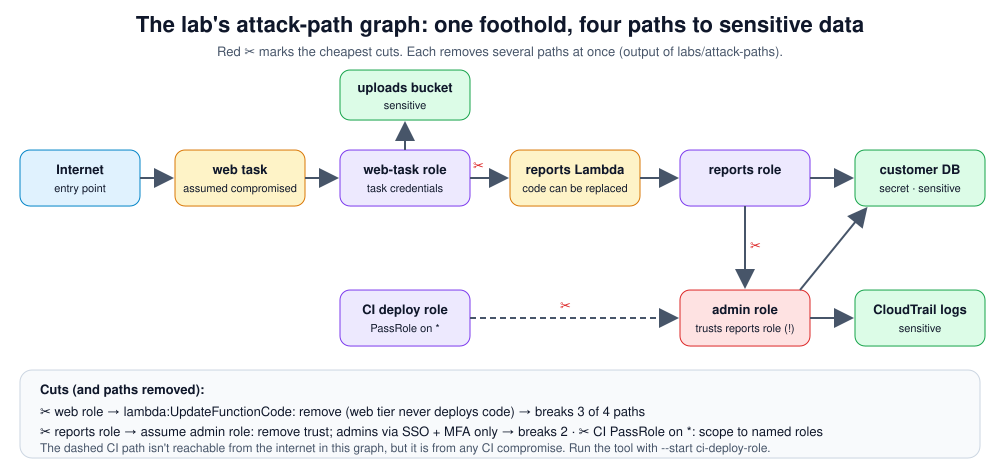

# Month 9 — Advanced Cloud Security

> 🔴 **Level 3 · Advanced** · Weeks 33–36 · ~42 h · Tracking issue: [#13](https://github.com/mascot200/cybersecurity-roadmap/issues/13)

**Goal:** identify cloud misconfigurations, understand attack paths and design layered defenses.

Level 3 changes the question from "is this resource configured securely?" to "if one thing goes wrong,
how far can it spread, and would we notice?" Everything this month is done from the defender's side, in
lab accounts and clusters you own.

## Weekly plan

| Week | Lesson | You will build / prove | Est. time |
|---|---|---|---|
| 33 | [Cloud attack paths](week-33-cloud-attack-paths.md) | Graph of your lab account; paths ranked; unnecessary links removed | 10 h |
| 34 | [Misconfiguration assessment](week-34-misconfiguration-assessment.md) | Prowler audit with a read-only role; fixes in Terraform; guardrails | 10 h |
| 35 | [Kubernetes security](week-35-kubernetes-security.md) | PSA restricted, least-privilege RBAC, default-deny NetworkPolicies | 10–12 h |
| 36 | [Defense validation](week-36-defense-validation.md) | Validation matrix with evidence; scheduled negative tests | 10 h |
| — | [Month project](project.md) | **Cloud threat model: 10+ threats with preventive and detective controls** | woven into weeks |
| — | [Monthly drill](drill.md) | ≥ 80% | 45 min |

## Lab code

| Lab | Status |
|---|---|
| [`labs/attack-paths/`](labs/attack-paths/) | Python attack-path analyzer on a synthetic graph; **7/7 tests passing**; CLI output shown in Week 33 |
| [`labs/k8s/`](labs/k8s/) | Hardened namespace, deployment, NetworkPolicies and RBAC (all YAML-parsed); `check_pods.py` **3/3 tests passing**. Manifests **not applied** to a live cluster when this was written; Week 35 lab steps confirm them |
| AWS steps (Prowler, SCPs, validation) | Not run in the build environment (no AWS account) |

## Milestone (must demonstrate before Month 10)

- [ ] Explain how **segmentation, least privilege and logging** reduce the impact of a compromised workload, using your attack-path graph before and after fixes
- [ ] Validation matrix with evidence for ≥ 10 controls

## Recommended resources

- **AWS Skill Builder** — <https://skillbuilder.aws/>
- **Kubernetes security** — <https://kubernetes.io/docs/concepts/security/>

---
[← Course home](../../../README.md) · [Start Week 33 →](week-33-cloud-attack-paths.md)
