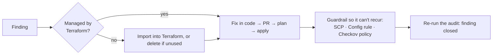

# Week 34 — Misconfiguration Assessment

> **Level:** Advanced · **Time:** ~10 h · **Tracking:** [issue #13](https://github.com/mascot200/cybersecurity-roadmap/issues/13)

## 🎯 Objectives

1. Audit a cloud account you own with automated posture tools (Prowler, AWS Security Hub).
2. Prioritize findings by exposure and attack path, not by count.
3. Remediate unsafe settings through code (Terraform), not console clicks.
4. Prevent recurrence with guardrails (SCPs, Config rules, IaC policies).

## 🌍 Why it matters

Cloud breaches are dominated by misconfiguration: public storage, exposed management interfaces,
permissive network rules, databases open to the internet, and old access keys. Accounts accumulate these
over time as people experiment. A regular, automated audit, followed by fixes in code and guardrails that
stop them coming back, is one of the most effective things a cloud security team does.

---

## 📖 Concepts

### 1. Tools (run only against accounts you own)

| Tool | What it does | Cost |
|---|---|---|
| **Prowler** | Hundreds of AWS checks mapped to CIS, AWS FSBP and compliance frameworks; HTML/CSV/JSON output | Open source |
| **AWS Security Hub** | Managed checks (CIS, AWS Foundational Security Best Practices) and aggregated findings | Free trial, then paid per check |
| **AWS Config rules** | Continuous evaluation of resource configuration | Paid per evaluation |
| **ScoutSuite** | Multi-cloud configuration review, offline HTML report | Open source |
| **IAM Access Analyzer** | External and unused access findings | External-access analyzer is free |

Run audits with a **read-only** identity (`SecurityAudit` + `ViewOnlyAccess` managed policies). An audit
tool never needs write access.

```bash
pipx install prowler
prowler aws --profile audit-readonly -M html csv              # full run
prowler aws --profile audit-readonly --severity critical high # focus on the worst
```

### 2. The misconfigurations that matter most

| Category | Example finding | Why it's serious |
|---|---|---|
| Public storage | S3 bucket or snapshot shared publicly | Direct data exposure |
| Exposed management | SSH/RDP/DB ports open to `0.0.0.0/0` | Brute force, exploits, data access |
| Identity hygiene | Root access keys; users without MFA; access keys older than 90 days; unused admin roles | Credential theft → account takeover |
| Logging gaps | CloudTrail not multi-region; no GuardDuty | You can't investigate or detect |
| Encryption gaps | Unencrypted EBS, RDS, or S3 | Exposure through snapshots or storage access |
| Workload hardening | IMDSv1 allowed; public IPs on app instances | Credential theft via SSRF; direct exposure |

### 3. Prioritization

Count is meaningless: 400 low findings matter less than one public database. Prioritize by:

1. **Exposure:** reachable from the internet, or shared outside the account?
2. **Sensitivity:** does it touch sensitive data or high-privilege identities?
3. **Attack path:** does it connect to other weaknesses (Week 33)?
4. **Effort:** quick fixes first if impact is similar.

### 4. Fix in code, then prevent



| Recurrence guardrail | Example |
|---|---|
| SCP | Deny `ec2:RunInstances` unless `ec2:MetadataHttpTokens = required` (IMDSv2) |
| Account setting | S3 Block Public Access at the account level |
| Config rule + auto-remediation | Close SG rules opening 22 to the world |
| Checkov policy in CI | Block public DB or open SG rules in PRs (Month 8) |

---

## 🧪 Lab — Audit, fix, guard (4 h, your AWS lab account)

1. Create an `audit-readonly` role with `SecurityAudit` + `ViewOnlyAccess`, assumable only by your SSO admin.
2. **Seed** a few deliberate, harmless misconfigurations in your lab account with Terraform: an SG allowing 22 from `0.0.0.0/0` (attached to nothing), a bucket without versioning, an instance allowing IMDSv1 (stop it immediately, or skip if you don't want the cost).
3. Run Prowler (critical/high first, then full). Find your seeded issues and anything else.
4. Prioritize: fill a table of finding → exposure → sensitivity → attack path → effort → decision.
5. Fix every critical/high finding **in Terraform**, apply through your pipeline, and rerun Prowler.
6. Add one guardrail per category of finding (Checkov policy, account setting, Config rule or SCP).
7. Destroy the seeded resources.

---

## 📝 Assignment — Audit and remediate a lab configuration

**Task:** audit a lab configuration and remediate unsafe settings.

`AUDIT.md`: tool versions and scope, prioritized findings table, remediations with PR links, before/after
Prowler summaries, the guardrails added, and accepted risks with owners and expiry.

### Acceptance criteria
- [ ] Audit run with a read-only identity
- [ ] All critical/high findings fixed in code or formally accepted
- [ ] Before/after evidence
- [ ] At least three recurrence guardrails
- [ ] Seeded resources destroyed

---

## 💼 On the job

- Cloud posture management (CSPM) is a standard security tool category; triaging its output is daily work.
- Mature teams measure "time to remediate" for critical findings, and track recurrence.

## ⚠️ Common mistakes

- Running audit tools with admin credentials.
- Fixing in the console, then Terraform puts the problem back on the next apply.
- Chasing finding counts instead of exposure.
- No guardrail, so the same finding returns next month.

## 🥊 Drill (pass mark 8/10)

**1.** Which permissions should an audit tool use?
<details><summary>Answer</summary>Read-only ones, e.g. <code>SecurityAudit</code> and <code>ViewOnlyAccess</code>.</details>

**2.** Name three high-impact misconfiguration categories.
<details><summary>Answer</summary>Any three of: public storage/snapshots, management/DB ports open to the internet, identity hygiene (root keys, no MFA, old keys), logging gaps, IMDSv1, unencrypted data stores.</details>

**3.** Why fix in Terraform rather than the console?
<details><summary>Answer</summary>Console fixes drift from code; the next apply may revert them, and they bypass review.</details>

**4.** How would you prevent IMDSv1 instances?
<details><summary>Answer</summary>An SCP denying <code>ec2:RunInstances</code> unless <code>ec2:MetadataHttpTokens</code> is <code>required</code>, plus account defaults and IaC checks.</details>

**5.** Why prioritize by exposure rather than count?
<details><summary>Answer</summary>One internet-exposed sensitive resource is far riskier than many low-impact internal findings.</details>

**6.** What does account-level S3 Block Public Access prevent?
<details><summary>Answer</summary>Any bucket in the account being made public through policies or ACLs.</details>

**7.** What should happen to an unused resource found in an audit?
<details><summary>Answer</summary>Delete it (after confirming with the owner), rather than fixing and maintaining it.</details>

**8.** Why re-run the audit after fixing?
<details><summary>Answer</summary>To prove the finding is closed and that the fix didn't introduce new issues.</details>

**9.** What's the difference between a finding and a guardrail?
<details><summary>Answer</summary>A finding reports an existing problem; a guardrail prevents that class of problem from being created again.</details>

**10.** Scenario: Prowler shows an access key last rotated 600 days ago belonging to a former contractor. What do you do?
<details><summary>Answer</summary>Check CloudTrail for recent use, disable then delete the key, remove the user if unneeded, rotate anything it could access, and add a guardrail/alert for old or unused keys (and move people to SSO).</details>

## ✅ Checklist
- [ ] Lab steps 1–7
- [ ] Assignment acceptance criteria met
- [ ] Drill ≥ 8/10, weekly log on issue #13
- [ ] Seeded resources destroyed; billing checked

## 📚 Resources
- Prowler — <https://docs.prowler.com/>
- AWS Security Hub — <https://docs.aws.amazon.com/securityhub/latest/userguide/what-is-securityhub.html>
- ScoutSuite — <https://github.com/nccgroup/ScoutSuite>
- AWS Foundational Security Best Practices — <https://docs.aws.amazon.com/securityhub/latest/userguide/fsbp-standard.html>

---
[← Week 33](week-33-cloud-attack-paths.md) · [Next: Week 35 — Kubernetes security →](week-35-kubernetes-security.md)
