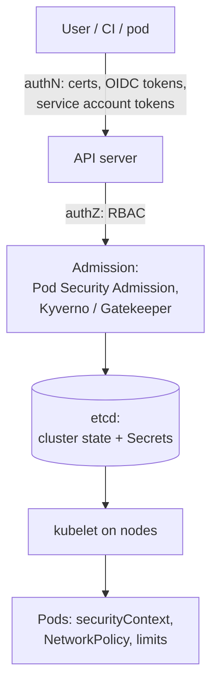

# Week 35 — Kubernetes Security

> **Level:** Advanced · **Time:** ~10–12 h · **Tracking:** [issue #13](https://github.com/mascot200/cybersecurity-roadmap/issues/13)
> **Lab files:** [`labs/k8s/`](labs/k8s/): hardened manifests (YAML-parsed) and `check_pods.py` (3/3 tests passing)

## 🎯 Objectives

1. Explain the Kubernetes security model: API server, RBAC, service accounts, admission, and the node.
2. Write least-privilege RBAC and avoid the dangerous grants.
3. Isolate workloads with Pod Security Admission and hardened `securityContext`s.
4. Segment traffic with NetworkPolicies (default deny, then allow what's needed).
5. Handle Kubernetes Secrets carefully, and know their limits.

## 🌍 Why it matters

Kubernetes concentrates a lot of power in one API. Someone with `create pods` in the wrong namespace, or a
pod allowed to run privileged with host mounts, can often take over the node and, from there, other
workloads and cloud credentials. **Tesla (2018)** had an exposed Kubernetes console without authentication
that was used for cryptomining and exposed cloud credentials. Secure defaults are essential because the
platform's defaults are permissive.

---

## 📖 Concepts

### 1. The layers



### 2. RBAC

| Object | Scope |
|---|---|
| `Role` / `RoleBinding` | One namespace |
| `ClusterRole` / `ClusterRoleBinding` | Whole cluster |

The lab's [`rbac.yaml`](labs/k8s/rbac.yaml) gives a `deployer` service account rights to manage Deployments
and Services and read pods/logs **in one namespace**, and nothing on Secrets or RBAC.

**Treat these grants like cluster admin:**

| Grant | Why it's powerful |
|---|---|
| `create pods` (or Deployments, Jobs…) in a namespace | Can run a pod that mounts any Secret in that namespace or uses any service account there |
| `get/list secrets` | Reads every credential in scope |
| `escalate`, `bind`, `impersonate` | Can grant themselves more permissions |
| `nodes/proxy`, `pods/exec` | Run commands in other workloads |
| Wildcards (`*` verbs or resources) | Includes all of the above, plus future resources |

Check effective permissions: `kubectl auth can-i --list --as=system:serviceaccount:invoices:deployer -n invoices`.

### 3. Pod isolation

[`namespace.yaml`](labs/k8s/namespace.yaml) labels the namespace with **Pod Security Admission
`restricted`**, so the API server rejects pods that don't meet it. [`api.yaml`](labs/k8s/api.yaml) meets it:

| Setting | Effect |
|---|---|
| `runAsNonRoot: true`, `runAsUser: 1000` | No root in the container |
| `allowPrivilegeEscalation: false` | No setuid escalation (Month 6's `no-new-privileges`) |
| `readOnlyRootFilesystem: true` + `emptyDir` for `/tmp` | Immutable filesystem |
| `capabilities.drop: [ALL]` | No Linux capabilities |
| `seccompProfile: RuntimeDefault` | Default syscall filter |
| `automountServiceAccountToken: false` | The pod gets no Kubernetes API token it doesn't need |
| Image pinned by digest; requests/limits; probes | Reproducible, bounded, self-healing |

[`check_pods.py`](labs/k8s/check_pods.py) checks these rules (plus no host namespaces, no `hostPath`, no
privileged containers). Its tests show the API deployment passes and
[`bad-pod.yaml`](labs/k8s/bad-pod.yaml) (privileged, `hostNetwork`, Docker socket mount) fails all 10 rules.
In a real cluster, enforce the same rules with Pod Security Admission plus **Kyverno** or **OPA Gatekeeper**.

### 4. NetworkPolicies

By default, every pod can talk to every other pod and to the internet. [`network-policies.yaml`](labs/k8s/network-policies.yaml):

1. `default-deny-all`: no ingress or egress for any pod in the namespace.
2. `api-from-ingress`: only the ingress controller's namespace can reach the API on 3000.
3. `api-egress`: the API can reach the DB on 5432 and DNS, and **nothing else**, including the cloud metadata endpoint and the internet.
4. `db-from-api`: the DB accepts connections only from the API.

> NetworkPolicies need a CNI plugin that enforces them (Calico, Cilium…). kind's default CNI
> (kindnet) does enforce them in recent versions (v0.24+). If yours doesn't, the policies are silently
> ignored, which is why the lab includes a test that a forbidden connection actually fails.

### 5. Secrets

Kubernetes Secrets are base64-encoded, **not encrypted**, by default in etcd. Protect them by enabling
encryption at rest for etcd (managed clusters such as EKS can use KMS envelope encryption), restricting
`get/list secrets` with RBAC, mounting them as files (not env vars) with tight `defaultMode` (the lab uses
`0400`), and preferring an external secrets manager (External Secrets Operator or the Secrets Store CSI driver).

---

## 🧪 Lab — Harden a local cluster (4 h)

Use [kind](https://kind.sigs.k8s.io/) (Kubernetes in Docker) on your lab VM. If your machine can't run it, do the
Kubernetes security labs on [Killercoda](https://killercoda.com/) instead.

```bash
kind create cluster --name sec-lab
kubectl apply -f labs/k8s/namespace.yaml
kubectl apply -f labs/k8s/bad-pod.yaml -n invoices   # expect: rejected by Pod Security Admission
python3 labs/k8s/check_pods.py labs/k8s/*.yaml        # offline check of the same rules
```

1. Confirm the bad pod is rejected in `invoices` (and note it's accepted in `default`, which has no PSA label).
2. Build your Month 6 image, load it into kind (`kind load docker-image`), set the digest in `api.yaml`, create the `db-credentials` secret, and deploy. Fix anything PSA rejects.
3. Apply `rbac.yaml`; use `kubectl auth can-i` to prove the deployer can update Deployments but can't read Secrets or create RoleBindings.
4. Apply the NetworkPolicies. From a debug pod in the namespace (labelled like the API), prove: DB reachable on 5432; internet and `169.254.169.254` unreachable. From a pod with another label, prove the DB is unreachable.
5. Run `python3 -m unittest -v` in `labs/k8s` and add a rule (e.g. reject images tagged `:latest`) with a test.
6. Delete the cluster: `kind delete cluster --name sec-lab`.

> The manifests were parsed and checked by `check_pods.py`, but **not applied** to a cluster when this course
> was written (no cluster available). Step 1–4 is where you confirm they work, and fix them if they don't.

---

## 📝 Assignment — Secure a small cluster

**Task:** deploy a small local cluster if your machine supports it, or complete a guided lab.

`K8S_SECURITY.md`: what you deployed, PSA level, RBAC (with `can-i` evidence), NetworkPolicies (with
allowed/blocked connection evidence), Secret handling, and what you'd add for production (policy engine,
image signing verification, etcd encryption, audit logging).

### Acceptance criteria
- [ ] Namespace enforces PSA `restricted`; a non-compliant pod is rejected
- [ ] Least-privilege RBAC proven with `can-i`
- [ ] Default-deny NetworkPolicies with allowed and blocked evidence
- [ ] Secrets mounted as files; not readable by the deployer
- [ ] Cluster deleted afterwards

---

## 💼 On the job

- Platform security teams run admission policies (Kyverno/Gatekeeper) so insecure workloads never start.
- Reviews of Helm charts and manifests look for exactly the `securityContext` and RBAC issues above.

## ⚠️ Common mistakes

- `cluster-admin` bound to CI or to developers "temporarily".
- No NetworkPolicies, so everything can talk to everything.
- Mounting service account tokens into pods that never use the API.
- Thinking Kubernetes Secrets are encrypted by default.
- Policies applied on a CNI that doesn't enforce them.

## 🥊 Drill (pass mark 8/10)

**1.** Why is `create pods` in a namespace close to reading all its Secrets?
<details><summary>Answer</summary>The user can create a pod that mounts any Secret in that namespace (or runs as any service account there) and read it from inside.</details>

**2.** What does Pod Security Admission `restricted` enforce?
<details><summary>Answer</summary>Non-root, no privilege escalation, dropped capabilities, seccomp RuntimeDefault/Localhost, no host namespaces or hostPath, and other restrictions.</details>

**3.** What does a default-deny NetworkPolicy do?
<details><summary>Answer</summary>Blocks all ingress and egress for selected pods unless another policy allows specific traffic.</details>

**4.** Why block egress to `169.254.169.254` from pods?
<details><summary>Answer</summary>To stop pods (e.g. via SSRF) from reaching the node's cloud metadata service and stealing its credentials.</details>

**5.** Are Kubernetes Secrets encrypted by default?
<details><summary>Answer</summary>No. They're base64-encoded in etcd unless encryption at rest is configured.</details>

**6.** Why set `automountServiceAccountToken: false`?
<details><summary>Answer</summary>So a compromised pod has no Kubernetes API credentials it doesn't need.</details>

**7.** How do you check what a service account can do?
<details><summary>Answer</summary><code>kubectl auth can-i --list --as=system:serviceaccount:&lt;ns&gt;:&lt;name&gt; -n &lt;ns&gt;</code>.</details>

**8.** Which RBAC verbs let someone grant themselves more access?
<details><summary>Answer</summary><code>escalate</code>, <code>bind</code>, <code>impersonate</code> (and write access to Roles/RoleBindings).</details>

**9.** Why test that a blocked connection really fails?
<details><summary>Answer</summary>If the CNI doesn't enforce NetworkPolicies, they're silently ignored. Only a test proves enforcement.</details>

**10.** Scenario: a Helm chart for a monitoring tool asks for `privileged: true` and a `hostPath` of `/`. Your review?
<details><summary>Answer</summary>That's effectively node root. Ask which access it really needs; use read-only, specific host paths and minimal capabilities; run it in a dedicated namespace with a documented exception; prefer a vendor/agent that supports least privilege.</details>

## ✅ Checklist
- [ ] Lab steps 1–6
- [ ] Assignment acceptance criteria met
- [ ] Drill ≥ 8/10, weekly log on issue #13

## 📚 Resources
- Kubernetes security concepts — <https://kubernetes.io/docs/concepts/security/>
- Pod Security Standards — <https://kubernetes.io/docs/concepts/security/pod-security-standards/>
- RBAC good practices — <https://kubernetes.io/docs/concepts/security/rbac-good-practices/>
- Network policies — <https://kubernetes.io/docs/concepts/services-networking/network-policies/>
- Kyverno policies — <https://kyverno.io/policies/>

---
[← Week 34](week-34-misconfiguration-assessment.md) · [Next: Week 36 — Defense validation →](week-36-defense-validation.md)
