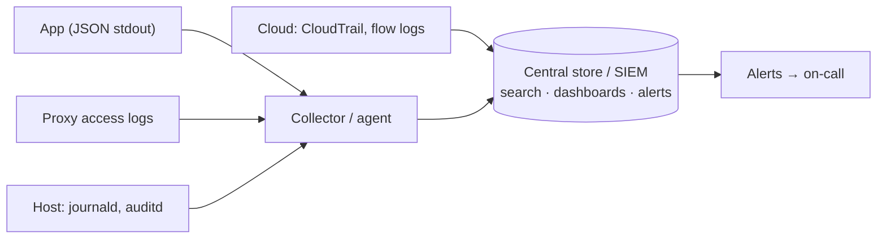

# Week 37 — Logging and Observability

> **Level:** Advanced · **Time:** ~10 h · **Tracking:** [issue #14](https://github.com/mascot200/cybersecurity-roadmap/issues/14)
> **Sample data:** [`labs/detections/events.jsonl`](labs/detections/events.jsonl), 633 synthetic structured events used all month

## 🎯 Objectives

1. Decide **what** to log for security: authentication, authorization decisions, admin actions, data access, errors.
2. Write structured (JSON) logs with consistent fields, UTC timestamps and correlation IDs.
3. Redact secrets and personal data before logs leave the process.
4. Centralize application, proxy, host and cloud logs in one searchable place.
5. Protect logs from tampering and set retention.

## 🌍 Why it matters

You can't detect what you don't record, and you can't investigate what you can't search. In many breach
reports, the attacker was inside for weeks or months, and the logs that would have shown it either didn't
exist or weren't looked at. **OWASP A09:2025 Security Logging and Alerting Failures** exists because this
is so common. The opposite failure matters too: logs full of passwords and tokens become a breach of their own.

---

## 📖 Concepts

### 1. What to log

| Event | Fields | Why |
|---|---|---|
| Login success/failure | user (or hashed identifier), IP, user agent, outcome, reason category | Brute force, stuffing, takeover |
| MFA, password reset, email change | user, outcome | Account takeover paths |
| Authorization denied | user, action, resource ID, tenant | Probing for IDOR/BOLA |
| Admin and role changes | actor, actor role, target, old/new value | Privilege escalation |
| Sensitive data access / exports | user, resource type, record count | Data theft |
| Input validation failures (aggregated) | endpoint, rule | Scanning, attacks |
| Errors | request ID, error class (details in a secure store) | Debugging and attack signals |

**Never log:** passwords, session IDs, tokens, API keys, full card numbers, secrets, full request bodies on
auth endpoints. Be careful with personal data and follow your privacy obligations.

### 2. Structured logs

```json
{"ts":"2026-10-01T09:50:00Z","event":"login","user":"user7@acme.test","ip":"203.0.113.66",
 "outcome":"failure","request_id":"bf0","service":"invoices-api","env":"prod"}
```

- **JSON, one event per line.** Fields, not sentences, so they can be searched and counted.
- **UTC ISO-8601 timestamps** with time synced (NTP) on every host. Correlating events across systems depends on it.
- **Correlation ID** (`request_id`) generated at the edge (Month 6's nginx `$request_id`) and passed through every service.
- **Consistent field names** across services (`user`, `ip`, `event`, `outcome`), e.g. following the Elastic Common Schema or OpenTelemetry conventions.

### 3. Redaction

Redact in the logger configuration so it can't be forgotten in individual calls. In Node.js, `pino`'s
`redact` option removes or masks fields by path:

```js
import pino from 'pino';
export const log = pino({
  redact: {
    paths: ['req.headers.authorization', 'req.headers.cookie', '*.password', '*.token', '*.secret'],
    censor: '[REDACTED]',
  },
});
```

Test it: log an object containing each sensitive field and assert the output doesn't contain the values
(the same pattern as Month 3's "no internal fields" test).

### 4. Centralizing



Options for a lab: **Grafana Loki + Grafana**, or **OpenSearch + Dashboards**, with **Fluent Bit** or
**Grafana Alloy** as the collector. In AWS: CloudWatch Logs (+ Logs Insights), or a SIEM.

### 5. Protecting logs

- Ship logs off the host quickly; attackers on a host can edit local logs.
- Separate permissions: app teams can read their logs; only the security team can delete or change retention.
- Retention long enough for investigations (many organizations use 90 days hot + 1 year archived; check legal requirements).
- Monitor the pipeline itself: alert when a source goes quiet (a stopped agent looks exactly like "no attacks").

---

## 🧪 Lab — A small logging stack (4 h)

1. Add structured JSON logging with `pino` (or your framework's equivalent) to your Month 5/6 API: request ID from the proxy header, the events in the table above, and redaction. Write the redaction test.
2. Run a local Loki + Grafana (or OpenSearch) stack with Docker Compose, bound to `127.0.0.1`, and ship the API, nginx and host (`journald`) logs to it.
3. Load [`events.jsonl`](labs/detections/events.jsonl) as an extra source. In Grafana Explore (LogQL) or OpenSearch, answer:
   - How many failed logins per IP? Which IP stands out?
   - Which user exported the most records?
   - Follow `request_id` `bf-ok` end to end.
4. Stop the log shipper for a few minutes, and design an alert for "no logs received from source X for 10 minutes".

---

## 📝 Assignment — Collect application and host logs

**Task:** collect application and host logs in a lab.

`LOGGING_DESIGN.md`: what you log (event table), field schema, what's never logged, redaction (with test),
pipeline diagram, retention and access, and three example queries answering security questions.

### Acceptance criteria
- [ ] Structured JSON logs with UTC timestamps and request IDs from proxy to API
- [ ] Redaction configured centrally and tested
- [ ] App, proxy and host logs searchable in one place
- [ ] Three working security queries
- [ ] A "source went quiet" alert designed (implemented next week)

---

## 💼 On the job

- Security engineers define logging standards that every service must meet before launch.
- Detection engineers depend on good fields: a detection is only as good as the data it runs on.

## ⚠️ Common mistakes

- Free-text log lines that can't be searched reliably.
- Local time zones and unsynced clocks.
- Logging tokens or passwords "for debugging".
- No alert when logging stops.

## 🥊 Drill (pass mark 8/10)

**1.** Name five security events every web app should log.
<details><summary>Answer</summary>Any five of: login success/failure, MFA events, password reset/email change, authorization denials, admin/role changes, sensitive data access/exports, validation failures, errors.</details>

**2.** Why structured JSON instead of free text?
<details><summary>Answer</summary>Fields can be reliably searched, filtered, counted and correlated by machines and queries.</details>

**3.** What is a correlation ID?
<details><summary>Answer</summary>A unique ID per request, created at the edge and passed through all services, so events for one request can be linked.</details>

**4.** Why UTC and synced clocks?
<details><summary>Answer</summary>Building a timeline across systems needs comparable timestamps.</details>

**5.** Where should redaction happen?
<details><summary>Answer</summary>Centrally in the logger configuration, before logs leave the process, and covered by tests.</details>

**6.** Name three things never to log.
<details><summary>Answer</summary>Any three of: passwords, session IDs, tokens/API keys, secrets, full card numbers, auth request bodies.</details>

**7.** Why ship logs off the host quickly?
<details><summary>Answer</summary>An attacker with host access can modify or delete local logs.</details>

**8.** Why alert when a log source goes quiet?
<details><summary>Answer</summary>A broken or disabled pipeline looks the same as "nothing happened", and attackers may disable logging.</details>

**9.** What's the relationship between logging and OWASP A09?
<details><summary>Answer</summary>A09 (Security Logging and Alerting Failures) covers missing or insufficient logs and alerts that let attacks go undetected.</details>

**10.** Scenario: during an investigation you find `Authorization: Bearer ey...` in API logs. What do you do?
<details><summary>Answer</summary>Treat logged tokens as exposed: revoke/rotate them, restrict and purge the affected logs where allowed, add redaction plus a test, and check who could read those logs.</details>

## ✅ Checklist
- [ ] Lab steps 1–4
- [ ] Assignment acceptance criteria met
- [ ] Drill ≥ 8/10, weekly log on issue #14

## 📚 Resources
- OWASP Logging Cheat Sheet — <https://cheatsheetseries.owasp.org/cheatsheets/Logging_Cheat_Sheet.html>
- pino redaction — <https://getpino.io/#/docs/redaction>
- Grafana Loki — <https://grafana.com/docs/loki/latest/>
- OpenTelemetry semantic conventions — <https://opentelemetry.io/docs/specs/semconv/>

---
[← Month overview](README.md) · [Next: Week 38 — Detection engineering →](week-38-detection-engineering.md)
