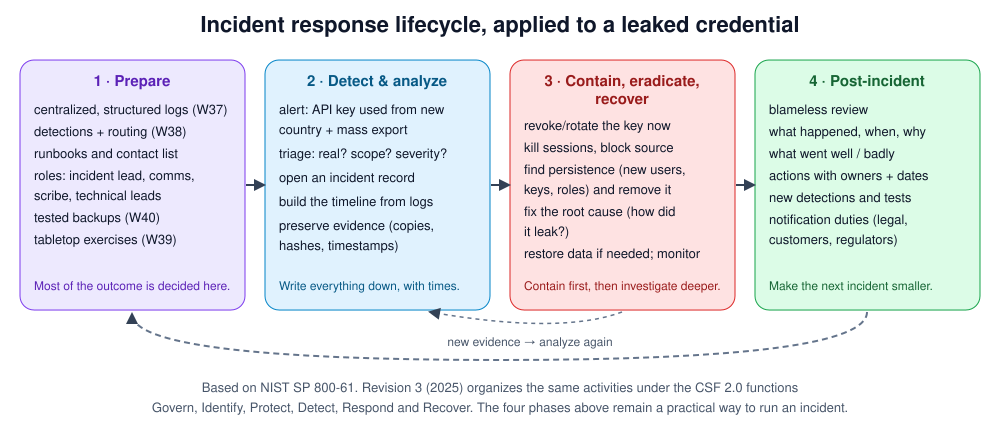

# Week 39 — Incident Response

> **Level:** Advanced · **Time:** ~10 h · **Tracking:** [issue #14](https://github.com/mascot200/cybersecurity-roadmap/issues/14)

## 🎯 Objectives

1. Run an incident through its phases: prepare, detect and analyze, contain/eradicate/recover, post-incident.
2. Triage an alert: is it real, what's the scope, how severe?
3. Preserve evidence and build a timeline.
4. Contain a credential compromise safely: revoke, rotate, hunt for persistence.
5. Run a tabletop exercise and write a blameless review.

## 🌍 Why it matters

Every organization has incidents; what differs is how fast they're contained and how much they cost. A
calm, practised process (who decides, what to do first, how to communicate, what to write down) is the
biggest factor. Teams that have rehearsed contain in hours; teams that improvise can take days, and often
destroy the evidence they need along the way.

---

## 📖 Concepts

### 1. Roles

| Role | Responsibility |
|---|---|
| **Incident lead** | Owns decisions and priorities; not doing hands-on work |
| **Technical lead(s)** | Investigation and containment |
| **Scribe** | Timeline of facts and decisions, with times |
| **Communications** | Updates to leadership, customers, legal |

In a small team one person may hold several roles. Decide that *before* the incident.

### 2. Severity

| Level | Example | Response |
|---|---|---|
| SEV-1 | Confirmed customer data access; production credentials in attacker hands | All hands, leadership informed, legal engaged |
| SEV-2 | Compromised non-production system; contained credential leak | Dedicated responders, same day |
| SEV-3 | Suspicious activity, no evidence of compromise | Investigate within business hours |

### 3. Triage questions

1. **Is it real?** Check the evidence the alert carries (Week 38). Could it be a test or a known benign source?
2. **What's affected?** Identities, systems, data, tenants.
3. **Is it ongoing?** Recent activity from the attacker's IPs, sessions or keys?
4. **What's the worst plausible impact?** That sets severity.

### 4. Evidence and timeline

- **Preserve before you change.** Export relevant logs (app, CloudTrail, flow logs) for the window; snapshot affected disks/volumes; record hashes of exported files.
- Work on **copies**; keep originals read-only.
- The timeline is a table: `time (UTC) | source | event | actor | notes`. Facts and decisions go in it as they happen.

### 5. Containing a leaked credential (the runbook)

| Step | AWS access key | App user account / API token |
|---|---|---|
| 1. Contain | Deactivate the key; for roles, revoke active sessions (deny sessions issued before now) | Disable account or revoke token; kill sessions (session version bump, Month 2) |
| 2. Scope | CloudTrail: every call with that key ID, successes and denials, source IPs | App logs: all actions by that user/token; exports; admin actions |
| 3. Hunt persistence | New IAM users, access keys, roles, trust policy changes, Lambda/ECS changes, new SG rules | New API tokens, changed email/MFA, new admin users, webhooks |
| 4. Eradicate | Remove anything the attacker created; fix the leak (repo, CI, laptop) | Same; fix the vulnerability or phishing path |
| 5. Recover | Issue new credentials through the normal process; restore data if changed | Reset credentials with the user; restore data |
| 6. Monitor | Watch for the attacker's IPs/patterns for days | Same |

**Order matters:** contain first. Investigating while a live key is still active lets the attacker keep
working, or notice and destroy evidence.

### 6. Communication and notification

- One channel for the incident; regular updates even when there's no news.
- Legal and privacy decide on notification duties. Many laws require notifying authorities and affected people within fixed deadlines once personal data is involved (for example, GDPR's 72 hours to the supervisory authority). Involve them early.
- Be factual; don't speculate in writing outside the incident team.

### 7. Blameless post-incident review

- Timeline, root cause(s), contributing factors, what went well, what was hard.
- Action items with **owners and dates**: new detections, tests, guardrails, runbook updates.
- Blameless: focus on how the system allowed the mistake, not on who made it. People share more, and the fixes are better.

---

## 🧪 Lab — Investigate the lab log (3 h)

Using [`events.jsonl`](labs/detections/events.jsonl) and your Week 38 alerts, treat the
`brute_force` alert for `user7@acme.test` as a live incident:

1. **Triage:** what does the alert's evidence show? Is it real? Severity?
2. **Scope:** from the logs, list everything `user7@acme.test` did after the successful login at 09:52:05Z, and everything IP `203.0.113.66` did.
3. **Timeline:** build the table from the first failure to the last related event.
4. **Containment plan:** write the exact steps you'd take in your app (disable account, bump session version, etc.) and in AWS if the account had cloud access.
5. Repeat triage for the `privilege_change` critical alert. What does it suggest about the app (hint: Month 3, Week 11)?

---

## 📝 Assignment — Tabletop: simulated credential compromise

**Task:** run a tabletop exercise for a simulated credential compromise.

Scenario: *"At 02:10 UTC, GuardDuty reports the CI deploy role being used from an IP outside GitHub's
ranges. Twenty minutes later, an unusual-export alert fires for an admin user in the invoices app."*

1. Run it with at least one other person (or alone, writing each role's actions). Inject new facts every 10 minutes (for example: "a new IAM user was created at 02:14", "the export contained 40,000 invoices").
2. Record decisions with timestamps.
3. Write `IR_REPORT.md`: summary, timeline, impact, containment and recovery steps, root-cause hypotheses, notifications considered, and action items with owners.
4. Update your runbooks with anything that was missing.

### Acceptance criteria
- [ ] Tabletop run with injects and a timeline
- [ ] Report with impact, actions taken and decisions
- [ ] At least five action items with owners and dates
- [ ] Runbook updated

---

## 💼 On the job

- Many security roles include an on-call rotation for incidents.
- Regular tabletops (quarterly is common) keep runbooks and contacts current.

## ⚠️ Common mistakes

- Investigating for hours before revoking an active credential.
- Rebooting or rebuilding systems before preserving evidence.
- No scribe, so nobody can reconstruct what happened when.
- Reviews that blame people, so the next incident is reported later.

## 🥊 Drill (pass mark 8/10)

**1.** Name the four phases of incident response.

Answer
Preparation; detection and analysis; containment, eradication and recovery; post-incident activity.

**2.** What's the first action when an access key is confirmed leaked?

Answer
Contain: deactivate/revoke the key (and active sessions), then scope with logs.

**3.** Why preserve evidence before making changes?

Answer
Containment and recovery can destroy logs, memory and disk state needed to understand scope and root cause.

**4.** What does a scribe do?

Answer
Records facts, actions and decisions with timestamps for the timeline and review.

**5.** Name three places to hunt for attacker persistence in AWS.

Answer
Any three of: new IAM users/access keys, roles and trust policies, attached policies, Lambda/ECS changes, security group rules, EventBridge rules.

**6.** How do you revoke an AWS role's existing sessions?

Answer
Attach a deny policy for sessions issued before now (the console's "revoke active sessions" uses <code>aws:TokenIssueTime</code>).

**7.** Why blameless reviews?

Answer
People share what really happened, and fixes target systems and processes rather than individuals.

**8.** Who decides on breach notifications?

Answer
Legal/privacy with leadership, based on laws and contracts. Involve them early.

**9.** What makes an action item useful?

Answer
Specific, with an owner and a due date, and tracked to completion.

**10.** Scenario: your alert shows 10 failed logins then a success for a customer admin from a new IP. Walk through your first 15 minutes.

Answer
Open an incident and assign roles; verify the evidence; disable the account/sessions (contain); check what the session did (exports, admin actions, new tokens); preserve the logs; notify the customer per process; decide severity; continue scoping.

## ✅ Checklist
- [ ] Lab steps 1–5
- [ ] Assignment acceptance criteria met
- [ ] Drill ≥ 8/10, weekly log on issue #14

## 📚 Resources
- NIST SP 800-61 Rev. 3 — <https://csrc.nist.gov/pubs/sp/800/61/r3/final>
- NIST Cybersecurity Framework — <https://www.nist.gov/cyberframework>
- AWS Security Incident Response Guide — <https://docs.aws.amazon.com/whitepapers/latest/aws-security-incident-response-guide/welcome.html>
- MITRE ATT&CK — <https://attack.mitre.org/>

---
[← Week 38](week-38-detection-engineering.md) · [Next: Week 40 — Recovery & resilience →](week-40-recovery-resilience.md)
