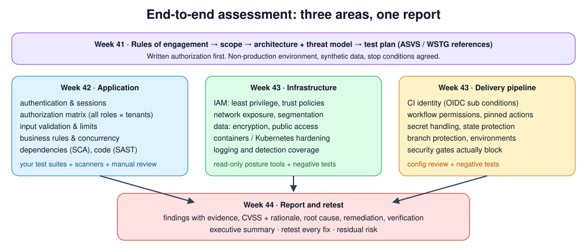

# Week 41 — Scope and Threat Model

> **Level:** Advanced · **Time:** ~10 h · **Tracking:** [issue #15](https://github.com/mascot200/cybersecurity-roadmap/issues/15)
> **Templates:** [`rules-of-engagement.md`](templates/rules-of-engagement.md) · [`test-plan.md`](templates/test-plan.md)

## 🎯 Objectives

1. Define an authorized scope: assets, environments, techniques, exclusions and stop conditions.
2. Produce an architecture diagram and data-flow map of the whole system: app, infrastructure and pipeline.
3. Turn the threat model into a **test plan** with requirements from OWASP ASVS and test methods from the OWASP WSTG.
4. State limitations up front.

## 🌍 Why it matters

An assessment's value depends on its scope and plan. Without written authorization, testing can be illegal.
Without a clear scope, important parts get skipped (often the pipeline and cloud identity) or out-of-scope
systems get touched. Without a plan tied to requirements, the result is a list of whatever happened to be
noticed, rather than evidence about the system's security.

---

## 📖 Concepts

### 1. Rules of engagement

The [template](templates/rules-of-engagement.md) covers: owner and approver, testers, window, environment,
in-scope and out-of-scope items, test accounts, allowed and forbidden techniques, data handling, stop
conditions, and communication. For this course, the target is **your own capstone-candidate system in a
non-production environment**, using synthetic data.

Typical exclusions, even when testing your own system: third-party services (identity provider, payment
provider), denial-of-service, production data, and anything that affects other people.

### 2. Architecture and data flows

Reuse and update your earlier work:

| Source | Use it for |
|---|---|
| Month 5 threat model (DFD, STRIDE) | Application-level threats and trust boundaries |
| Month 7 architecture + checklist | Cloud components and controls |
| Month 8 pipeline diagram | Delivery path and identities |
| Month 9 attack-path graph and cloud threat model | Cross-component paths |
| Month 10 detection catalogue | What *should* be detected during testing |

### 3. From threats to a test plan

Each test case links a **requirement** to a **method** and an **expected result** ([template](templates/test-plan.md)):

| Standard | Use |
|---|---|
| **OWASP ASVS** (Application Security Verification Standard) | *What* must be true: numbered, testable requirements at three levels (L1 basic, L2 standard for most apps, L3 high assurance) |
| **OWASP WSTG** (Web Security Testing Guide) | *How* to test web apps: test case IDs like `WSTG-ATHZ-04` (insecure direct object references) |
| **CIS Benchmarks / AWS FSBP** | Infrastructure configuration requirements |
| Your own controls (Months 5–10) | Pipeline, logging, recovery |

Prefer **repeatable** methods: your existing test suites, scanners and scripts produce evidence that can
be re-run at retest time. Manual testing fills the gaps the automation can't cover (business logic, chained issues).

### 4. Limitations

State what you didn't cover and why (time, access, tooling, out of scope). A report without limitations
overstates assurance.

---

## 🧪 Lab — Prepare the assessment (3–4 h)

1. Choose the target: the system you've built across Months 3–10 (or the start of your capstone), deployed to a non-production environment.
2. Fill in [`rules-of-engagement.md`](templates/rules-of-engagement.md) and sign it.
3. Update the architecture diagram to show app, cloud and pipeline, with trust boundaries and data flows.
4. Pick ASVS level L2 and select 30–50 requirements that apply. Map each to a test method.
5. Fill in [`test-plan.md`](templates/test-plan.md) with at least 30 test cases across application, infrastructure and pipeline.
6. Write the limitations section.

---

## 📝 Assignment — Written test plan and architecture diagram

**Task:** create a written test plan and architecture diagram.

### Acceptance criteria
- [ ] Signed rules of engagement with stop conditions
- [ ] Architecture diagram covering app, infrastructure and pipeline, with trust boundaries
- [ ] Test plan with ≥ 30 cases, each linked to a requirement (ASVS/CIS/own control) and a method
- [ ] At least 10 cases use automated, repeatable methods
- [ ] Limitations stated

---

## 💼 On the job

- Consultants and internal AppSec teams start every engagement with scoping and rules of engagement; many organizations require it for internal tests too.
- ASVS-mapped test plans make results comparable across releases and teams.

## ⚠️ Common mistakes

- Starting to test before scope is agreed.
- Forgetting the pipeline and cloud identities.
- Test plans without expected results, so pass/fail is a matter of opinion.
- No stop conditions.

## 🥊 Drill (pass mark 8/10)

**1.** What must exist before any testing starts?

Answer
Written authorization: rules of engagement with scope, approver and constraints.

**2.** What's the difference between ASVS and WSTG?

Answer
ASVS lists verifiable security requirements (what must be true); WSTG describes how to test web applications (test procedures).

**3.** Which ASVS level fits most business applications?

Answer
Level 2.

**4.** Name three typical out-of-scope items.

Answer
Any three of: production, third-party services, real user data, denial-of-service, social engineering, other tenants.

**5.** What are stop conditions for?

Answer
Defining when testing must pause (real personal data found, instability, out-of-scope access) and who to notify.

**6.** Why prefer repeatable test methods?

Answer
They provide consistent evidence and can be re-run to verify fixes at retest.

**7.** What should every test case include?

Answer
Requirement reference, method/tool, expected result, status and linked finding.

**8.** Why include the delivery pipeline in scope?

Answer
It has powerful identities and can change production; weaknesses there bypass application controls.

**9.** Why write limitations?

Answer
So readers know what assurance the report does and doesn't give.

**10.** Scenario: during testing you find an endpoint returning what looks like real customer emails in staging. What do you do?

Answer
Stop per the stop conditions, don't copy or explore the data further, record what you saw, notify the owner immediately, and treat it as a potential data-handling incident.

## ✅ Checklist
- [ ] Lab steps 1–6
- [ ] Assignment acceptance criteria met
- [ ] Drill ≥ 8/10, weekly log on issue #15

## 📚 Resources
- OWASP ASVS — <https://owasp.org/www-project-application-security-verification-standard/>
- OWASP Web Security Testing Guide — <https://owasp.org/www-project-web-security-testing-guide/>
- Microsoft Security Development Lifecycle — <https://learn.microsoft.com/en-us/compliance/assurance/assurance-microsoft-security-development-lifecycle>

---
[← Month overview](README.md) · [Next: Week 42 — Application testing →](week-42-application-testing.md)
