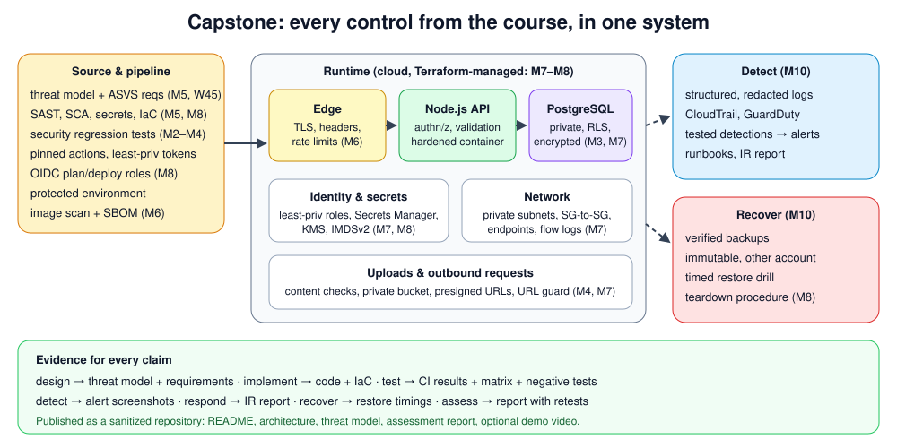

# Month 12 — Capstone and Career Preparation

> 🔴 **Level 3 · Advanced** · Weeks 45–48 · ~44 h · Tracking issue: [#16](https://github.com/mascot200/cybersecurity-roadmap/issues/16) · **Final gate**

**Goal:** demonstrate that you can build and secure a complete system.

Everything comes together: one system, secured at every layer, with evidence for every claim, assessed,
published, and explained well enough to land a security role.

## Weekly plan

| Week | Lesson | You will build / prove | Est. time |
|---|---|---|---|
| 45 | [Architecture and requirements](week-45-architecture-requirements.md) | Architecture, threat model, 25–40 testable requirements, gap list | 10 h |
| 46 | [Application and pipeline](week-46-application-pipeline.md) | Gaps closed with tests; every gate required; blocked-PR evidence | 10–12 h |
| 47 | [Infrastructure and operations](week-47-infrastructure-operations.md) | Infra/ops evidence, `SECRETS.md`, one full-lifecycle run | 10–12 h |
| 48 | [Assessment and publication](week-48-assessment-publication.md) | Final assessment, sanitized public repo, README with evidence | 10–12 h |
| — | [Career guide](career-guide.md) | Roles, positioning, 20 interview questions | ongoing |
| — | [Capstone project](project.md) | **Secured cloud-native application with evidence** | the month |
| — | [Final checkpoint drill](drill.md) | ≥ 80% + practical demo | 90 min |

## Lab

| Lab | Status |
|---|---|
| [`labs/sanitize/`](labs/sanitize/) | Pre-publication checker, **6/6 tests passing**. A false-positive bug found during development was fixed. Run over the whole course, it found no account IDs, keys or private keys |

## Milestone (course completion)

- [ ] Demonstrate a complete security lifecycle on the capstone: **design, implement, test, detect, remediate, report**
- [ ] Final checkpoint drill ≥ 80% and practical demo
- [ ] Close Month 12 issue #16 and the Level 3 epic [#4](https://github.com/mascot200/cybersecurity-roadmap/issues/4)

## Recommended resources

- **GitHub documentation** — <https://docs.github.com/>
- **NIST NICE Framework** — <https://www.nist.gov/itl/applied-cybersecurity/nice/nice-framework-resource-center>

---
[← Month 11](../month-11-end-to-end-assessment/README.md) · [Course home](../../../README.md) · [Start Week 45 →](week-45-architecture-requirements.md)
