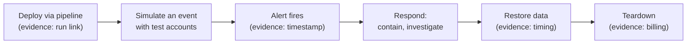

# Week 47 — Infrastructure and Operations

> **Level:** Advanced · **Time:** ~10–12 h · **Tracking:** [issue #16](https://github.com/mascot200/cybersecurity-roadmap/issues/16)

## 🎯 Objectives

1. Close the infrastructure, detection and recovery gaps from Week 45.
2. Capture evidence for access controls, alerting and restoration.
3. Document secrets handling end to end.
4. Run the full lifecycle once: deploy → detect a simulated event → respond → restore → tear down.

## 🌍 Why it matters

This week proves the system can be operated securely, not just built securely: identities are scoped,
the network is closed, alerts actually reach someone, and data can be brought back. These are the
questions an operations-minded interviewer, or an auditor, will ask.

---

## 📖 Concepts

### 1. Infrastructure evidence

| Requirement area | Evidence to capture | Course reference |
|---|---|---|
| Identity | Policy lint/Access Analyzer results; simulator and CLI negative tests per role | M7 W25, M9 W36 |
| Network | Reachability Analyzer results; failed connection from outside to DB | M7 W26 |
| Data | Block Public Access setting; bucket policy denials; encryption settings | M7 W27 |
| Containers / K8s | `verify.sh` or `check_pods.py` output; PSA rejection | M6, M9 W35 |
| Posture | Prowler critical/high: all closed or accepted | M9 W34 |
| Attack paths | Before/after numbers from the graph tool | M9 W33 |

### 2. Operations evidence

| Requirement area | Evidence | Course reference |
|---|---|---|
| Logging | Sample redacted log lines; query results by request ID | M10 W37 |
| Detection | Each detection's test results + an alert received in the channel (timestamp) | M10 W38 |
| Response | Short IR report for a simulated event | M10 W39 |
| Recovery | `verify-restore.sh` output with timing; RPO/RTO comparison | M10 W40 |
| Teardown | Documented procedure + billing check | M8 W32 |

### 3. Secrets handling, end to end

Write `SECRETS.md` as a table: secret → where it's created → where it's stored → who/what can read it →
how it's delivered at runtime → rotation method → last rotated. Include CI (OIDC, no stored keys), the
app (Secrets Manager via task role), the database (managed password or IAM auth), Terraform state
(protected), and logs (redaction).

### 4. One full-lifecycle run

---

## 🧪 Lab — Prove operations (6 h)

1. Close remaining infrastructure gaps through Terraform and the pipeline.
2. Capture every piece of evidence in the two tables above into an `evidence/` folder with an index (file, what it proves, date, hash).
3. Write `SECRETS.md`.
4. Run the full lifecycle once and write a one-page IR report.
5. Update the requirement → evidence table from Week 46 with infrastructure and operations rows.

---

## 📝 Assignment — Evidence for access controls, alerting and restoration

**Task:** capture evidence for access controls, alerting and restoration.

### Acceptance criteria
- [ ] Every infrastructure/operations requirement has evidence
- [ ] At least one alert received end to end, with timing
- [ ] A restore performed and timed against the RTO
- [ ] `SECRETS.md` complete
- [ ] Evidence index with hashes

---

## 💼 On the job

- Operational evidence is what SOC 2 and ISO 27001 auditors ask for.
- Being able to explain "how would you know, and how would you recover?" sets candidates apart.

## ⚠️ Common mistakes

- Evidence captured from a different environment than the one described.
- Alerts tested only by reading the rule.
- Forgetting teardown and paying for idle resources.

## 🥊 Drill (pass mark 8/10)

**1.** How do you prove the database isn't publicly reachable?

Answer
Reachability analysis showing no path, SG rules referencing only the app SG, and a failed connection attempt from outside.

**2.** What proves an alert works?

Answer
A controlled trigger and the alert received in the right channel within the expected time.

**3.** What belongs in `SECRETS.md`?

Answer
Each secret's creation, storage, readers, runtime delivery, rotation method and last rotation.

**4.** Why hash evidence files?

Answer
To show they haven't been altered since capture.

**5.** What does a full-lifecycle run demonstrate?

Answer
That deployment, detection, response, recovery and teardown all work together on the real system.

**6.** Where does the RTO comparison come from?

Answer
The timed restore drill vs the target in the requirements.

**7.** Why include Terraform state in the secrets inventory?

Answer
State can contain secrets in plaintext and must be access-controlled.

**8.** Name two operational controls auditors ask about.

Answer
Any two of: logging and monitoring, incident response, backup and restore, access reviews, change management.

**9.** Why tear down after the run?

Answer
To control cost and reduce attack surface from idle resources; it also proves the teardown procedure works.

**10.** Scenario: your alert fired, but nobody would have seen it at 3 a.m. Is that a gap?

Answer
Yes, for alerts that matter: define on-call or escalation, or document the accepted risk (e.g. business-hours response for a lab project).

## ✅ Checklist
- [ ] Lab steps 1–5
- [ ] Assignment acceptance criteria met
- [ ] Drill ≥ 8/10, weekly log on issue #16

## 📚 Resources
- AWS Well-Architected Security Pillar — <https://docs.aws.amazon.com/wellarchitected/latest/security-pillar/welcome.html>
- NIST Cybersecurity Framework — <https://www.nist.gov/cyberframework>

---
[← Week 46](week-46-application-pipeline.md) · [Next: Week 48 — Assessment & publication →](week-48-assessment-publication.md)
