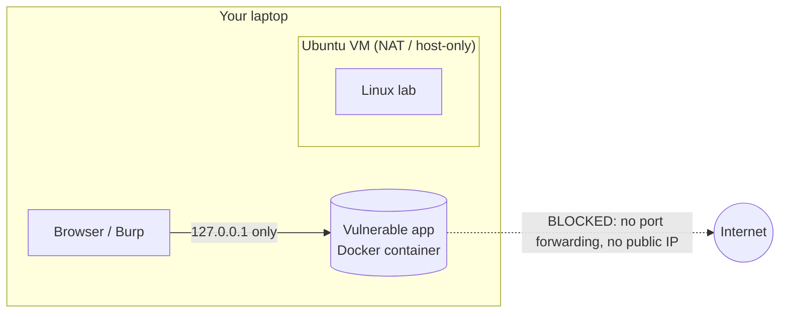

# Safety, Ethics and Lab Management

> **Read this before you run any lab.** Security skills are dual-use. The difference between a
> security engineer and a criminal is **authorization**.

## The rules

1. **Only test systems you own or have explicit, written authorization to test.**
   "It's public on the internet" is *not* authorization. Neither is "I was just curious".
2. **Keep intentionally vulnerable apps isolated.** Bind them to `127.0.0.1`, run them in a VM with
   host-only networking, and never expose them on a public IP or cloud instance.
3. **Use synthetic data.** Never use real customer data, real credentials or real tokens in a lab.
4. **Never commit secrets.** Use `.env` files listed in `.gitignore`, and enable secret scanning.
5. **Cloud labs:** set budget alerts *before* creating resources, use least-privilege identities,
   and **destroy resources after every lab**.
6. **Bug bounty / external targets:** only within a program's published scope and rules.
7. **Back up your lab work** and keep a log of what you changed and when.

## Why this matters (legal reality)

Most countries have computer misuse laws (e.g. the US Computer Fraud and Abuse Act, the UK Computer
Misuse Act, Nigeria's Cybercrimes Act 2015, and equivalents elsewhere). Unauthorized access —
even "just looking" — can be a crime. Professional testers work under a signed **scope /
rules-of-engagement** document. You will write one in Month 11.

## Safe lab network patterns



Docker binding examples:

```bash
# ✅ Safe: only reachable from your own machine
docker run --rm -p 127.0.0.1:3000:3000 bkimminich/juice-shop

# ❌ Unsafe: listens on every interface (and Docker can bypass ufw rules!)
docker run --rm -p 3000:3000 bkimminich/juice-shop
```

## Cloud budget protection checklist

- [ ] Root account has MFA and is **not** used day to day
- [ ] A budget with email alert at e.g. $5 and $20
- [ ] Every lab resource has a tag like `project=cyber-lab`
- [ ] After each lab: `terraform destroy` or manual teardown, then check the billing console
- [ ] No long-lived access keys on your laptop if SSO/temporary credentials are possible

## My agreement

Copy this into your journal and sign it with the date:

> I will only test systems I own or am explicitly authorized to test. I will isolate vulnerable
> labs, use synthetic data, protect secrets, and tear down cloud resources after each lab.
